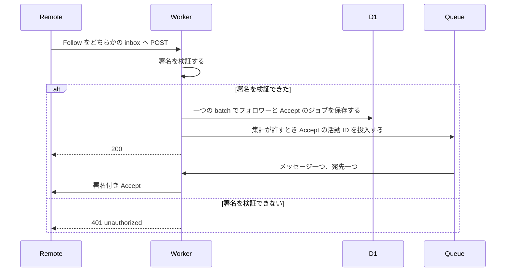
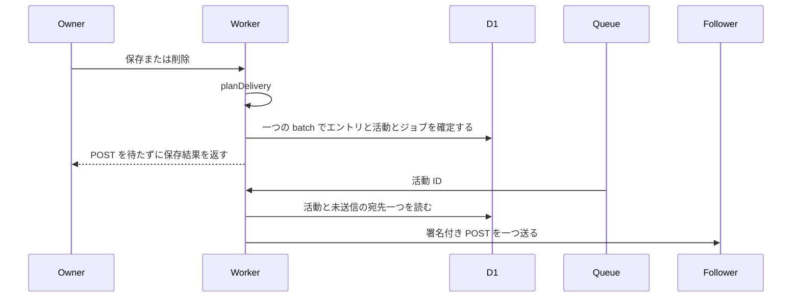
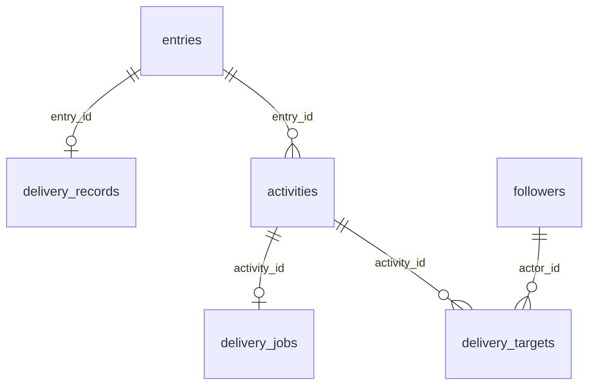

# ActivityPub の設計

[English](design.md)

## このドキュメントについて

この設計は、[ActivityPub](requirements.ja.md) を一つの Worker で実装する方法を決める。親プロダクトは [weblog.yamanoku.net](../../product.ja.md) である。リモートのインスタンスはアクターを解決し、署名付きでフォローし、そのあと Create、Update、Delete を受け取る。所有者は、フォローを一件ずつ承認しない。

配送対象の定義は [所有者の書き込み](../owner-writing/requirements.ja.md) にある。人間向けの HTML とフィードは [公開閲覧](../public-reading/requirements.ja.md) に残す。この文書が決めるのは、活動 URL、配送ジョブを載せる batch、キューのメッセージ、署名するヘッダである。

### 対象読者

この機能を実装する人と、変更するエージェントである。

### 前提知識

受入条件は [ActivityPub](requirements.ja.md) にある。配送対象、`publishedAt`、410 の Tombstone は [所有者の書き込み](../owner-writing/requirements.ja.md) にある。

[D1 Database](https://developers.cloudflare.com/d1/worker-api/d1-database/) は、`batch()` 内の文が失敗すると列を中断するか、巻き戻すと書く。同じページは、文が順に実行されるとも書く。この設計では、失敗した batch の変更は残さない。Free プランの一呼び出しは、クエリ 50 回までである。`batch()` 一つは、クエリ 1 回として数える。一文は 100 KB までであり、束縛パラメータは 100 個までである。一行は 2 MB までである。出典は [Limits](https://developers.cloudflare.com/d1/platform/limits/) である。

キューの枠は、要件にあるとおり一日 1 万操作である。64 KB の書き込み、読み出し、削除が、それぞれ操作 1 回である。保持は 24 時間である。出典は 2026-10-30 更新の [Queues pricing](https://developers.cloudflare.com/queues/platform/pricing/) と [Queues limits](https://developers.cloudflare.com/queues/platform/limits/) である。

Workers Free の Cron Trigger は、アカウントあたり 5 件までである。CPU 時間は一呼び出し 10 ms までである。ネットワーク待ちは CPU 時間に入らない。出典は [Workers limits](https://developers.cloudflare.com/workers/platform/limits/) である。

署名の組み合わせは、Social Web Incubator Community Group の報告に従う。対象は ActivityPub と HTTP 署名であり、時点は 2024-06-07 である。出典は [その報告](https://swicg.github.io/activitypub-http-signature/) である。

### このドキュメントで扱わないこと

- 所有者の検証、編集画面、CLI トークン
- 人間向けの HTML、Atom、JSON Feed、タイトル索引、空のページ、Gyazo のバイト列
- Cosense の一覧、取り込みのカーソル、ローカル編集と新しいソースの合流
- ブロックリスト、返信、ブースト、いいね、クライアント投稿 API
- UI フレームワークと ORM
- 署名の CPU を測ったあとに有料プランを選ぶこと。その問いは親プロダクトに残す

## 実装方針

成果物は、エントリを既に書いている Worker 上の連合である。二つ目の Worker は置かない。Durable Object も置かない。Workers Free でも、SQLite 付きの Durable Object は作れる。起動している間の経過時間には、1 日 13,000 GB-s の枠がある。出典は 2026-10-02 更新の [Workers の料金](https://developers.cloudflare.com/workers/platform/pricing/) である。このアプリは一人分の関係データである。オブジェクトを起こし続ける理由は無い。ドメインは活動を計画し、inbox の受信を受け入れるかを決める。署名、保存、投入はアダプタが行う。ドメインは D1、Queue、KV、Fedify の型を import しない。Cloudflare SDK と特定の ORM も import しない。

所有者の保存と削除は、batch の前に活動を計画する。計画は `none`、`create`、`update`、`delete` のどれかである。エントリと辺を確定する `batch()` が、活動も確定する。送信が必要なときは、同じ batch が配送ジョブも確定する。エントリと辺を書く関数は、これまでどおり `commitEntryBatch` だけである。取り込みの変更一覧は、この計画を呼ばない。配送ジョブを挿入しない。キューへも入れない。

保存の応答は、その batch のあとで返す。フォロワーへの POST を待たない。署名と POST は、あとからキューの一呼び出しにつき宛先一つで行う。

### どの変更が活動を計画するか

`planDelivery` は、保存済みのエントリと次のエントリを比べる。前のエントリが無いときは、配送対象ではない。配送対象とは、種類が `article`、`note`、`bookmark` のいずれかであり、公開状態が `public` であることである。

- エントリが配送対象になる。計画は `create` である。フォロワーがゼロでも、batch は `delivery_records` を挿入する。
- 配送対象のままで、プレーンテキストの本文が変わる。計画は `update` である。
- 配送対象のままで、変わるのがタイトルだけである。計画は `none` である。
- 配送対象のままで、変わるのが bookmark の URL だけである。計画は `none` である。
- 配送済みのエントリが draft または page になる。所有者が削除したときも、ここである。計画は `delete` である。batch は `delivery_records` を残す。
- その Delete のあとで、再び配送対象になる。計画は、同じオブジェクト ID への新しい `create` である。
- 配送の活動が一度も無く、この保存でも配送対象にしない。計画は `none` である。公開の page は、取り込んだ page を含め、所有者が種類を変えるまでここにある。

本文も変わる create は、Create 一つである。Create と Update の両方にはしない。活動 ID は、batch の前に `crypto.randomUUID()` で作る小文字の UUID である。オブジェクト ID は `https://weblog.yamanoku.net/e/{id}` のままである。

### 誰へ POST するか

batch は、その時点のフォロワーを、その活動の `delivery_targets` へコピーする。batch よりあとで増えたフォロワーはコピーしない。新しいフォロワーへ、過去の活動は POST しない。送信の時点で、もうフォロワーでない宛先は飛ばす。その宛先へは POST しない。

宛先がゼロのときも、活動の行は入れる。ジョブの行は入れない。POST が無くても、outbox はその活動を列挙できる。フォロワーが空でも、Create の batch が確定したときに、そのエントリは配送済みになる。

Accept だけは例外である。宛先は、今保存したフォロワー一人である。エントリの活動ではない。outbox には出さない。

残った宛先につき、署名付き POST を一つ送る。宛先は、その行にコピーした inbox URL である。このホストは、複数のフォロワーを共有 inbox の POST 一つにまとめない。

### 確定のあと

batch が未送信のジョブを確定し、キューの集計が書き込み、読み出し、削除の 3 操作を賄えるとき、Worker は活動 ID を投入する。メッセージの本文は、その URL だけである。この大きさは、書き込み、読み出し、削除のそれぞれで操作 1 回である。集計が 3 操作を賄えないとき、ジョブは未送信のまま残す。キューが書き込みを拒んだときも、同じである。保存の応答は成功のままである。応答は、有料プランの購入を案内しない。

消費者は D1 から活動を読み、一度署名し、未送信の宛先一つへ POST する。2xx の応答は、その宛先を送信済みにする。それ以外の結果は、未送信のまま残す。消費者はそのメッセージを確認し、基盤が同じメッセージを繰り返さないようにする。未送信の宛先が残り、集計が次のメッセージを賄えるときは、消費者は同じ活動 ID を再び投入する。賄えないときは、毎時の cron が同じ投入を行う。宛先を送信済みにするのは、2xx を保存したあとだけである。その保存の前に落ちたときは、同じ活動 ID を再び送る。

すべての宛先が送信済みか、飛ばしたあとに、ジョブとその宛先を消す。活動の行は残す。POST が失敗しても、フォロワーの行は残す。エントリの保存は繰り返さない。

## アーキテクチャ・シーケンス図

公開の経路は Access の外に置く。所有者の書き込みは、所有者の書き込みが既に定める経路のままである。下の図は、連合の手順だけを示す。

図を置く理由は、保存、そのあとの POST、inbox の Accept を、一つの要求へまとめやすいからである。三つは別の時点である。

## データモデル・ER 図

活動 ID は `https://weblog.yamanoku.net/users/yamanoku/s/{uuid}` である。UUID は小文字である。経路は `users` の下に置く。所有者の書き込みが、このキーを既に予約している。この機能は、閲覧用パスの予約キーを増やさない。再試行でも、この URL は変えない。オブジェクト ID とは別である。

`followers` から活動やジョブへ、外部キーの削除連鎖は付けない。`entries` からも付けない。フォロワーを消しても、活動は消えない。エントリを消しても、`delivery_records` と活動は消えない。

- `activities` は `id`、`type`、`entry_id`、`object_id`、`published_at` を持つ。`id` は活動 URL であり、主キーである。`type` は `Create`、`Update`、`Delete`、`Accept` のどれかである。Accept の `entry_id` は null である。`published_at` は、ジョブを確定した時点の UTC の ISO 8601 である。outbox の索引は、`published_at` の降順、次に `id` の降順である。
- `delivery_jobs` の主キーは `activity_id` である。行があることは、送信が終わっていないことを示す。成功したら行を消す。
- `delivery_targets` は `activity_id`、`actor_id`、`inbox_url`、`sent_at` を持つ。主キーは `activity_id` と `actor_id` である。取得が成功するまで、`inbox_url` は null でよい。送信するか飛ばすまで、`sent_at` は null である。ジョブの成功で、これらの行を消す。
- `followers` の主キーは `actor_id` である。ほかに `inbox_url`、`follow_activity_id`、`created_at` を持つ。`inbox_url` と `follow_activity_id` は null でよい。送信元一人が一行である。Undo はその行を消す。活動は消さない。
- `delivery_records` は、所有者の書き込みが 410 のために読む表のままである。Create のジョブを確定するとき、この機能が `entry_id` を挿入する。種類や公開状態が変わっても、行は消さない。エントリを削除しても、行は消さない。
- `queue_op_tally` の主キーは `utc_date` である。値は UTC の `YYYY-MM-DD` である。整数の `operations` を持つ。
- `kv_write_tally` の主キーは `utc_date` である。整数の `writes` を持つ。

秘密鍵は表に置かない。列にも置かない。公開 HTML は、これらの表を読まない。スキーマの変更は追加だけである。D1 のデータベースは二つ目を作らない。

活動の文書は、送信するときと読むときに組み立てる。HTML は二重に保存しない。未送信の Create は、あとの保存で埋め込みオブジェクトが変わり得る。活動 ID は変わらない。エントリ行が無くなったあとの Create と Update は、オブジェクト ID だけを埋める。Delete のオブジェクトは、常にオブジェクト ID である。

## API・インターフェース

これらの経路は Access の外にある。`GET /{title}` より前に登録する。

### WebFinger とアクター

`GET /.well-known/webfinger` は `resource` を読む。解決するのは `acct:yamanoku@weblog.yamanoku.net` だけである。コンテンツ型は `application/jrd+json; charset=utf-8` である。`Cache-Control` は `no-cache` である。subject はそのアカウントである。リンクは一つである。`rel` は `self`、`type` は `application/activity+json`、`href` は `https://weblog.yamanoku.net/users/yamanoku` である。それ以外の resource は 404 である。本文は `text/plain; charset=utf-8` で、`not_found` と書く。フォロワーは増やさない。

`GET /users/yamanoku` は Person を返す。コンテンツ型は `application/activity+json; charset=utf-8` である。`Cache-Control` は `no-cache` である。文書の `@context` は、次の二つである。

- `https://www.w3.org/ns/activitystreams`
- `https://w3id.org/security/v1`

項目は、次のとおりである。

- `id` は `https://weblog.yamanoku.net/users/yamanoku` である。
- `type` は `Person` である。
- `preferredUsername` は `yamanoku` である。
- `inbox` は `https://weblog.yamanoku.net/users/yamanoku/inbox` である。
- `outbox` は `https://weblog.yamanoku.net/users/yamanoku/outbox` である。
- `followers` は `https://weblog.yamanoku.net/users/yamanoku/followers` である。
- `endpoints.sharedInbox` は `https://weblog.yamanoku.net/inbox` である。
- `publicKey.id` は `https://weblog.yamanoku.net/users/yamanoku#main-key` である。
- `publicKey.owner` はアクター ID である。
- `publicKey.publicKeyPem` は、その RSA 鍵一つの公開側である。

秘密鍵は載せない。秘密が無いとき、または使える RSA 鍵ではないとき、応答は 503 `actor_key_missing` である。2048 ビット未満も、同じ応答である。本文は `text/plain; charset=utf-8` である。`Cache-Control` は `no-store` である。鍵の無いアクターは公開しない。有料プランの購入も案内しない。

### Inbox

`POST /users/yamanoku/inbox` と `POST /inbox` は、一つの関数を呼ぶ。どちらの経路でも、GET は 405 である。何も保存しない。

アダプタは、ドメインが保存する前に署名を調べる。失敗は 401 `unauthorized` である。本文は `text/plain; charset=utf-8` である。`Cache-Control` は `no-store` である。失敗に含めるものは、次のとおりである。

- 署名が無い
- 署名が不正である
- リモートの鍵を使えない
- ダイジェストが本文と一致しない
- `Date` が Worker の時計から 60 分を外れている
- アルゴリズムが `rsa-sha256` でも `hs2019` でもない
- 鍵の所有者が活動のアクターではない

`hs2019` は、報告のとおり `rsa-sha256` として検証する。応答は 5xx にしない。

検証できた、このアクターへの Follow は、Accept のジョブと同じ batch でフォロワーを一人保存する。フォロワーの行は、Accept の配送より前に確定する。同じ送信元は、その一行を更新する。Accept を再び積むことができる。応答は 200 で、本文は空である。検証できた Undo が、現在のフォロワーからの Follow を指すときは、そのフォロワーを消し、200 を返す。誰にも合わない Undo は、200 を返し、状態を変えない。それ以外の検証済み活動は、200 を返して保存しない。JSON でない本文も、ここである。

Accept の活動 ID は、batch の前に選ぶ。オブジェクトは Follow である。その Follow は、保存したリモートの活動 ID があるときにそれを使う。リモートのアクターと、Follow の対象であるこのアクターも使う。ID の無い Follow でも、フォロワーは保存する。そのときの Accept オブジェクトは、Follow の ID を省く。

リモートのアクター文書を取得できないときも、フォロワーは保存する。`inbox_url` は null のままである。Accept のジョブは残す。消費者は取得をやり直す。取得の失敗で、フォロワーは消さない。

フォロワーを保存できない batch は、503 `store_unavailable` を返す。この符号が、401 との違いである。本文は、有料プランの購入を案内しない。その batch の変更は残さない。

### Outbox とフォロワー

両方のコレクションは、ログイン無しで読める。コンテンツ型は `application/activity+json; charset=utf-8` である。`Cache-Control` は `no-cache` である。保存の失敗は 503 `store_unavailable` である。空のコレクションにはしない。

outbox が列挙するのは `Create`、`Update`、`Delete` だけである。`published_at` が新しいものを先にする。同時刻は、活動 ID の降順である。頁の大きさは 10 である。`page` の無いコレクション URL は `OrderedCollection` である。`totalItems` と `first` を持つ。活動を全部は中に置かない。頁は、同じ経路の `OrderedCollectionPage` である。最初の頁は `page=true` である。次の頁は、それに加えて `before` と `before_id` を送る。

頁は 11 行を読み、先頭の 10 行を返す。11 行目があるとき、`next` の `before` は 10 行目の `published_at` である。`before_id` は、その行の UUID である。最後の頁は `next` を省く。述語は `published_at < ? OR (published_at = ? AND id < ?)` である。outbox を読んでも、POST はしない。

次の頁では、`before` と `before_id` を揃って渡す。`before_id` は小文字の UUID である。`before` は空でない文字列で、40 文字までであり、空白を含まない。それ以外は 400 `invalid_cursor` である。本文は `text/plain; charset=utf-8` である。`Cache-Control` は `no-store` である。

フォロワーのコレクションは、現在のフォロワーを `actor_id` の昇順で列挙する。頁の大きさは 10 である。`page=true` の形は outbox と同じである。次の頁は `after` を送る。値は、前の頁の最後の `actor_id` である。述語は `actor_id > ?` である。`after` は空でない文字列で、500 文字までであり、空白を含まない。それ以外は 400 `invalid_cursor` である。各項目はオブジェクトである。`type` は `Person`、`id` はリモートのアクター ID、`inbox` は保存した inbox URL である。inbox が null の項目は、`inbox` を省く。Undo で行が消えるので、あとの頁にそのアクターは出ない。

### 活動 URL

`GET /users/yamanoku/s/{uuid}` は、その活動文書を返す。コンテンツ型は `application/activity+json; charset=utf-8` である。`Cache-Control` は `no-cache` である。未知の ID は 404 `not_found` である。Accept は見ない。この経路に HTML は無い。

文書の `actor` はアクター ID である。`to` は `https://www.w3.org/ns/activitystreams#Public` を含む。`cc` はフォロワーのコレクションを含む。Create、Update、Delete は、この宛先を使う。Accept の `to` は、フォロワーのアクター ID である。Public は付けない。

エントリ行があるあいだ、Create と Update はオブジェクトを埋める。Delete の `object` は正規 URL である。オブジェクトの `published` は、エントリの `publishedAt` である。オブジェクトの `updated` を付けるのは Update のときだけである。値はエントリの `updated_at` である。Create は `updated` を省く。

### 生存オブジェクト

`GET /e/{id}` の tombstone は、所有者の書き込みの振る舞いを保つ。確認は、次の順である。

1. 公開行が無く、`tombstones` にその id があるときは 410 である。Tombstone と 410 の HTML は、所有者の書き込みが定めるままである。この機能は、どちらの本文も差し替えない。
2. 公開行が無く、tombstone も無いときは 404 である。draft はこの分岐である。本文は返さない。
3. 行が公開である。Accept が `application/activity+json` または `application/ld+json` を含む。かつ `text/html` を含まない。`*/*` も含まない。このときは 200 で、下のオブジェクトを返す。
4. それ以外の Accept は、公開閲覧の HTML である。

手順 3 の Accept 判定は、tombstone の分岐と同じである。オブジェクトのコンテンツ型は `application/activity+json; charset=utf-8` である。`Cache-Control` は `no-cache` である。`id` は正規 URL である。`attributedTo` はアクター ID である。`published` は `publishedAt` である。`to` と `cc` は、上の活動と同じ宛先である。

型は、article なら `Article`、note と bookmark なら `Note`、page なら `Page` である。page は配送しない。GET のオブジェクトは `Page` にする。page を Article や Note としては出さない。`name` は、保存されたタイトルが空でないときにそのタイトルである。空のときは省く。`summary` を付けるのは Article だけである。値は、保存されたプレーンテキスト本文の、Unicode スカラ値で先頭 100 個である。本文がそれより短いときは、全文である。省略記号は付けない。数える単位は、UTF-16 の符号単位ではない。Note と Page は `summary` を省く。

`content` は HTML の断片である。描画は、保存された文字をエスケープしてからアンカーを入れる。保存された本文は書き換えない。ページリンクの範囲は、所有者の書き込みにある抽出関数から取る。`code:` または `table:` のブロックの行は、エスケープした文字のままである。ただし、その中のページリンクはアンカーにする。外部 URL は、それらのブロックの外にある `http://` または `https://` の並びである。終わりは空白、`[`、`]` のいずれかである。ほかのスキームは、エスケープした文字のままである。生成する href は `http` と `https` だけである。

公開の解決は、公開行だけを使う。

- その現在のタイトルを持つ公開エントリが、ちょうど一つある。そのエントリが対象である。
- それ以外で、その文字列の最新の `recorded_at` を持つ公開の過去タイトルが、ちょうど一つある。比較は文字列である。同じ時刻が二つあるときは、単一の対象は無い。
- それ以外は、単一の対象は無い。

href は、その公開対象に閲覧用パスがあるときは、その絶対パスである。閲覧用パスが無いときは、正規 URL である。単一の公開対象が無いときは、タイトルのパスである。Gyazo の URL と `scrapbox.io/files` の URL は、書かれた URL へのアンカーのままである。この断片は `img` を出さない。`video` も出さない。

bookmark は、保存された外部 URL が `http` または `https` のとき、本文のあとにアンカーを一つ足す。アンカーの文字は、その URL である。それ以外の空でない値は、エスケープした文字である。保存された本文は変えない。

### キューと cron

キューのバインディングは `DELIVERY_QUEUE` である。この Worker の cron は `0 * * * *` である。初版で登録するトリガは、これ一つである。アカウントの上限は 5 件である。cron は未送信のジョブを、古い `published_at` から 20 件まで読む。集計が 3 操作を賄えるとき、それぞれの活動 ID を投入する。署名しない。POST もしない。基盤が CPU で止めた cron は、ジョブを未送信のまま残す。次の時にやり直す。

`queue_op_tally.operations` は、その UTC 日の最初は 0 である。投入側は、キューが書き込みを受けたあとに 1 を足す。消費者は、メッセージを受け取ったときに 1 を足す。確認したときにも 1 を足す。投入の前に、`operations + 3` は 10000 以下でなければならない。二つの呼び出しが競合すると、数操作だけ超えることがある。確認と挿入は、アイソレートをまたぐロックではない。この設計はロックを足さない。有料プランも契約しない。記録した操作が 10000 のとき、消費者は POST せずに確認する。ジョブは未送信のまま残す。

## 外部サービスとの連携方式

保存先は D1 で、バインディングは `DB` である。フォロワー保存は、フォロワーの行を読み書きするポートである。最初のアダプタは、この D1 バインディングである。ドメインは `D1Database` を知らない。セッションと読み取りレプリカは使わない。

Queues が運ぶのは活動 ID である。消費者は、この Worker の中で動く。ドメインが見るのは、活動 URL を投入するか拒むかのポートである。Queue の型は見ない。

KV のバインディング `KEY_CACHE` は、リモートの公開鍵を短時間だけ置く。キャッシュのキーは `keyId` である。値は PEM である。期限は 12 時間である。KV は、フォロワーやジョブの正本ではない。`kv_write_tally` は、その UTC 日の put を数える。put が 1000 に達した日は、それ以上キャッシュへ書かない。検証は、リモートの鍵を取得して続ける。1000 書き込みの出典は、2026-10-30 更新の [KV limits](https://developers.cloudflare.com/kv/platform/limits/) である。キャッシュした PEM で検証に失敗したときは、リモートの鍵をもう一度取得する。それでも使えない鍵は 401 である。

鍵の解決は、`keyId` からフラグメントを除いた HTTPS URL を取得する。Accept は `application/activity+json` である。PEM は、`id` が `keyId` と一致する `publicKey` である。取得の失敗、RSA 以外の鍵、検証できない PEM は、401 である。

連合アダプタは、署名と inbox 本文の解析に Fedify を使ってよい。選ぶ理由は、フォロワー、活動、ジョブの正本を D1 に残せるからである。KV に置くのは、リモート鍵の短時間の写しだけである。Fedify を外すときは、そのアダプタを差し替える。ドメインは、その型を import しない。それらの記録をライブラリが所有しないと動けないビルドでは、アダプタは自前の署名にする。自前の署名は、基盤の RSA 実装と、同じヘッダを使う。Fedify の Workers 公式例の範囲は、Follow の Accept と Undo(Follow) までである。この例の範囲に、ブログ全体の実装は入らない。この節のアダプタの条件は、そのまま残る。

外向きの POST は、`rsa-sha256` で次を署名する。

- `(request-target)`
- `host`
- `date`
- `digest`
- `content-type`

`keyId` は `https://weblog.yamanoku.net/users/yamanoku#main-key` である。ダイジェストは、報告が定める接頭辞のあとに、本文ハッシュの Base64 を続ける。本文ハッシュは SHA256 である。

リモート inbox への POST は、消費者の一呼び出しにつきサブリクエスト一つである。Free プランのサブリクエストは 50 までである。同時の外向き接続は 6 までである。宛先一つは、この枠に収まる。2xx 以外の応答は、4xx と 5xx を含め、宛先を未送信のまま残す。あとで同じ活動 ID を再試行する。アプリは有料プランへ移さない。

## データの取り扱い設計

フォロワーのアクター ID と inbox URL は、配送の宛先として保存する。ログイン無しのフォロワー一覧に出る。配送したタイトルと本文は、outbox と生存オブジェクトから誰でも読める。秘密鍵は、フォロワーの個人データではない。

秘密鍵を読むのは鍵のポートだけであり、読む場所は署名するアダプタの中だけである。公開の SQL では選ばない。ログへ書かない。どの応答にも返さない。受信した Follow の本文は、全部は残さない。行が残すのは、リモートのアクター ID、inbox、Follow の活動 ID である。

送信が成功したジョブと宛先は消す。活動と `delivery_records` は残す。outbox と、あとの 410 が ID を必要とするためである。Undo はフォロワーの行を消す。所有者によるエントリの削除は、活動を消さない。

キューと KV の集計は、UTC 日の回数だけを持つ。本文は持たない。鍵材も持たない。次の UTC 日は 0 から始まる。読むのは、その日の行だけだからである。

## 認証認可に関する特記事項

資格は三つで、互いに流用しない。ブラウザのログインと CLI トークンは、inbox の送信元を認めない。HTTP 署名は、所有者の書き込みを認めない。WebFinger、アクター、outbox、フォロワー一覧、どちらの inbox、活動 URL も、ログインを要求しない。

ブロックリストは無い。検証できる Follow を提示した送信元は、フォロワーになる。

## セキュリティ上の留意事項

inbox がフォロワーを保存するのは、署名を検証でき、鍵の所有者が活動のアクターであるときだけである。秘密鍵は Worker の秘密 `ACTOR_PRIVATE_KEY` に置く。値は PKCS#8 の PEM であり、初回の公開デプロイより前に一度作る。Worker は、アイソレートごとに新しい鍵を作らない。秘密はリポジトリに置かない。

`content` は、アンカーを入れる前に保存された文字をエスケープする。プレーンテキストの本文は、自分のタグを足せない。href の値は `http` と `https` だけである。

約束する配送は一回以上である。受信者が繰り返しの活動 ID を無視しないとき、同じ活動は複数回見える。その結果は受け入れる。

基盤が CPU で止めた署名作業は、401 にしない。有料プランを契約する理由にもしない。宛先は未送信のままである。その作業を減らすか、有料プランを採るかは、親プロダクトの未決のままである。

Workers Logs は、2026-12-01 から Observability の料金へ移る。移るという記載の出典は、2026-10-02 更新の [Workers の料金](https://developers.cloudflare.com/workers/platform/pricing/) である。移行後の単価は、まだ確認していない。金額は、確認できるまで書かない。この設計は、古いログを読むことに依存しない。Logpush は使わない。

## デプロイに関する特記事項

移行で足す表は、`activities`、`delivery_jobs`、`delivery_targets`、`followers`、`queue_op_tally`、`kv_write_tally` である。`delivery_records` は既存の表である。フォロワーが空でも、その状態は妥当である。`ACTOR_PRIVATE_KEY` が 2048 ビット以上の RSA 鍵一つを持つまで、アクター URL は 503 `actor_key_missing` である。Ed25519 は、その鍵にしない。

cron は、上のトリガ一つである。これ以上のトリガは、アカウントの上限 5 件に数える。ホスト名は `weblog.yamanoku.net` のままである。変えると、アクター ID とすべての活動 URL が変わる。

取り込みは、フォロワーが一人もいないときにも実行できる。その確定は、これまでどおり活動を挿入しない。

## 検討した代替手段

### フォロワーを共有 inbox にまとめる

共有 inbox につき POST 一つにすると、同じインスタンスのフォロワーが多い日はキューの操作が減る。宛先の展開は、そのインスタンスの問題になる。初版は、保存した inbox を一つずつ宛先にする。その一覧は、フォロワーのコレクションで所有者が読める。まとめは、活動 ID を変えずに後から足せる。

### 保存の要求の中でファンアウトする

保存は、返す前にフォロワーの人数だけ署名することになる。要件では、保存の応答はその POST を待たない。再試行できないキューは採らない。batch が行うのは、ジョブの保存だけである。

### 活動の本文をキューのメッセージに入れる

消費者は、文書を組み立てるために D1 を読まなくて済む。メッセージは 128 KB までであり、本文はそれより大きくなり得る。メッセージが運ぶのは活動 ID である。文書は D1 から組み立てる。

### 失敗したメッセージを基盤に再試行させる

失敗し続ける宛先は、24 時間の保持が終わるまで読み直される。読み出しのたびに操作を使う。消費者はメッセージを確認し、D1 のジョブは残す。集計が許すとき、cron が同じ活動 ID を投入する。

### 消費者の一呼び出しで全フォロワーに署名する

一呼び出しで RSA 署名を何度も行うと、10 ms を超えやすい。署名一つの費用は、まだ測っていない。宛先一つを一呼び出しにすると、再試行の単位が操作 3 回と揃う。

### アイソレートの中で RSA 鍵を作る

新しいアイソレートが新しい公開鍵を出すと、古い鍵を固定したフォロワーが外れる。鍵は秘密一つであり、初回の公開デプロイより前に作る。

### 活動に HTML の写しを保存する

再送の POST は、最初の描画を保てる。その代わり、本文を `activities` へ複製し、行の上限に近づき得る。文書は現在のエントリから組み立てる。描画が変わっても、活動 ID は変わらない。

### 活動 ID を `/a/{uuid}` にする

その経路には、新しい閲覧用パスの予約キーが要る。`/users/yamanoku/s/` の下の ID は、所有者の書き込みが既に予約したキーを使う。

## 未決事項

この機能の実装を止める未決は無い。

署名の CPU が無料枠を定常的に超えるか、そのとき所有者は作業を減らすか有料プランを採るかは、親プロダクトの未決のままである。その測定までは、この機能は有料プランを契約しない。

Workers Logs の 2026-12-01 以降の単価は、まだ確認していない。所有者が公開された価格を確認するまで、この設計は金額を書かない。暫定は、上のセキュリティの節のとおりである。古いログには依存しない。Logpush は使わない。
