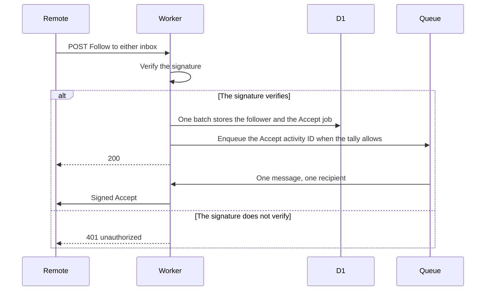
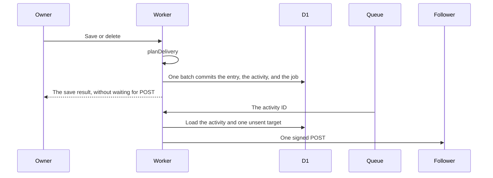
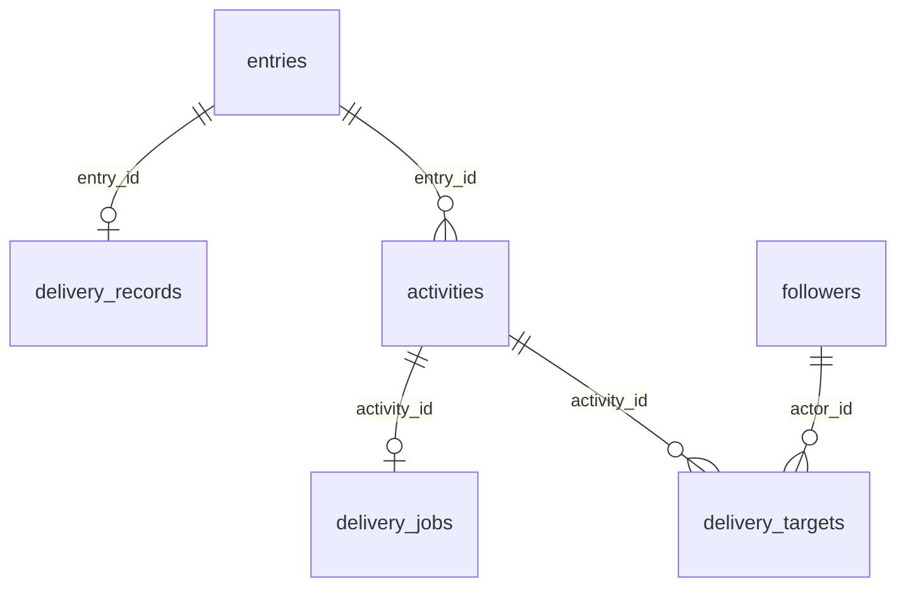

# ActivityPub design

[日本語](design.ja.md)

## About this document

This design decides how one Worker implements [ActivityPub](requirements.md) for [weblog.yamanoku.net](../../product.md). A remote instance resolves the actor, follows with a signed request, and later receives Create, Update, and Delete. The owner does not approve each follow.

Which entries are deliverable is defined by [Owner writing](../owner-writing/requirements.md). Human-readable HTML and feeds stay in [Public reading](../public-reading/requirements.md). This document chooses the activity URL, the batch that stores a delivery job, the queue message, and the signature headers.

### Audience

People and agents implementing or changing this feature.

### Prerequisites

The acceptance criteria in [ActivityPub](requirements.md). Deliverable entries, `publishedAt`, and the 410 Tombstone are in [Owner writing](../owner-writing/requirements.md).

[D1 Database](https://developers.cloudflare.com/d1/worker-api/d1-database/) says that if a statement in a `batch()` fails, the sequence is aborted or rolled back. The same page also says the statements run sequentially. This design treats a failed batch as leaving none of that batch's changes. On the Free plan, one invocation allows 50 queries. One `batch()` counts as one query. A statement is at most 100 KB and 100 bound parameters. A row is at most 2 MB. The source is [Limits](https://developers.cloudflare.com/d1/platform/limits/).

The queue allowance used below is the one in the requirements: 10,000 operations a day, one operation per 64 KB written, read, or deleted, and 24 hours of retention. The source is [Queues pricing](https://developers.cloudflare.com/queues/platform/pricing/) and [Queues limits](https://developers.cloudflare.com/queues/platform/limits/), both last updated 2026-10-30.

Workers Free allows 5 Cron Triggers per account and 10 ms of CPU time per invocation. Network wait is not CPU time. The source is [Workers limits](https://developers.cloudflare.com/workers/platform/limits/).

The signature joint follows the Social Web Incubator Community Group report on ActivityPub and HTTP Signatures, as of 2024-06-07. The source is [that report](https://swicg.github.io/activitypub-http-signature/).

### Outside this document

- Owner validation, the edit screen, and the CLI token
- Human-readable HTML, Atom, JSON Feed, the title index, empty pages, and Gyazo bytes
- Cosense listing, the import cursor, and merging a local edit with a newer source
- A block list, ActivityPub Reply activities, boosts, likes, and a client posting API. An owner reply on a note stays in owner writing and is not delivered
- The UI framework and the ORM

## Implementation approach

The deliverable is federation on the Worker that already writes entries. There is no second Worker and no Durable Object. Workers Free can still create a Durable Object that uses SQLite. The free allowance for duration while it is running is 13,000 GB-s a day. The source is [Workers pricing](https://developers.cloudflare.com/workers/platform/pricing/), updated 2026-10-02. This app is one person's relational data and has no reason to keep an object awake. The domain plans activities and decides whether an inbox post is accepted. Adapters sign, store, and enqueue. The domain does not import D1 types, Queue types, KV types, the Cloudflare SDK, an ORM, or Fedify types.

An owner save or delete plans the activity before the batch. The plan is `none`, `create`, `update`, or `delete`. The same `batch()` that commits the entry and its edges also commits the activity and, when a send is required, the delivery job. `commitEntryBatch` remains the only function that writes an entry and its edges. Import builds a change list that does not call this planner, does not insert a delivery job, and does not enqueue.

The save response returns after that batch. It does not wait for a follower POST. Signing and the follower POST run later, one recipient per queue invocation.

### Which change plans an activity

`planDelivery` compares the stored entry with the next one. A missing previous entry is not deliverable. Deliverable means kind `article`, `note`, or `bookmark`, visibility `public`, and the entry is not a reply to another note. Owner writing defines that reply.

- The entry becomes deliverable. The plan is `create`. The batch inserts `delivery_records` even when no follower exists.
- The entry stays deliverable and the plain-text body changes. The plan is `update`.
- The entry stays deliverable and only the title changes. The plan is `none`.
- The entry stays deliverable and only the bookmark URL changes. The plan is `none`.
- A delivered entry becomes draft or page, or the owner deletes it. The plan is `delete`. The batch leaves `delivery_records` in place.
- The entry becomes deliverable again after that Delete. The plan is a new `create` for the same object id.
- The entry has never had a delivery activity, and this save does not make it deliverable. The plan is `none`. A public page, including an imported page, stays in this case until the owner changes the kind.

A create that also changes the body is one Create, not a Create plus an Update. The activity ID is a new lowercase UUID from `crypto.randomUUID()`, chosen before the batch. The object id remains `https://weblog.yamanoku.net/e/{id}`.

### Who receives the POST

The batch copies the current followers into `delivery_targets` for that activity. A follower added after the batch is not copied, so a new follower is not posted the older activity. At send time, a target whose actor is no longer a follower is skipped and is not posted.

Zero targets means the activity row is still inserted and no job is inserted. The outbox can list that activity without a POST. An empty followers collection still records the entry as delivered when the Create batch commits.

Accept is the exception. It has one target, the follower just stored. It is not an entry activity and it is not listed in the outbox.

Each remaining target is one signed POST to the inbox URL copied onto that target. This host does not collapse several followers into one shared-inbox POST.

### After the commit

When the batch commits a pending job and the queue tally can cover one write, one read, and one delete, the Worker enqueues the activity ID. The message body is that URL and nothing else. A message of that size is one operation per write, read, or delete. If the tally cannot cover those three operations, or the queue refuses the write, the job stays pending and the save response is still success. The response does not tell the owner to buy a plan.

The consumer reads the activity from D1, signs once, and POSTs to one unsent target. A 2xx response marks that target sent. Any other outcome leaves it unsent. The consumer then acknowledges the message so the platform does not retry that same message in a loop. If unsent targets remain, and the tally can cover another message, the consumer enqueues the same activity ID again. The hourly cron does that enqueue when the consumer could not. A target is marked sent only after the 2xx is stored. A crash before that store sends the same activity ID again.

The job is deleted, with its targets, only after every target is sent or skipped. The activity row remains. Follower rows remain after a failed POST. The entry save is not repeated.

## Architecture and sequence diagrams

Public routes stay outside Access. Owner writes stay on the routes owner writing already defines. The diagrams below show only the federation steps.

A diagram is included because the save, the later POST, and the inbox Accept are easy to collapse into one request. They are three different times.

## Data model and ER diagrams

The activity ID is `https://weblog.yamanoku.net/users/yamanoku/s/{uuid}`. The UUID is lowercase. The path stays under `users`, which owner writing already reserves, so this feature adds no view-path key. Retries keep this URL. It is not the object ID.

No foreign key cascades from `followers` or `entries` into activities or jobs. Removing a follower does not delete an activity. Deleting an entry does not delete `delivery_records` or activities.

- `activities` holds `id`, `type`, `entry_id`, `object_id`, and `published_at`. `id` is the activity URL and the primary key. `type` is `Create`, `Update`, `Delete`, or `Accept`. `entry_id` is null for Accept. `published_at` is the UTC ISO 8601 commit time of the job. The index used by the outbox is `published_at` descending, then `id` descending.
- `delivery_jobs` holds `activity_id` as its primary key. A row means the send is not finished. Success deletes the row.
- `delivery_targets` holds `activity_id`, `actor_id`, `inbox_url`, and `sent_at`. The primary key is `activity_id` plus `actor_id`. `inbox_url` may be null until a fetch succeeds. `sent_at` is null until that target is sent or skipped. Success of the job deletes these rows.
- `followers` holds `actor_id` as its primary key, plus `inbox_url`, `follow_activity_id`, and `created_at`. `inbox_url` and `follow_activity_id` may be null. One sender is one row. Undo deletes that row and does not delete activities.
- `delivery_records` stays the table owner writing reads for 410. This feature inserts `entry_id` when a Create job is committed. It does not delete the row when kind or visibility changes, or when the entry is deleted.
- `queue_op_tally` holds `utc_date` as its primary key, a `YYYY-MM-DD` UTC date, and an integer `operations`.
- `kv_write_tally` holds `utc_date` as its primary key and an integer `writes`.

The private key is not a table and not a column. Public HTML does not read these tables. The schema is additive. There is no second D1 database.

The activity document is built when it is sent or read. The HTML is not stored a second time. A later save can change the embedded object of an unsent Create while the activity ID stays the same. After the entry row is gone, Create and Update embed only the object id. Delete always uses the object id as its object.

## APIs and interfaces

These routes are outside Access. They are registered before `GET /{title}`.

### WebFinger and the actor

`GET /.well-known/webfinger` reads `resource`. Only `acct:yamanoku@weblog.yamanoku.net` resolves. The content type is `application/jrd+json; charset=utf-8`. `Cache-Control` is `no-cache`. The subject is that account. One link has `rel` `self`, `type` `application/activity+json`, and `href` `https://weblog.yamanoku.net/users/yamanoku`. Any other resource is 404. The body is `text/plain; charset=utf-8` and says `not_found`. No follower is added.

`GET /users/yamanoku` returns the Person. The content type is `application/activity+json; charset=utf-8`. `Cache-Control` is `no-cache`. The document uses `@context` of `https://www.w3.org/ns/activitystreams` and `https://w3id.org/security/v1`.

- `id` is `https://weblog.yamanoku.net/users/yamanoku`.
- `type` is `Person`.
- `preferredUsername` is `yamanoku`.
- `inbox` is `https://weblog.yamanoku.net/users/yamanoku/inbox`.
- `outbox` is `https://weblog.yamanoku.net/users/yamanoku/outbox`.
- `followers` is `https://weblog.yamanoku.net/users/yamanoku/followers`.
- `endpoints.sharedInbox` is `https://weblog.yamanoku.net/inbox`.
- `publicKey.id` is `https://weblog.yamanoku.net/users/yamanoku#main-key`.
- `publicKey.owner` is the actor id.
- `publicKey.publicKeyPem` is the public half of the one RSA key.

The private key is absent. When the secret is missing or is not a usable RSA key of at least 2048 bits, the response is 503 `actor_key_missing`. The body is `text/plain; charset=utf-8`. `Cache-Control` is `no-store`. The response does not publish a keyless actor and does not ask the caller to buy a plan.

### Inbox

`POST /users/yamanoku/inbox` and `POST /inbox` call one function. GET on either path is 405 and stores nothing.

The adapter checks the signature before the domain stores anything. Failure is 401 `unauthorized`, `text/plain; charset=utf-8`, and `Cache-Control: no-store`. Failure includes a missing signature, a bad signature, an unusable remote key, a digest that does not match the body, a `Date` outside 60 minutes of the Worker clock, an algorithm other than `rsa-sha256` or `hs2019`, and a key owner that is not the activity actor. `hs2019` is verified as `rsa-sha256`, as the report describes. The response is not 5xx.

A verified Follow of this actor stores one follower in the same batch as the Accept job. The follower row is committed before Accept is delivered. The same sender updates that one row and can queue Accept again. The response is 200 with an empty body. A verified Undo that refers to a Follow from a current follower deletes that follower and returns 200. A verified Undo that matches nobody returns 200 and changes nothing. Any other verified activity, including a body that is not JSON, returns 200 and is not stored.

The Accept activity ID is chosen before the batch. Its object is a Follow. That Follow uses the stored remote activity id when one was present, the remote actor, and this actor as the Follow object. A Follow that arrived without an id still stores the follower. The Accept object then omits the Follow id.

If the remote actor document cannot be fetched, the follower is still stored, `inbox_url` stays null, and the Accept job remains. The consumer tries the fetch again. A failed fetch does not delete the follower.

A batch that cannot store the follower returns 503 `store_unavailable`. That code is how this failure differs from 401. The body does not ask the sender to buy a plan. None of that batch remains.

### Outbox and followers

Both collections are unauthenticated. The content type is `application/activity+json; charset=utf-8`. `Cache-Control` is `no-cache`. A store failure is 503 `store_unavailable`, not an empty collection.

The outbox lists `Create`, `Update`, and `Delete` only. Newer `published_at` comes first. The same time is ordered by activity id descending. Page size is 10. The collection URL without `page` is an `OrderedCollection` with `totalItems` and `first`. It does not inline every activity. A page is an `OrderedCollectionPage` on the same path. The first page is `page=true`. A later page also sends `before` and `before_id`.

The page reads 11 rows and returns the first 10. When an 11th row exists, `next` uses the 10th row's `published_at` as `before` and that row's UUID as `before_id`. The last page omits `next`. The predicate is `published_at < ? OR (published_at = ? AND id < ?)`. Reading the outbox does not POST.

`before` and `before_id` are required together on a later page. `before_id` is a lowercase UUID. `before` is a non-empty string of at most 40 characters and contains no whitespace. Any other combination is 400 `invalid_cursor`. The body is `text/plain; charset=utf-8` and `Cache-Control` is `no-store`.

The followers collection lists current followers, ordered by `actor_id` ascending. Page size is 10. The same `page=true` shape is used. A later page sends `after`, the last `actor_id` on the previous page. The predicate is `actor_id > ?`. `after` must be a non-empty string of at most 500 characters with no whitespace. Otherwise the response is 400 `invalid_cursor`. Each item is an object with `type` `Person`, `id` set to the remote actor id, and `inbox` set to the stored inbox URL. A null inbox is omitted. Undo removes the row, so a later page does not include that actor.

### Activity URL

`GET /users/yamanoku/s/{uuid}` returns that activity document. The content type is `application/activity+json; charset=utf-8`. `Cache-Control` is `no-cache`. An unknown id is 404 `not_found`. Accept is not consulted. This path has no HTML representation.

The document's `actor` is the actor id. `to` contains `https://www.w3.org/ns/activitystreams#Public`. `cc` contains the followers collection. Create, Update, and Delete use those audiences. Accept uses `to` set to the follower's actor id and omits Public.

Create and Update embed the object while the entry row exists. Delete sets `object` to the canonical URL. The object's `published` is the entry `publishedAt`. The object's `updated` is present only on an Update, and it is the entry `updated_at`. Create omits `updated`.

### Live object

`GET /e/{id}` keeps the tombstone behavior from owner writing. The checks run in this order.

1. No public row, and `tombstones` has the id: 410. When Accept contains `application/activity+json` or `application/ld+json`, and it contains neither `text/html` nor `*/*`, the response is an Activity Streams Tombstone. Any other Accept is 410 HTML. Owner writing specifies both bodies. This feature does not replace either body.
2. No public row and no tombstone: 404. A draft takes this branch. The body is not returned.
3. The row is public, and Accept contains `application/activity+json` or `application/ld+json`, and it contains neither `text/html` nor `*/*`: 200 with the object below.
4. Any other Accept: the HTML from public reading.

The same Accept test as the tombstone branch decides step 3. The object content type is `application/activity+json; charset=utf-8`. `Cache-Control` is `no-cache`. `id` is the canonical URL. `attributedTo` is the actor id. `published` is `publishedAt`. `to` and `cc` match the activity audiences above.

The type is `Article` for an article, `Note` for a note or a bookmark, and `Page` for a page. A page is not delivered. Its GET object still uses `Page`, so a page is not presented as an Article or a Note. `name` is the stored title when the title is non-empty, and is omitted when the title is empty. `summary` is set only on an Article. It is the first 100 Unicode scalar values of the stored plain-text body. A shorter body is the whole body. No ellipsis is added. A UTF-16 code unit is not the unit. A Note and a Page omit `summary`.

`content` is an HTML fragment. The renderer escapes the stored text, then inserts anchors. The stored body is not rewritten. Page-link spans come from the extract function in owner writing. Lines in a `code:` or `table:` block stay escaped text, except a page-link span inside them becomes an anchor. An external URL is an `http://` or `https://` run outside those blocks, ending at whitespace, `[`, or `]`. Any other scheme stays escaped text. Generated hrefs are only `http` or `https`.

Public resolution uses public rows only.

- Exactly one public entry has that current title. That entry is the target.
- Otherwise, exactly one public past title has the latest `recorded_at` for that string. Comparison is text. A tie has no single target.
- Otherwise there is no single target.

The href is the absolute view path when the one public target has one. It is the canonical URL when that target has no view path. It is the title path when there is no single public target. A Gyazo URL and a `scrapbox.io/files` URL stay anchors to the written URL. This fragment does not emit `img` or `video`.

A bookmark appends one anchor after the body when the stored external URL is `http` or `https`. The anchor text is that URL. Any other non-empty value is escaped text. The stored body is not changed.

### Queue and cron

The queue binding is `DELIVERY_QUEUE`. The cron on this Worker is `0 * * * *`. Version 1 registers that one trigger. The account limit is 5. The cron loads up to 20 pending jobs, oldest `published_at` first, and enqueues each activity ID when the tally can cover three operations. It does not sign and does not POST. A cron invocation that the platform stops for CPU leaves the jobs pending. The next hour tries again.

`queue_op_tally.operations` starts at 0 for the UTC date. The enqueue path adds 1 after the queue accepts the write. The consumer adds 1 when it receives a message and adds 1 when it acknowledges it. Before an enqueue, `operations + 3` must be at most 10,000. A race between two invocations can overshoot by a few operations because the check and the insert are not a cross-isolate lock. This design does not add a lock and does not contract a paid plan. At 10,000 recorded operations, the consumer acknowledges without a POST and leaves the job pending.

## External service integration

D1 is the store, binding `DB`. The follower store is the port that reads and writes follower rows. Its adapter queries through `db` from `void/db`. [D1](https://void.cloud/guide/database/d1) says those queries use a D1 session for each Void request, and that replicas can lag between requests. The domain does not know `D1Database` and does not import `void/db`.

Queues carry the activity ID. The consumer runs in this Worker. The domain sees a port that enqueues an activity URL or refuses. It does not see the Queue type.

KV binding `KEY_CACHE` caches a remote public key. The cache key is the `keyId`. The value is the PEM. The expiration is 12 hours. KV is not the record of followers or jobs. `kv_write_tally` counts puts for the UTC date. At 1,000 puts, that date writes no further cache entry. Verification still fetches the remote key. The source for the 1,000 writes is [KV limits](https://developers.cloudflare.com/kv/platform/limits/), last updated 2026-10-30. A cached PEM that fails verification is fetched once more from the remote key. A key that still cannot be used is 401.

The key is resolved by removing the fragment from `keyId` and requesting that HTTPS URL with Accept `application/activity+json`. The PEM is the `publicKey` whose `id` equals the `keyId`. A failed fetch, a key that is not RSA, or a PEM that does not verify is 401.

The federation adapter is the hand-rolled signer. It does not use Fedify. The owner chose this signer. Followers, activities, and jobs stay in D1. KV still holds only the short-lived remote key. The domain does not import Fedify types. The adapter does not import them either. The adapter signs and verifies with Workers Web Crypto, using RSASSA-PKCS1-v1.5. The source is [Web Crypto](https://developers.cloudflare.com/workers/runtime-apis/web-crypto/), updated 2026-09-30. That page's table marks sign, verify, and importKey for RSASSA-PKCS1-v1.5, and digest for SHA-256. A mark on that page means the feature is believed to be fully supported according to the specification. The same page says Web Crypto is significantly faster than the same work in JavaScript. The signed headers stay the ones in the next paragraph. The adapter reads the inbox body as JSON and does not pass it to a federation library. The domain still decides whether the post is accepted.

Outbound POST signs `(request-target)`, `host`, `date`, `digest`, and `content-type` with `rsa-sha256`. `keyId` is `https://weblog.yamanoku.net/users/yamanoku#main-key`. The digest is the SHA-256 prefix from the report, then the base64 of the body hash. The body hash is SHA-256.

Remote inbox POST is one subrequest per consumer invocation. The Free plan allows 50 subrequests and 6 concurrent outbound connections. One recipient stays inside that budget. A non-2xx response, including 4xx and 5xx, leaves the target unsent and retries the same activity ID later. The app does not move onto a paid plan.

## Data handling

Follower actor IDs and inbox URLs are stored so delivery can address them. They are shown on the followers collection without login. Delivered titles and bodies are world-readable through the outbox and the live object. The private key is not a follower's personal data.

The private key is read only by the key port, and only inside the adapter that signs. It is not selected by public SQL, not written to logs, and not returned by any response. The received Follow body is not retained whole. The row keeps the remote actor id, the inbox, and the Follow activity id.

A job and its targets are deleted after the send succeeds. Activities and `delivery_records` stay so the outbox and a later 410 still have their ids. Undo deletes the follower row. An owner delete of an entry does not delete activities.

Queue and KV tallies hold counts for a UTC date. They contain no body and no key material. The next UTC date starts at zero because the read is for that date only.

## Authentication and authorization notes

Three credentials stay separate. The browser login and the CLI token do not authorize an inbox sender. An HTTP signature does not authorize an owner write. WebFinger, the actor, the outbox, the followers collection, either inbox, and the activity URL do not require a login.

There is no block list. A sender that presents a verifying Follow becomes a follower.

## Security considerations

The inbox stores a follower only after the signature verifies and the key owner is the activity actor. The private key stays in the Worker secret `ACTOR_PRIVATE_KEY`. The value is a PKCS#8 PEM generated once, before the first public deploy. The Worker does not generate a new key per isolate. The secret is not in the repository.

`content` escapes stored text before it inserts anchors, so the plain-text body cannot add its own tags. Href values are only `http` and `https`.

Delivery is at least once. A receiver that does not ignore a repeated activity ID can show the same activity more than once. That result is accepted.

Signature work that the platform stops for CPU is not converted into 401. The target stays unsent. Resuming it follows the [product](../../product.md) principle: reduce that work until it fits the free tier. This feature does not contract a paid plan.

Workers Logs move to Observability pricing on 2026-12-01. The source for that move is the [Workers pricing](https://developers.cloudflare.com/workers/platform/pricing/) page, updated 2026-10-02. The unit price after that date has not been confirmed. This design does not state an amount. This design does not rely on reading old logs. Logpush is not used.

## Deployment notes

The migration adds `activities`, `delivery_jobs`, `delivery_targets`, `followers`, `queue_op_tally`, and `kv_write_tally`. `delivery_records` is the existing table. An empty followers table is valid. The actor URL is 503 `actor_key_missing` until `ACTOR_PRIVATE_KEY` holds one RSA key of at least 2048 bits. Ed25519 is not that key.

The cron is the one trigger above. Adding further triggers counts toward the account limit of 5. The hostname stays `weblog.yamanoku.net`. Changing it would change the actor id and every activity URL.

Import can run before any follower exists. Those commits still do not insert activities.

## Alternatives considered

### Collapse followers into the shared inbox

One POST per shared inbox would spend fewer queue operations when many followers use one instance. The recipient set is then the instance's problem. Version 1 addresses each stored inbox, which is the list the owner can read on the followers collection. Grouping can be added without changing the activity ID.

### Fan out inside the save request

The save would sign once per follower before it returned. The requirements say the save response does not wait for that POST, and a queue that cannot retry is rejected. The batch only stores the job.

### Put the activity body in the queue message

The consumer would not need D1 to build the document. A message is at most 128 KB, and the body can be larger. The message carries the activity ID. The document is built from D1.

### Let the platform retry a failed message

A failing recipient would be read again until the 24-hour retention ended, and each read is an operation. The consumer acknowledges and leaves the D1 job. The cron enqueues the same activity ID when the tally allows.

### Sign every follower in one consumer invocation

Several RSA signatures in one invocation are likely to pass 10 ms. That cost is still unmeasured for a single signature. One recipient per invocation keeps the retry unit equal to one operation triple.

### Generate the RSA key inside each isolate

A new isolate would publish a new public key and break followers that pinned the old one. The key is one secret, created before the first public deploy.

### Store an HTML snapshot on the activity

The retried POST would keep the first rendering. It would also copy every body into `activities` and could approach the row limit. The document is built from the current entry. The activity ID does not change when that rendering changes.

### Use `/a/{uuid}` as the activity ID

That path would need a new reserved view-path key. The ID under `/users/yamanoku/s/` uses the key owner writing already reserves.

### Use Fedify in the federation adapter

Fedify's Cloudflare Workers example accepts Follow and Undo(Follow) only. The source is the [example README](https://github.com/fedify-dev/fedify/blob/main/examples/cloudflare-workers/README.md). The same file says the example exports `fetch()` and `queue()`, and that the library processes the queue messages. That example is not this blog. This feature already keeps followers, activities, and jobs in D1, and the queue message is only an activity ID. The owner chose the hand-rolled signer, so the adapter does not import Fedify.

## Open questions

None that block implementation of this feature.

The unit price of Workers Logs after 2026-12-01 is not confirmed. Until the owner checks a published price, this design states no amount. The interim remains the security section: do not depend on old logs, and do not use Logpush.
