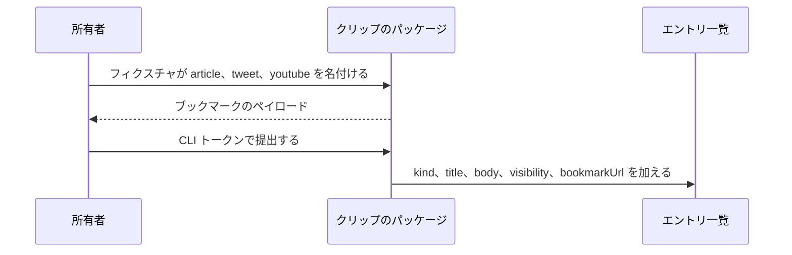

# クリップの設計

[English](design.md)

## このドキュメントについて

この設計は、[クリップ](requirements.ja.md) を別パッケージがどう実行するかを決める。親プロダクトは [weblog.yamanoku.net](../../product.ja.md) である。所有者は、ブックマークのペイロードと、既存の CLI トークンを選んだ。

### 対象読者

クリップのパッケージを実装または変更する人と、エージェント。

### 前提知識

[クリップ](requirements.ja.md) の受け入れ条件。エントリの項目、CLI トークン、作成の面は [所有者の書き込み](../owner-writing/requirements.ja.md) にある。

### このドキュメントで扱わないこと

- 新しいエントリ種別、対象名のための新しい列
- ライブ取得、oEmbed、字幕のダウンロード
- Access を外したあとのブラウザ認証の方式
- Worker の経路、有料の Cloudflare 製品
- ブラウザのストアへの掲載

## 実装方針

成果物はパッケージ `packages/clip` の一つである。Worker アプリケーションのパッケージ `void` とは別である。このパッケージは Worker の公開手順では公開しない。Cloudflare のサービスは足さない。

パッケージの入口はブラウザのスクリプトである。スクリプトは、グローバルの `window` がある場所で動く。Node の `module` と `require` は読まない。純粋な変換と提出の関数は `window.weblogClip` に置く。テストと、テストとは別の消費者は、その関数を呼ぶ。関数を作り直さない。

`clipSource` はフィクスチャのオブジェクトを読み、ブックマークのペイロードを返す。拒否のときはペイロードを返さない。`submitClip` は、CLI トークンが空でない文字列のとき、そのペイロードを呼び手のエントリ一覧へ加える。どちらの関数もネットワークを取得しない。どちらの関数もホストの経路を足さない。

## アーキテクチャ・シーケンス図

パッケージは所有者のブラウザにある。提出は、呼び手が渡したエントリ一覧へブックマークを渡す。Worker の経路は、所有者の書き込みの作成のままである。

トークンの無い提出は、追加の前に戻る。一覧は元のままである。

## データモデル・ER 図

新しい表は無い。新しい列も無い。対象名は保存しない。ER 図は、この機能が持たない列を作ることになる。この設計には置かない。

結果オブジェクトのキーは三つである。

- `source` は、フィクスチャが `article`、`tweet`、`youtube` のいずれかの文字列を名付けるとき、その文字列である。それ以外は `null` である。
- `ownerWrite` は、フィクスチャが所有者の書き込みの確認を通ったときのブックマークのオブジェクトである。拒否のときは `null` である。オブジェクトのキーは `kind`、`title`、`body`、`visibility`、`bookmarkUrl` である。`kind` は `bookmark` である。
- `refusal` は、`ownerWrite` があるとき `null` である。それ以外は `unknown_source`、`invalid_visibility`、`missing_title`、`missing_bookmark_url`、`empty_body` のいずれかである。

`submitClip` は、追加したとき `stored: true` と `reason: "stored"` を返す。追加したオブジェクトは、その五つのキーを持ち、トークンを持たない。`count` は、呼び出し後のエントリ一覧の長さである。トークンが無いときは `stored: false`、`reason: "unauthorized"` を返し、一覧は変わらない。トークンがあり `ownerWrite` が `null` のときは `stored: false`、`reason: "no_payload"` を返し、一覧は変わらない。

## API・インターフェース

ブラウザのスクリプトは `window.weblogClip` を代入する。オブジェクトの関数は `clipSource` と `submitClip` である。`SOURCE_KINDS` は、`article`、`tweet`、`youtube` の配列であり、この順である。

`clipSource(fixture)` は、`fixture.source` が文字列のときだけ、その値を使う。`fixture.url`、`fixture.title`、`fixture.body`、`fixture.visibility` を読む。フィクスチャの他のプロパティは無視する。タイトルの正規化は、両端の空白を除き、連続する空白の並びを一つの空白に置き換える。欠いた本文は空文字列になる。URL が文字列でないとき、または両端の空白を除くと空のときは、URL が無い。保存するブックマーク URL はフィクスチャの文字列である。関数は呼び出しごとに新しいオブジェクトを返す。同じフィクスチャの二回の呼び出しは、JSON として等しいオブジェクトを返す。関数は `Date` も `Math.random` も読まない。

拒否の確認順は、公開状態、タイトル、URL、その次に公開の空本文である。

`submitClip(clipResult, credentials, store)` は `credentials.token` を読む。トークンがあるのは、その値が長さ 1 以上の文字列のときだけである。それ以外の資格情報と、資格情報が無い場合は、`unauthorized` を返し、`store` を変えない。トークンがあり `ownerWrite` がオブジェクトのときは、`ownerWrite` から `kind`、`title`、`body`、`visibility`、`bookmarkUrl` をコピーした新しいオブジェクトを追加する。トークンも対象名も追加しない。

マニフェストは三つの対象を `article`、`tweet`、`youtube` と名付ける。ブラウザのスクリプトをパッケージの入口として載せる。そのスクリプトが、ブラウザの読むファイルである。Worker アプリケーションは、それを読まない。

ホストへ残す作成の面は、POST `/entries` と、所有者の書き込みにある共有の作成操作のままである。このパッケージはその HTTP 要求を送らず、経路も足さない。`submitClip` は、呼び手が持つエントリ一覧に対する、ブックマーク項目の受理である。

## 外部サービスとの連携方式

なし。スクリプトは HTTP 要求を出さない。X、YouTube、ブラウザのストアとは接続しない。

## データの取り扱い設計

フィクスチャは引数である。結果は戻り値である。`submitClip` が追加するのは、ブックマークの五つの項目だけである。パッケージはファイルもブラウザの保存も書かない。トークンをエントリへコピーしない。呼び出しが返ったあと、パッケージはフィクスチャもトークンも持たない。

## 認証認可に関する特記事項

`credentials.token` は所有者の CLI トークンである。所有者は、拡張機能の資格情報としてこれを選んだ。このパッケージは、トークンが空でない文字列であることを確認する。Access の JWT は検証しない。パスキーは検証しない。トークンが無いと `unauthorized` を返し、何も保存しない。トークンがあるとブックマークの項目を保存し、トークンは捨てる。ホスト上のハッシュ確認は、所有者の書き込みの作成のままである。

## セキュリティ上の留意事項

スクリプトはクッキーも Access の JWT も読まない。保存するオブジェクトにトークンの項目は無い。マニフェストは、ライブ取得のためのホスト権限を要求しない。

## デプロイに関する特記事項

なし。このパッケージは Worker ではなく、Cloudflare へは公開しない。ブラウザのストアへの公開は、要件の外である。

## 検討した代替手段

### Worker アプリケーションの中に置く

変換を `void` アプリケーションに置くこともできる。求められているのは別パッケージである。選んだ設計は、スクリプトを `packages/clip` に置く。

### クリップを note として保存する

所有者は `bookmark` を選んだ。note には必須の外部 URL が無い。選んだ設計は種別 `bookmark` を使い、URL を本文とは別に保つ。

### パッケージがページを取得する

ライブ取得はタイトルと本文を埋められる。要件はライブ取得を外している。選んだ設計は、フィクスチャのタイトル、本文、公開状態、URL を読む。

## 未決事項

なし。所有者は、[クリップ](requirements.ja.md) でブックマーク、四つの項目、CLI トークンを選んだ。Access を外したあとのブラウザ認証は、所有者の書き込みに残る。
