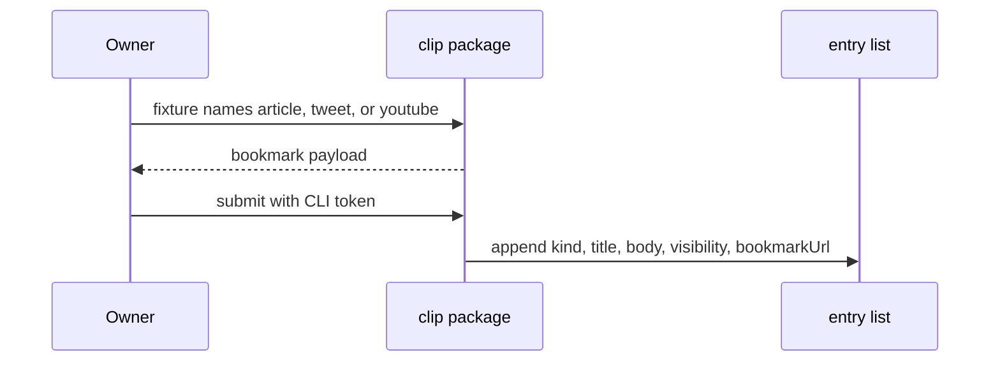

# Clip design

[日本語](design.ja.md)

## About this document

This design decides how the separate clip package carries out [Clip](requirements.md) for [weblog.yamanoku.net](../../product.md). The owner chose a bookmark payload and the existing CLI token.

### Audience

People and agents implementing or changing the clip package.

### Prerequisites

The acceptance criteria in [Clip](requirements.md). Entry fields, the CLI token, and the create surface stay in [Owner writing](../owner-writing/requirements.md).

### Outside this document

- A new entry kind or a new column for the source name
- Live fetching, oEmbed, and transcript download
- A browser authentication method after Access is removed
- A Worker route or a paid Cloudflare product
- A browser-store listing

## Implementation approach

The deliverable is one package, `packages/clip`, separate from the Worker application package `void`. The package is not published with the Worker deploy. It adds no Cloudflare service.

The package entry is a browser script. The script runs where a `window` global exists. It does not read Node's `module` or `require`. The pure transform and the submit function live on `window.weblogClip`. Tests and a separate consumer call those functions. They do not reimplement them.

`clipSource` reads a fixture object and returns a bookmark payload, or a refusal and no payload. `submitClip` appends that payload to the caller's entry list when the CLI token is a non-empty string. Neither function fetches the network. Neither function adds a host route.

## Architecture and sequence diagrams

The package sits in the owner's browser. Submit hands the bookmark to the entry list the caller provides. The Worker route stays the owner-writing create.

A submit without the token returns before the append. The list stays as it was.

## Data model and ER diagrams

No new table and no new column. The source name is not stored. An ER diagram would invent a column this feature does not have, so this design omits one.

The result object has three keys.

- `source` is `article`, `tweet`, or `youtube` when the fixture names one of those strings. It is `null` when the source is outside the three.
- `ownerWrite` is the bookmark object when the fixture passes the owner-writing checks. It is `null` on a refusal. The object keys are `kind`, `title`, `body`, `visibility`, and `bookmarkUrl`. `kind` is `bookmark`.
- `refusal` is `null` when `ownerWrite` is present. Otherwise it is `unknown_source`, `invalid_visibility`, `missing_title`, `missing_bookmark_url`, or `empty_body`.

`submitClip` returns `stored: true` and `reason: "stored"` when it appends. The appended object has those five keys and no token. `count` is the entry list length after the call. A missing token returns `stored: false`, `reason: "unauthorized"`, and the list is unchanged. A token with `ownerWrite: null` returns `stored: false`, `reason: "no_payload"`, and the list is unchanged.

## APIs and interfaces

The browser script assigns `window.weblogClip`. The object's functions are `clipSource` and `submitClip`. `SOURCE_KINDS` is the array `article`, `tweet`, `youtube` in that order.

`clipSource(fixture)` uses `fixture.source` only when it is a string. It reads `fixture.url`, `fixture.title`, `fixture.body`, and `fixture.visibility`. Other fixture properties are ignored. Title normalization trims both ends and replaces each run of whitespace with one space. A missing body becomes the empty string. A URL is missing when it is not a string or when trimming both ends leaves the empty string. The stored bookmark URL is the fixture string. The function returns a new object on every call. Two calls with the same fixture return objects that compare equal as JSON. The function does not read `Date` or `Math.random`.

The refusal check order is visibility, title, URL, then a public empty body.

`submitClip(clipResult, credentials, store)` reads `credentials.token`. The token is present only when that value is a string of length greater than zero. Any other credential, including a missing credential, returns `unauthorized` and does not change `store`. When the token is present and `ownerWrite` is an object, the function appends a new object with `kind`, `title`, `body`, `visibility`, and `bookmarkUrl` copied from `ownerWrite`. It does not append the token or the source name.

The manifest names the three sources as `article`, `tweet`, and `youtube`, and lists the browser script as the package entry. The script is the file the browser loads. The Worker application does not load it.

The host surface for the persisted create remains POST `/entries` and the shared create operation in owner writing. This package does not send that HTTP request and does not add a route. `submitClip` is the acceptance of the bookmark fields on the entry list the caller holds.

## External service integration

None. The script issues no HTTP request. X, YouTube, and the browser store are not connected.

## Data handling

The fixture is an argument. The result is a return value. `submitClip` appends only the five bookmark fields. The package writes no file and no browser storage. It does not copy a token into the entry. After the call returns, the package holds neither the fixture nor the token.

## Authentication and authorization notes

`credentials.token` is the owner's CLI token. The owner chose that credential for the extension. This package checks that the token is a non-empty string. It does not verify an Access JWT and does not verify a passkey. A missing token returns `unauthorized` and stores nothing. A present token stores the bookmark fields and drops the token. The hash check on the host remains the owner-writing create.

## Security considerations

The script does not read a cookie or an Access JWT. The stored object has no token field. The manifest requests no host permission for a live fetch.

## Deployment notes

None. The package is not a Worker and is not deployed to Cloudflare. Publishing to a browser store is outside the requirements.

## Alternatives considered

### Clip inside the Worker application

The transform could live in the `void` application. The request asks for a separate package. The selected design keeps the script in `packages/clip`.

### Store the clip as a note

The owner chose `bookmark`. A note has no required external URL. The selected design uses kind `bookmark` and keeps the URL apart from the body.

### Fetch the page from the package

A live fetch could fill title and body. The requirements exclude live fetching. The selected design reads the fixture's title, body, visibility, and URL.

## Open questions

None. The owner chose the bookmark, the four fields, and the CLI token in [Clip](requirements.md). Browser authentication after Access is removed stays with owner writing.
