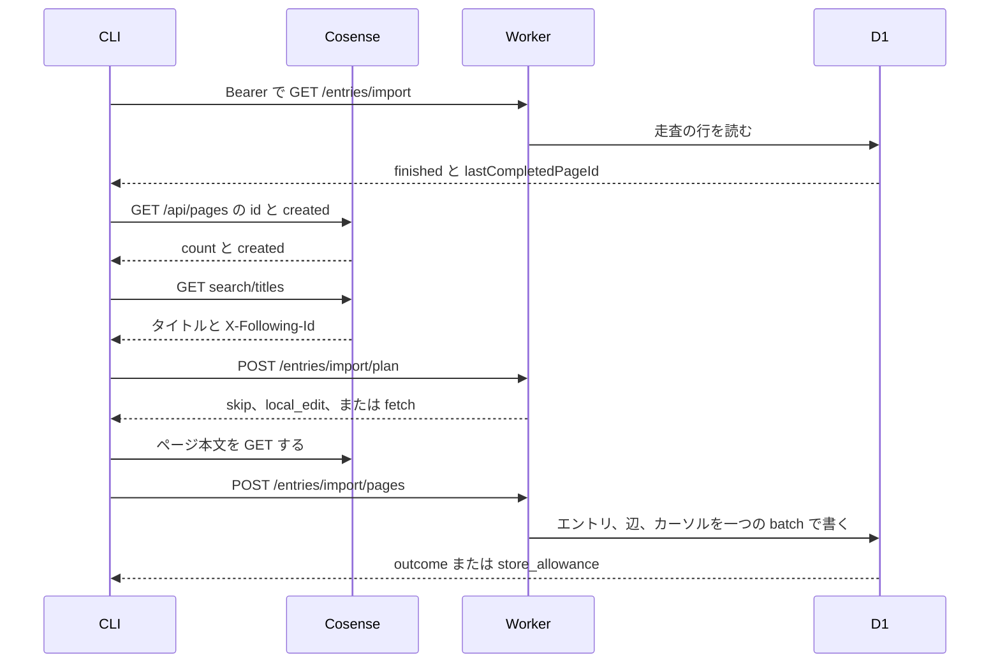

# Cosense からの取り込みの設計

[English](design.md)

## このドキュメントについて

この設計は、[Cosense からの取り込み](requirements.ja.md) を実装する方法を決める。親プロダクトは [weblog.yamanoku.net](../../product.ja.md) である。

CLI は公開プロジェクトを読む。このホストへは、ページを一つずつ確定させる。確定は、[所有者の書き込み](../owner-writing/requirements.ja.md) と同じく、エントリと辺の batch である。所有者の HTTP API は、これまでどおり Cosense のページ ID を受け取らない。

### 対象読者

この機能を実装する人と、変更するエージェントである。

### 前提知識

受入条件は [Cosense からの取り込み](requirements.ja.md) にある。

[D1 Database](https://developers.cloudflare.com/d1/worker-api/d1-database/) は、`batch()` 内の文が失敗すると列を中断するか、巻き戻すと書く。同じページは、文が順に実行されるとも書く。この設計では、失敗した batch の変更は残さない。

Free プランの D1 は、Worker の一呼び出しにつきクエリ 50 回までである。一文の束縛パラメータは 100 個までである。SQL は 100 KB までである。一行は 2 MB までである。データベースは 500 MB までである。出典は 2026-10-30 更新の [Limits](https://developers.cloudflare.com/d1/platform/limits/) である。同じ表は、その 50 クエリの行を、読み取りサブリクエストの上限とも呼ぶ。Free の一日の書き込み行数は 10 万である。出典は 2026-10-30 更新の [Pricing](https://developers.cloudflare.com/d1/platform/pricing/) である。そのページでは、クエリごとの `meta.rows_written` がそのクエリの書き込み行数を返す。索引の行も数に入る。アカウントの残り枠は返さない。

2026-09-01 以降、Free プランは一日の読み取り行数か書き込み行数を超えると、クエリが失敗する。保存済みの行は残る。枠は 00:00 UTC に戻る。出典は [D1 の変更履歴](https://developers.cloudflare.com/changelog/post/2026-09-01-d1-free-tier-limit-enforcement/) である。

走査の一覧は `https://scrapbox.io/api/pages/yamanoku/search/titles` である。応答ヘッダ `X-Following-Id` が空でないとき、その値を次の `followingId` にする。ヘッダが空か無いときは、その応答で一覧が終わる。2026-11-01 は、ヘッダの値が空であり、一つの応答にプロジェクトが入っていた。次の要求は、ヘッダの値を使う。本文中の最後のページ ID を `followingId` にしてはならない。

### このドキュメントで扱わないこと

- 所有者の手作業による作成、更新、削除、ブラウザのログイン、トークンの発行。これらは所有者の書き込みに残す。
- 人間向けのフィード、タイトルの HTML、空のページ、Gyazo のバイト列。これらは [公開閲覧](../public-reading/requirements.ja.md) に残す。
- 活動の送信、Follow、HTTP 署名。
- Gyazo と `scrapbox.io/files` のバイナリ複製。バケット `gyazo-archives` への書き込み。
- 所有者の書き込みが抽出する辺以外の、Cosense 記法の描画。
- UI フレームワークと ORM。
- ローカル編集の上へ、より新しいソース本文を採る手順。

## 実装方針

成果物は、既存 CLI のサブコマンドと、同じ Worker 上の認証付き経路三つである。一覧の走査、待機、報告は CLI が持つ。Worker は、一要求につきページを多くて一つ確定する。Worker の一要求では、プロジェクトを取り込まない。

ドメインとアダプタは分ける。ドメインは結果を決め、ページを検証し、変更の一覧を作る。D1 の型は取り込まない。Cloudflare SDK、特定の ORM、Fedify の型も取り込まない。D1 アダプタが batch を実行する。CLI のアダプタが Cosense とこのホストを呼ぶ。

エントリと辺を書く関数は `commitEntryBatch` だけである。所有者の作成と更新は、それぞれの変更一覧を作る。取り込みも変更一覧を作る。取り込みの一覧は、作成のとき `cosense_page_id` を設定する。種類、公開状態、bookmark の URL、不変 ID、`published_at`、既存のページ ID は変えない。

### 走査

所有者が実行するコマンドは、取り込みのサブコマンド一つである。`WEBLOG_TOKEN` と `WEBLOG_URL` は、所有者の CLI と同じ方法で読む。基底 URL の既定値は `https://weblog.yamanoku.net` である。

コマンドは最初に `GET /entries/import` を呼ぶ。401 のときは何も保存しない。Cosense も呼ばない。カーソルも変えない。この呼び出しが成功してから、ほかの処理を始める。

次に CLI は、`https://scrapbox.io/api/pages/yamanoku` を読む。`limit` は 1000 である。`skip` は 0 から始め、1000 ずつ増やす。返った件数が `limit` より少ないとき、読み終える。`limit`、`skip`、`created` の説明は、[api/pages/:projectname](https://scrapbox.io/scrapboxlab/api%2Fpages%2F:projectname) にある。使う項目は `id` と `created` だけである。`created` は Unix 秒である。集めた件数が応答の `count` と違うときは、走査を始めない。新しいページは完了にしない。429 と 5xx は、本文の取得と同じ待ち方で同じ要求を再試行する。

移行対象の `created` は 1793661527 以下である。この整数は Requirements の上限である。UTC の表記は 2026-11-02T23:18:47Z である。読み終えた一覧に無いページ ID も、対象外である。これより大きい `created` のページは、plan へ送らない。本文も取らない。投稿もしない。標準出力にも出さない。完了としても記録しない。走査は次のページへ続く。

CLI は `search/titles` を先頭から読む。`X-Following-Id` が空でなくなるまで、その値で次を読む。ヘッダが空か無くなったら一覧は終わりである。ページの順は、その応答の順のままである。CLI は並び替えない。

保存された走査が終わっておらず、`lastCompletedPageId` があるときは、その ID を見るまで本文を取らない。そのページも投稿しない。見た ID 自体は、再び投稿しない。それより後のページを処理する。一覧が終わってもその ID が無いときは、`cursor_missing` とそのページ ID を出す。`finished` は false のままである。終了コードは 0 以外にする。

保存された走査が終わっているときは、CLI は最初のページから処理する。この実行では `lastCompletedPageId` を動かさない。途中で止まっても `finished` は true のままである。次の実行は、再び最初のページから始める。置き換えの規則があるため、この繰り返しは安全である。

未完了で始まった実行が最後のページまで処理したとき、CLI は `POST /entries/import/finish` を呼ぶ。これで `finished` が true になる。finish が失敗したときは、カーソルを最後の確定の位置に残す。次の実行は、その ID の続きから行う。

### ページ一つ

移行対象のページについて、CLI はページ ID と一覧の `updated` を `POST /entries/import/plan` へ送る。一度に送るのは 80 件までである。応答は、本文の取得を省くか、ローカル編集として報告するか、本文を取るかを返す。応答に本文は含めない。

`skip` は、保存された本文が最後に取り込んだ本文と一致し、一覧の時刻が新しくないときである。CLI は本文を取らない。

`local_edit` は、保存された本文が最後に取り込んだ本文と違うときである。スナップショット列が NULL のときも、これに含める。CLI はページ ID を報告し、本文を取らない。ソースの本文は書かない。

`fetch` は、そのページ ID のエントリが無いときである。本文が一致し、一覧の時刻が新しいときも `fetch` である。CLI は `https://scrapbox.io/api/pages/yamanoku/{title}/text` を取り、そのテキストを投稿する。タイトルは、パーセント符号化された一つのパス要素にする。

ページの経路は、もう一度判定する。古い plan では、ローカル編集を上書きできない。本文を省いた要求は、空の本文ではない。空文字列が空の本文である。

作成の投稿は、整数の `sourceCreatedAt` を含む。値は、ページ一覧の `created` である。保存はしない。値が無いときは、Worker が書かない。1793661527 より大きいときも、Worker が書かない。応答は 200 の `outside_target` である。CLI は、そのページを報告しない。完了にもしない。整数でない値は 422 `invalid_source_time` である。CLI はカーソルを動かさずに停止する。既にエントリがあるページの置き換えは、この判定を使わない。

作成は種類を page、公開状態を public にする。bookmark の URL は空にする。batch の前に `crypto.randomUUID()` で小文字の UUID を発行する。ページ ID を保存する。本文は text 応答のままである。先頭行がタイトルと一致しても残す。`published_at` は NULL である。batch は `delivery_records` を挿入しない。活動も積まない。

置き換えは、取得したタイトルと本文を書き、辺を作り直す。閲覧パスと過去タイトルは、所有者の書き込みの規則で更新する。種類、公開状態、bookmark の URL、ページ ID、不変 ID、`published_at` は維持する。活動は積まない。エントリの `created_at` と `updated_at` は、確定した時刻である。一覧の `updated` は、別に `source_updated_at` として保存する。

最後に取り込んだ本文は、いま確定したテキストになる。このスナップショットとソース時刻は、作成か置き換えが確定したときだけ変わる。

カーソルを進めるのは、その同じ batch の中だけである。確定が成功し、CLI が `advanceCursor` を真にしたときに限る。CLI が `advanceCursor` を真にするのは、未完了から始まった実行だけである。

### 待機と再試行

Cosense の再試行は CLI が行う。`Retry-After` を解釈できる HTTP 429 は、その値だけ待つ。秒数なら、その秒数待つ。HTTP 日付なら、その瞬間まで待つ。ヘッダの無い 429、5xx、解釈できない `Retry-After` は、60 秒待つ。再試行するのは同じ要求である。成功のあとには待機を入れない。再試行が成功するまで、そのページは完了にしない。

batch の前に、Worker は文が変える行数を見積もる。内訳はエントリ一つ、消す既存の辺一つにつき一行、新しい辺一つにつき一行である。タイトルが変わるときは過去タイトル一行を足す。カーソルを進めるときはカーソル一行を足す。索引の行は、この見積もりに入れない。当日の集計と見積もりの和が 10 万を超えるときは、batch を送らない。503 `store_allowance` を返す。

batch が成功したあと、アダプタはその batch の `meta.rows_written` を、現在の UTC 日の集計へ足す。集計の行が無いときは 0 とする。新しい UTC 日は 0 から始まる。集計は、このデータベースが記録した書き込みである。アカウント全体の合計ではない。ほかの書き込みが、先にアカウントの枠を使い切ることがある。

D1 が Free の一日の書き込み行数か、一日の読み取り行数を超えたとして拒否したとき、アダプタは 503 `store_allowance` を返す。応答の本文は、そのエラーコードである。有料プランへの移行を勧める提供者の文は含めない。それ以外の batch 失敗は 503 `store_unavailable` である。その batch は確定しない。

`store_allowance` のとき、CLI は次の 00:00 UTC まで待ち、同じページを再び投稿する。待っているあいだ、そのページは完了ではない。`store_unavailable` のとき、CLI は停止する。カーソルは変えない。終了コードは 0 以外にする。

### 報告

標準出力には、書かなかったページを一行ずつ出す。実行の最後にも一行出す。行には本文、スナップショット、トークンを含めない。

- `local_edit` とページ ID
- `empty_body` とページ ID
- `unavailable` とページ ID
- `edges_too_large` とページ ID
- `missing_title` とページ ID
- `cursor_missing` とページ ID
- 一覧の走査が端まで達したときの `finished`
- それより前に停止したときの `stopped`

`empty_body`、`unavailable`、`edges_too_large`、`missing_title` は、そのページを完了にしない。走査は次のページへ続く。`unavailable` は、429 と 5xx 以外の本文応答である。ソースがもう持たないページも、これに含める。`cursor_missing` は実行を止める。

429 と 5xx 以外の一覧応答は、実行を止める。新しいページは完了にしない。未完了のカーソルは、その位置に残す。終了コードは 0 以外にする。

終了コードを 0 にするのは、標準出力が `finished` で終わるときだけである。ページの報告行だけでは、0 以外にはしない。

この設計はロックを取らない。所有者が実行するコマンドは一つである。ページ ID の一意性は、同じソースページの二つ目のエントリを拒む。

## アーキテクチャ・シーケンス図

Cosense を呼ぶのは CLI だけである。D1 を書くのは Worker だけである。公開 HTML の経路は、取り込みの経路を読まない。

ER 図は要らない。走査は一行であり、すべてのエントリの子ではない。ページ ID は `entries` の一意な列である。

## データモデル・ER 図

`entries.cosense_page_id` は、一意で NULL を許す text 列のままである。所有者の HTTP API は、これまでどおり受け取らない。所有者の更新 SQL も、これまでどおりこの列を書かない。

この機能は `entries` へ NULL を許す列を二つ足す。

- `last_imported_body` は、そのページの最後の成功した取り込みが確定したプレーンテキストである。NULL は、この機能のスナップショットが無いことを示す。後の比較では、NULL を現在の本文と一致したとは扱わない。
- `source_updated_at` は、その確定のときに保存した一覧の `updated` である。Unix 秒の整数である。エントリの `updated_at` ではない。NULL は、ソース時刻が未保存であることを示す。後の一覧の時刻は、新しいものとして扱う。

`import_walk` は一行を持つ。主キーは定数 `yamanoku` である。`last_completed_page_id` は NULL を許す text である。`finished` は 0 か 1 である。行が無いときは、未完了でカーソルが NULL の走査として読む。カーソルを進める最初の確定が、この行を挿入する。

`import_write_tally` の主キーは `utc_date` である。値は UTC の `YYYY-MM-DD` である。`rows_written` は整数である。事前確認が読むのは、現在の UTC 日だけである。

エントリを削除すると、その行のページ ID、スナップショット、ソース時刻も消える。走査の行は残る。同じページ ID を後から取り込むと、新しい不変 ID のエントリを作る。

## API・インターフェース

### Cosense

CLI は次の URL を、資格情報なしの HTTPS GET で呼ぶ。プロジェクトは公開である。CLI は、受け取った JSON から `user` と `users` を捨てる。それらの項目は、このホストへ送らない。

- `GET https://scrapbox.io/api/pages/yamanoku?limit=1000&skip=0` と、`skip` を 1000 ずつ増やした同じパス
- `GET https://scrapbox.io/api/pages/yamanoku/search/titles`
- 空でない `X-Following-Id` を `followingId` にした、同じパス
- `GET https://scrapbox.io/api/pages/yamanoku/{title}/text`

ページ一覧から使う項目は `id` と `created` である。`search/titles` の要素に `created` は無い。出典は [api/pages/:projectname/search/titles](https://scrapbox.io/scrapboxlab/api%2Fpages%2F:projectname%2Fsearch%2Ftitles) である。そのページは、作成日時を返さないと書く。走査で使う要素は `id`、`title`、`updated` である。要素に本文の行は無い。`links` 配列は辺の一覧ではない。辺は、保存したプレーンテキストから、所有者の書き込みの規則で抽出する。text 応答は `text/plain` であり、そのまま保存する。CLI は `i.gyazo.com`、`gyazo.com`、`scrapbox.io/files` を要求しない。

件数を測った URL `https://scrapbox.io/api/pages/yamanoku?limit=1` は、走査には使わない。あの応答には、`X-Following-Id` による続きが無い。

### Worker

四つの経路は、`Authorization: Bearer` と、`/entries` と同じトークンハッシュを要求する。Access の背後には置かない。`GET /entries/{id}` より前に登録する。

`GET /entries/import` は、`finished` と `lastCompletedPageId` を返す。

`POST /entries/import/plan` は、ページを 80 件まで受け取る。各ページは `cosensePageId` と、整数の `sourceUpdatedAt` を持つ。応答は同じ ID を列挙する。`action` は `skip`、`local_edit`、`fetch` のいずれかである。80 件を超える要求は 422 `plan_too_large` である。CLI はより小さい塊を送る。整数でないソース時刻は 422 `invalid_source_time` である。CLI はカーソルを動かさずに停止する。

`POST /entries/import/pages` は、`cosensePageId`、`title`、整数の `sourceUpdatedAt`、`body`、`advanceCursor` を受け取る。作成のときだけ、整数の `sourceCreatedAt` も受け取る。`body` は null を許す。応答は `outcome` と `cosensePageId` である。`outcome` は次の九つである。

- `created`
- `replaced`
- `unchanged`
- `local_edit`
- `need_body`
- `empty_body`
- `edges_too_large`
- `missing_title`
- `outside_target`

`POST /entries/import/finish` は `finished` を true にする。`lastCompletedPageId` は変えない。

成功した判定は 200 である。`empty_body`、`edges_too_large`、`missing_title`、`plan_too_large`、`invalid_source_time` は 422 である。検証できないトークンは 401 `unauthorized` である。枠の失敗は 503 `store_allowance` である。ほかの保存の失敗は 503 `store_unavailable` である。

`need_body` は、CLI がまだテキストを送っていないことを示す。CLI は本文を取り、再び投稿する。`need_body` は報告行にしない。`outside_target` も 200 である。報告行にはしない。エントリは作らない。

### CLI

サブコマンドは `import` である。プロジェクトの引数は取らない。上書きの旗も取らない。取り込み元のプロジェクトは固定である。

空白だけのテキストは、空の本文にしない。公開の空文字列は `empty_body` である。本文が空文字列の draft は保存する。結果の公開状態が、所有者が既に付けた draft であるためである。作成は public なので、空の作成は拒否する。

## 外部サービスとの連携方式

Cosense へは、CLI からの HTTPS GET で到達する。API キーは無い。失敗は、上に書いた再試行か報告になる。この機能は、有料の Cosense プランを追加しない。

保存のアダプタは D1 である。バインディング名は `DB` である。ドメインは `D1Database` を知らない。アダプタは、提供者のエラー文で Free の一日の上限を識別する。その文は `store_allowance` に置き換える。

事前確認は、Free の一日の書き込み上限 10 万と、このアプリの集計を使う。GraphQL Analytics API は呼ばない。

## データの取り扱い設計

集めるソースのデータは、ページ ID、タイトル、プレーンテキスト、一覧の `updated`、判定用の `created` である。`created` は保存しない。作成は公開のページとして保存する。したがってタイトルと本文は、誰でも読める。取り込み元のプロジェクトは、既に公開されている。

スナップショットは、後の実行がローカル編集を識別するために残す。後の取り込みが確定したときだけ置き換える。公開ページとしては別に持たない。公開 HTML は `last_imported_body`、`source_updated_at`、`import_walk` を読まない。

報告と plan の応答は、本文、スナップショット、トークンを省く。CLI はトークンをリポジトリへ書かない。

所有者の削除は、エントリと一緒にスナップショットを消す。この機能自身は、エントリを削除しない。

## 認証認可に関する特記事項

取り込みコマンドは、所有者の書き込みが既に発行した CLI トークンを使う。ブラウザのログインは、このコマンドの資格ではない。HTTP 署名は、これらの経路を認可しない。

最初の `GET /entries/import` が 401 のとき、コマンドは Cosense を呼ぶ前に停止する。後の 401 もコマンドを止める。カーソルは進めない。

## セキュリティ上の留意事項

トークンのハッシュは、所有者の書き込みと同じ方法で照合する。トークンの値は、ログに出さない。報告にも出さない。

Worker は、Cosense のアカウント ID を受け取らない。CLI は投稿の前に捨てる。

作成したページは公開である。ローカル編集は、エントリに既にある公開状態を維持する。これらの経路は、公開 HTML としては配信しない。

## デプロイに関する特記事項

スキーマの変更は追加である。最初の取り込みの前に、`last_imported_body`、`source_updated_at`、`import_walk`、`import_write_tally` を足す。D1 のデータベースは二つ目を作らない。このコマンド以外に、既存サイトからの取り込みは無い。

所有者はサブコマンドを実行し、止められる。未完了のカーソルが、次の実行の続き位置になる。コマンドは 00:00 UTC まで眠ることがある。Cron Trigger は登録しない。

## 検討した代替手段

### 後から増えたページも取り込む

一覧は、このあと増えることがある。増えたページも次の走査で作ると、対象が 2026-11-03 の 7655 ページを超える。所有者は、その 7655 ページの移行を目的にした。採用した判定は、Requirements の上限より後の `created` を作らない。

### プロジェクトを Worker の一要求で取り込む

一要求が一覧、再試行、すべてのページ書き込みを持つことになる。Free プランは一呼び出しのクエリが 50 回までである。長い待機も一要求には収まらない。採用した分担は、Cosense の呼び出しと待機を CLI に置く。

### CLI から D1 を直接書く

Requirements は、エントリを直接保存する経路を禁じている。採用した経路は Worker を呼び、Worker が `commitEntryBatch` を呼ぶ。

### POST `/entries` でページ ID を受け取る

所有者の HTTP API がページ ID を受け取ることになる。所有者の書き込みは、受け取らないと定めている。採用した取り込み経路は、ID を取り込みの変更一覧へだけ渡す。

### `links` 配列を辺にする

その配列は、所有者の書き込みの抽出規則と違い得る。採用する辺は、保存したプレーンテキストから抽出する。

### 一日の合計を GraphQL Analytics から読む

その API は、アカウント全体の書き込みを合計できる。別の資格情報が要る。採用した確認は、手元の集計と、提供者の一日上限エラーである。

### 最後に取り込んだ本文はハッシュだけを保存する

ハッシュなら、より少ない容量で不一致が分かる。Requirements は、最後の確定の行テキストを残すよう求めている。採用した列は、そのテキストを保存する。二部の写しは、500 MB のデータベース上限に数える。行が収まらないときは `store_unavailable` である。既存のエントリは削除しない。

### コマンドの周りにロックを取る

重複した実行は指定されていない。ロックは新しい規則になる。採用した設計はロックを足さない。ページ ID の一意性は、二つ目のエントリを拒み続ける。

## 未決事項

ローカル編集のあとで、より新しい Cosense の本文を採る手順は、Requirements の未決のままである。所有者が決めるまでは、この機能はページ ID を報告する。新しい本文は書かない。

抽出が Cosense の画面上のリンク範囲と一致するかは、所有者の書き込みの未決のままである。この機能はその規則を呼び、変えない。

この設計を止めるほかの問いは無い。`cursor_missing`、`edges_too_large`、`missing_title` の扱いは、上の方法である。
