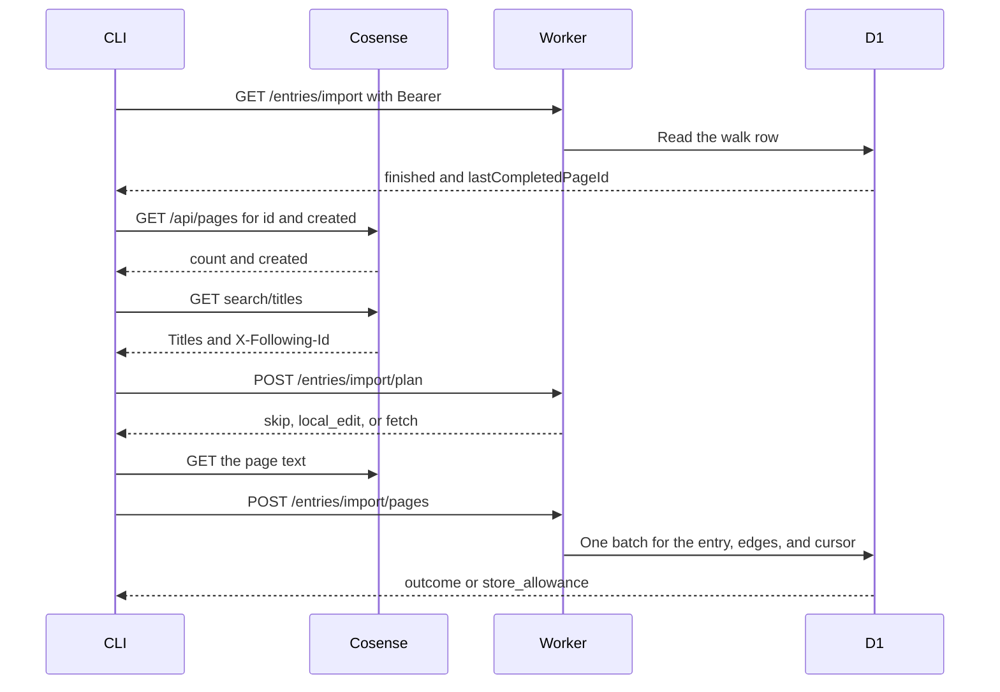

# Cosense import design

[日本語](design.ja.md)

## About this document

This design decides how to implement [Cosense import](requirements.md) for [weblog.yamanoku.net](../../product.md).

The CLI reads the public project and asks this host to commit one page at a time. The commit uses the same entry-and-edge batch as [Owner writing](../owner-writing/requirements.md). The owner's HTTP API still does not accept a Cosense page ID.

### Audience

People and agents implementing or changing this feature.

### Prerequisites

The acceptance criteria in [Cosense import](requirements.md).

[D1 Database](https://developers.cloudflare.com/d1/worker-api/d1-database/) says that if a statement in a `batch()` fails, the sequence is aborted or rolled back. The same page also says the statements run sequentially. This design treats a failed batch as leaving none of that batch's changes.

On the Free plan, D1 allows 50 queries per Worker invocation, 100 bound parameters per statement, a SQL statement of at most 100 KB, and a row of at most 2 MB. A database is at most 500 MB. The source is [Limits](https://developers.cloudflare.com/d1/platform/limits/), last updated 2026-10-30. That limits table also names the 50-query row as the read-subrequest limit. Free daily row writes are 100,000. The source is [Pricing](https://developers.cloudflare.com/d1/platform/pricing/), last updated 2026-10-30. That page says each query's `meta.rows_written` counts the rows that query wrote, including index rows. It does not return the account's remaining daily allowance.

Since 2026-09-01, a Free-plan query fails when the account exceeds the daily row read or row write limit. Stored rows remain. The allowance returns at midnight UTC. The source is the [D1 changelog](https://developers.cloudflare.com/changelog/post/2026-09-01-d1-free-tier-limit-enforcement/).

The walk list is `https://scrapbox.io/api/pages/yamanoku/search/titles`. A non-empty `X-Following-Id` response header is the next `followingId` query parameter. An empty or missing header means that response ends the list. On 2026-11-01 the header value was empty and one response contained the project. The next request must use the header value. It must not use the last page ID in the body as `followingId`.

### Outside this document

- The owner's manual create, update, delete, browser login, and token issuance. Those stay in owner writing.
- Human-readable feeds, title HTML, empty pages, and Gyazo bytes. Those stay in [Public reading](../public-reading/requirements.md).
- Sending activities, Follow, and HTTP signatures.
- Copying Gyazo or `scrapbox.io/files` binaries, and writing the bucket `gyazo-archives`.
- Rendering Cosense notation other than the edges owner writing extracts.
- A UI framework and an ORM.
- The later procedure that adopts a newer source body over a local edit.

## Implementation approach

The deliverables are a subcommand of the existing CLI and three authenticated routes on the same Worker. The CLI holds the list walk, the waits, and the report. The Worker commits at most one page per request. One Worker request does not import the project.

The domain and the adapters stay separate. The domain decides the outcome, validates the page, and builds the change list. It does not import D1 types, the Cloudflare SDK, a specific ORM, or Fedify types. The D1 adapter runs the batch. The CLI adapter calls Cosense and this host.

`commitEntryBatch` is the only function that writes an entry and its edges. Owner create and owner update build one change list. Import builds another. Import's list sets `cosense_page_id` on create and does not change kind, visibility, bookmark URL, immutable ID, `published_at`, or an existing page ID.

### Walk

The owner runs one import subcommand. It reads `WEBLOG_TOKEN` and `WEBLOG_URL` the same way the owner CLI does. The default base URL is `https://weblog.yamanoku.net`.

The command first calls `GET /entries/import`. A 401 stores nothing, does not call Cosense, and does not change the cursor. Any other run starts only after that call succeeds.

The CLI then reads `https://scrapbox.io/api/pages/yamanoku`. `limit` is 1000. `skip` starts at 0 and increases by 1000. The read ends when a response has fewer pages than `limit`. `limit`, `skip`, and `created` are documented on [api/pages/:projectname](https://scrapbox.io/scrapboxlab/api%2Fpages%2F:projectname). The fields used are `id` and `created`. `created` is Unix seconds. When the number of pages collected differs from the response `count`, the CLI does not start the walk and completes no new page. HTTP 429 and 5xx use the same wait and retry as a text fetch.

A migration-set page has `created` less than or equal to 1793661527. That integer is the requirements cutoff. In UTC it is 2026-11-02T23:18:47Z. A page ID absent from that completed read is outside the set. A page with a greater `created` is not sent to plan, its text is not fetched, and it is not posted. It produces no stdout line and is not recorded as completed. The walk continues at the next page.

The CLI then reads `search/titles` from the start. It follows a non-empty `X-Following-Id` until the header is empty or absent. Pages stay in that response order. The CLI does not sort them again.

When the stored walk is unfinished and `lastCompletedPageId` is set, the CLI does not fetch text and does not post a page until it has seen that ID. The seen ID itself is not posted again. Later pages are handled. If the list ends without that ID, the command prints `cursor_missing` and that page ID, leaves `finished` false, and exits non-zero.

When the stored walk is finished, the CLI handles the list from the first page. It does not move `lastCompletedPageId` during that run. A stop in the middle leaves `finished` true, so the next run starts from the first page again. Replace rules make that repeat safe.

When the CLI has handled the last page of a run that started unfinished, it calls `POST /entries/import/finish`. That sets `finished` true. A failed finish leaves the cursor where the last commit put it. The next run continues after that ID.

### One page

For each page in the migration set, the CLI sends the page ID and the list's `updated` number to `POST /entries/import/plan`, in chunks of at most 80. The response tells the CLI to skip, to report a local edit, or to fetch the text. The response does not contain a body.

`skip` means the stored body still equals the last imported body and the list time is not newer. The CLI does not fetch text.

`local_edit` means the stored body differs from the last imported body, including when the snapshot column is NULL. The CLI prints the page ID and does not fetch text. The source body is not written.

`fetch` means no entry stores the page ID, or the body still matches and the list time is newer. The CLI fetches `https://scrapbox.io/api/pages/yamanoku/{title}/text` and posts that text. The title is one percent-encoded path segment.

The page route decides again. A stale plan cannot overwrite a local edit. An omitted body is not an empty body. The empty string is an empty body.

A create post includes integer `sourceCreatedAt`. The value is the page list's `created` and is not stored. When the value is missing, or when it is greater than 1793661527, the Worker writes nothing. The response is 200 `outside_target`. The CLI does not report that page and does not record it as completed. A non-integer value is 422 `invalid_source_time`, and the CLI stops without moving the cursor. A replace of a page that already has an entry does not use this check.

A create sets kind to page and visibility to public, leaves the bookmark URL empty, issues a new lowercase UUID with `crypto.randomUUID()` before the batch, and stores the page ID. The body is the text response unchanged, including a first line equal to the title. `published_at` is NULL. The batch does not insert `delivery_records` and does not enqueue an activity.

A replace writes the fetched title and body, rebuilds edges, and updates the view path and past titles by the owner-writing rules. It leaves kind, visibility, bookmark URL, page ID, immutable ID, and `published_at` as they are. It does not enqueue an activity. Entry `created_at` and `updated_at` are the commit times. The list's `updated` number is stored separately as `source_updated_at`.

The last imported body becomes the text just committed. Both that snapshot and the source time change only on a committed create or replace.

The cursor advances only inside that same batch, and only when the commit succeeds and the CLI set `advanceCursor`. The CLI sets `advanceCursor` only for a run that started unfinished.

### Wait and retry

Cosense retries happen in the CLI. HTTP 429 with a parseable `Retry-After` waits for that value. A delta-seconds value waits that many seconds. An HTTP-date waits until that instant. A 429 without the header, a 5xx response, and an unparseable `Retry-After` wait 60 seconds. The same request is retried. The wait is not inserted after a success. The page is not completed before the retry succeeds.

Before the batch, the Worker estimates the rows the statements will change: one entry, one per existing edge deleted, one per new edge, one past-title row when the title changes, and one cursor row when the cursor advances. Index rows are not in this estimate. If today's tally plus that estimate is above 100,000, the Worker does not send the batch and returns 503 `store_allowance`.

After a successful batch, the adapter adds that batch's `meta.rows_written` to the tally for the current UTC date. A missing tally row counts as zero. A new UTC date starts at zero. The tally is this database's recorded writes, not the account total. Another writer can exhaust the account first.

When D1 rejects the query because the account exceeded the free daily row write limit or the free daily row read limit, the adapter returns 503 `store_allowance`. The response body is the error code. It does not include the provider sentence that tells the caller to upgrade. Any other failed batch returns 503 `store_unavailable` and leaves that batch uncommitted.

On `store_allowance`, the CLI sleeps until the next 00:00 UTC and posts the same page again. The page is not complete while it waits. On `store_unavailable`, the CLI stops, leaves the cursor unchanged, and exits non-zero.

### Report

Stdout receives one line for each page that was not written, and a final line for the run. The lines do not contain a body, a snapshot, or the token.

- `local_edit` and the page ID
- `empty_body` and the page ID
- `unavailable` and the page ID
- `edges_too_large` and the page ID
- `missing_title` and the page ID
- `cursor_missing` and the page ID
- `finished` when the list walk reached its end
- `stopped` when the run stopped earlier

`empty_body`, `unavailable`, `edges_too_large`, and `missing_title` do not complete the page. The walk continues with the next page. `unavailable` is a text response other than 429 or 5xx, including a missing page. `cursor_missing` stops the run.

A list response other than 429 or 5xx stops the run. The CLI completes no new page. An unfinished cursor stays. Exit status is non-zero.

Exit status is zero only when the stdout ends with `finished`. Page report lines do not by themselves make the status non-zero.

This design does not take a lock. One owner command is the supported run. The unique page ID still prevents a second entry for the same source page.

## Architecture and sequence diagrams

The CLI is the only component that calls Cosense. The Worker is the only component that writes D1. Public HTML routes do not read the import routes.

An ER diagram is unnecessary. The walk is one row, and it is not a child of every entry. The page ID is a unique column on `entries`.

## Data model and ER diagrams

`entries.cosense_page_id` stays a unique nullable text column. The owner's HTTP API still does not accept it. Owner update SQL still does not write it.

This feature adds two nullable columns to `entries`.

- `last_imported_body` is the plain text committed by the last successful import of that page. NULL means this feature has no snapshot. A later comparison treats NULL as not equal to the current body.
- `source_updated_at` is the list `updated` value stored at that commit. It is an integer number of Unix seconds. It is not the entry's `updated_at`. NULL means no source time is stored, so a later list time counts as newer.

`import_walk` holds one row. Its primary key is the constant `yamanoku`. `last_completed_page_id` is nullable text. `finished` is 0 or 1. A missing row is read as an unfinished walk with a null cursor. The first commit that advances the cursor inserts the row.

`import_write_tally` has primary key `utc_date`, a `YYYY-MM-DD` UTC date, and an integer `rows_written`. The pre-check reads only the current UTC date.

Deleting an entry deletes that row's page ID, snapshot, and source time. The walk row remains. A later import of the same page ID creates a new immutable ID.

## APIs and interfaces

### Cosense

The CLI calls these URLs with no credential. The project is public. The CLI discards `user` and `users` from any JSON it receives. It does not send those fields to this host.

- `GET https://scrapbox.io/api/pages/yamanoku?limit=1000&skip=0`, then the same path with `skip` increased by 1000
- `GET https://scrapbox.io/api/pages/yamanoku/search/titles`
- The same path with `?followingId=` set to a non-empty `X-Following-Id`
- `GET https://scrapbox.io/api/pages/yamanoku/{title}/text`

The page-list fields used are `id` and `created`. A `search/titles` element has no `created`. The source is [api/pages/:projectname/search/titles](https://scrapbox.io/scrapboxlab/api%2Fpages%2F:projectname%2Fsearch%2Ftitles), which says that response does not include the creation time. Each walk element used by this feature has `id`, `title`, and `updated`. The element has no body lines. The `links` array is not the edge list. Edges are extracted from the stored plain text by the owner-writing rules. The text response is `text/plain` and is stored unchanged. The CLI does not request `i.gyazo.com`, `gyazo.com`, or `scrapbox.io/files`.

The measured count URL, `https://scrapbox.io/api/pages/yamanoku?limit=1`, is not the walk. That response has no `X-Following-Id` continuation.

### Worker

All four routes require `Authorization: Bearer` and the same token hash as `/entries`. They are not behind Access. They are registered before `GET /entries/{id}`.

`GET /entries/import` returns `finished` and `lastCompletedPageId`.

`POST /entries/import/plan` accepts at most 80 pages. Each page has `cosensePageId` and integer `sourceUpdatedAt`. The response lists the same IDs with `action` of `skip`, `local_edit`, or `fetch`. A larger batch is 422 `plan_too_large`. The CLI sends a smaller chunk. A non-integer source time is 422 `invalid_source_time`, and the CLI stops without moving the cursor.

`POST /entries/import/pages` accepts `cosensePageId`, `title`, integer `sourceUpdatedAt`, `body`, and `advanceCursor`. A create also accepts integer `sourceCreatedAt`. `body` may be null. The response is `outcome` and `cosensePageId`. Outcomes are `created`, `replaced`, `unchanged`, `local_edit`, `need_body`, `empty_body`, `edges_too_large`, `missing_title`, and `outside_target`.

`POST /entries/import/finish` sets `finished` to true. It does not change `lastCompletedPageId`.

Successful decisions use 200. `empty_body`, `edges_too_large`, `missing_title`, `plan_too_large`, and `invalid_source_time` use 422. An unverified token uses 401 `unauthorized`. Allowance failure uses 503 `store_allowance`. Any other store failure uses 503 `store_unavailable`.

`need_body` means the CLI has not yet sent the text. The CLI fetches and posts again. `need_body` is not a report line. `outside_target` is also 200. It is not a report line, and it creates no entry.

### CLI

The subcommand is `import`. It takes no project argument and no overwrite flag. The source project is fixed.

Whitespace-only text is not an empty body. A public empty string is `empty_body`. A draft whose body is the empty string is stored, because the resulting visibility is the draft the owner already set. A create is public, so an empty create is refused.

## External service integration

Cosense is reached by HTTPS GET from the CLI. There is no API key. A failure is retried or reported as specified above. This feature does not add a paid Cosense plan.

D1 is the storage adapter. The binding name is `DB`. The domain does not know `D1Database`. The adapter recognizes the free daily limit by the provider error text, then replaces that text with `store_allowance`.

The pre-check uses the Free daily write maximum of 100,000 and this app's tally. It does not call the GraphQL Analytics API.

## Data handling

The collected source data is the page ID, the title, the plain text, the list `updated` number, and `created` for the membership check. `created` is not stored. The create stores a public page, so the title and body are world-readable. The source project is already public.

The snapshot is kept so a later run can recognize a local edit. It is replaced only when a later import commits. It is not a separate public page. Public HTML does not read `last_imported_body`, `source_updated_at`, or `import_walk`.

The report and the plan response omit bodies, snapshots, and the token. The CLI does not write the token into the repository.

An owner delete removes the snapshot with the entry. This feature does not delete an entry by itself.

## Authentication and authorization notes

The import command uses the CLI token owner writing already issued. Browser login is not this command's credential. HTTP signatures do not authorize these routes.

A 401 at the first `GET /entries/import` stops the command before any Cosense call. A later 401 also stops the command and does not advance the cursor.

## Security considerations

The token hash is compared the same way owner writing compares it. The token value is not logged and is not printed in the report.

The Worker does not accept Cosense account IDs. The CLI drops them before the post.

Created pages are public. A local edit keeps the visibility already stored on the entry. These routes are not served as public HTML.

## Deployment notes

The schema change is additive. Add `last_imported_body`, `source_updated_at`, `import_walk`, and `import_write_tally` before the first import. Do not create a second D1 database. There is no import of an existing site other than this command.

The owner runs the subcommand and can stop it. The unfinished cursor is what allows the next run to continue. The command may sleep until 00:00 UTC. It does not register a Cron Trigger.

## Alternatives considered

### Also import pages that appear later

The list can grow after this date. Creating those later pages on the next walk would take the set past the 7655 pages from 2026-11-03. The owner chose migration of those 7655 pages as the purpose. The selected check does not create a page whose `created` is after the requirements cutoff.

### Import the project inside one Worker request

One request would hold the list, the retries, and every page write. The Free plan allows 50 queries per invocation, and a long wait does not fit one request. The selected split keeps Cosense calls and waits in the CLI.

### Write D1 from the CLI

The requirements say the import has no path that stores an entry directly. The selected path calls the Worker, which calls `commitEntryBatch`.

### Accept the page ID on POST `/entries`

The owner's HTTP API would then accept a page ID. Owner writing says it does not. The selected import routes pass the ID only into the import change list.

### Use the `links` array as the edges

That array can differ from the owner-writing extraction rules. The selected edges are extracted from the stored plain text.

### Read the account's daily total from GraphQL Analytics

That API can sum account-wide writes. It needs a separate credential. The selected check is the local tally plus the provider's daily-limit error.

### Store only a hash of the last imported body

A hash would show inequality with less storage. The requirements ask to keep the line text of the last commit. The selected column stores that text. Two copies count toward the 500 MB database limit. A row that does not fit is `store_unavailable` and does not delete the existing entry.

### Take a lock around the command

Overlapping runs were not specified. A lock would be a new rule. The selected design adds no lock. The unique page ID still prevents a second entry.

## Open questions

The procedure for adopting a newer Cosense body after a local edit stays open in the requirements. Until the owner decides, this feature reports the page ID and does not write the newer body.

Whether extraction matches the link range on the Cosense screen stays open in owner writing. This feature calls those rules and does not change them.

No other question blocks this design. `cursor_missing`, `edges_too_large`, and `missing_title` are the methods above.
