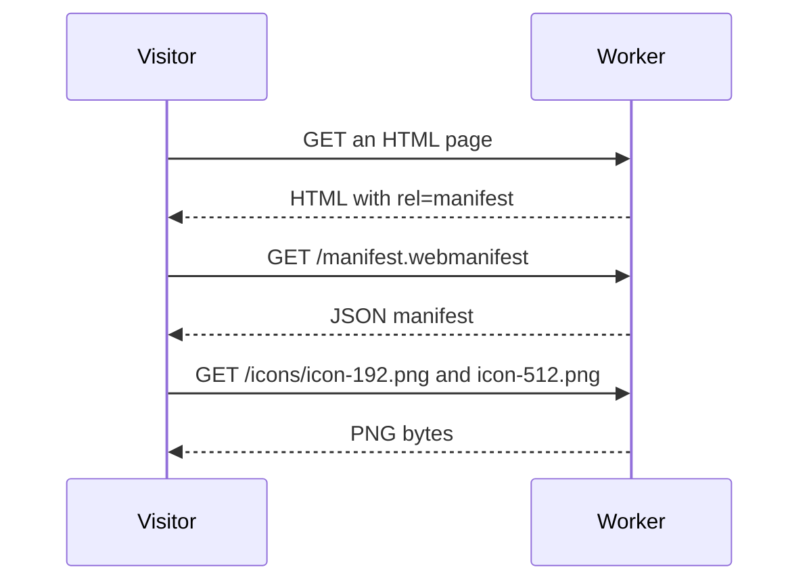

# インストールの設計

[English](design.md)

## このドキュメントについて

この設計は、今の Worker が [インストール](requirements.ja.md) を [weblog.yamanoku.net](../../product.ja.md) でどう返すかを決める。閲覧者は公開サイトをインストールできる。サービスワーカーは足さない。

### 読者

インストール用の文書を実装する人、または変える人。エージェントも含む。

### 前提

[インストール](requirements.ja.md) の受入条件。

Lighthouse のインストール検査は、2024-04-16 の [installable-manifest](https://developer.chrome.com/docs/lighthouse/pwa/installable-manifest) が項目を挙げている。`short_name` または `name` がある。アイコンは 192px と 512px である。`start_url` がある。`display` は `fullscreen`、`standalone`、`minimal-ui` のいずれかである。`prefer_related_applications` を true にはしない。

メニューからのインストールは、2023-12-05 の [install criteria](https://developer.chrome.com/blog/update-install-criteria) で条件が変わった。サービスワーカーの `fetch()` ハンドラは、Chrome 108（モバイル）と 112（デスクトップ）で外れた。自動のプロンプトは、そのハンドラをまだ見ることがある。この機能はハンドラを足さない。そのプロンプトは約束しない。

ウェブアプリマニフェストの [start URL](https://www.w3.org/TR/appmanifest/#start_url-member) は、ナビゲーションの範囲の内側になければならない。[purpose](https://www.w3.org/TR/appmanifest/#purpose-member) は、省略した purpose を任意の文脈で使えるアイコンだと説明する。`maskable` だけの purpose は、その汎用アイコンではない。

[Installing web applications](https://developer.chrome.com/docs/modern-web-guidance/guides/pwa/install-web-app)（2026-11-08 公開）は、今の文書が自分のマニフェストをリンクし、マニフェストが安定した `id` を宣言するとよいと説明している。ページ内のインストール操作は [インストール](requirements.ja.md) の外である。

### このドキュメントの外

- オフラインでの閲覧、プッシュ、バックグラウンド同期
- インストールボタンと、OS のダイアログ
- 新しい見た目
- ブラウザ拡張のマニフェスト
- 編集の認証

## 実装方針

成果物は、マニフェスト一つと PNG 二つ、それに共有 HTML の head にあるリンクである。ファイルは Worker の静的ファイルとしてコピーする。Worker は今の一つの Void アプリケーションのままである。二つ目の Worker も、サービスワーカーも無い。

マニフェストは `public/manifest.webmanifest` である。アイコンは `public/icons/icon-192.png` と `public/icons/icon-512.png` である。Void は、プロジェクトルートの `public/` をファイルとして返す。拡張子 `webmanifest` は、開発サーバが使う MIME 対応（`mrmime`）では `application/manifest+json` である。PNG の拡張子は `image/png` である。

`src/pages/layout.svelte` は、`<svelte:head>` に `<link rel="manifest" href="/manifest.webmanifest">` を置く。このレイアウトはすべての HTML ページを包む。最初の応答も、このホスト内の後の移動も、リンクを出す。フィードなど、ページでない応答はレイアウトを使わない。

マニフェストの `id` は `/`、`name` と `short_name` は `ウェブログ`、`start_url` と `scope` は `/`、`display` は `standalone` である。`prefer_related_applications` は書かない。各アイコンの `purpose` は `any`、`type` は `image/png` である。

アイコンの絵は、`src/pages/layout.svelte` の見出しに既にあるパスである。塗りは `#1a1a1a` で、見出しの色 `--color-neutral-solid-gray-900` と同じである。背景は白で、ページの背景と同じである。ラスタは正方形で、一辺は 192 と 512 である。

比較キー `manifest.webmanifest` は、[所有者の書き込み](../owner-writing/requirements.ja.md) が既に拒む閲覧用パスのキーに加える。タイトルはその URL を取らない。アイコンは `/icons/` の下に置く。そこは、パス要素一つのタイトルではない。

`navigator.serviceWorker` を呼ぶスクリプトは無い。サービスワーカーのファイルも足さない。

## アーキテクチャとシーケンス

閲覧者はページか静的ファイルを要求する。Worker は HTML、マニフェスト、または PNG を返す。データベースの呼び出しは足さない。

## データモデルと ER 図

なし。表と列は足さない。

## API とインターフェース

絶対 URL のホストは `https://weblog.yamanoku.net` である。要求の Host ヘッダは、これを変えない。

| 経路 | 応答 |
| --- | --- |
| `GET /manifest.webmanifest` | マニフェストの JSON。所有者の資格情報は要らない。 |
| `GET /icons/icon-192.png` | 192×192 の PNG。所有者の資格情報は要らない。 |
| `GET /icons/icon-512.png` | 512×512 の PNG。所有者の資格情報は要らない。 |

`start_url` は `/` である。その応答は、公開閲覧の公開ホームのままである。

## 外部サービスとの連携

なし。これらのファイルは、有料の実行環境を足さない。

## データの取り扱い

ファイルは静的である。要求はファイルを書き換えない。これらのファイルのために D1 も読まない。

## 認証と認可

資格情報は要らない。これらの URL に付いた Access ヘッダは、本文を編集文書へ切り替えない。GET `/edit` は、今の編集ゲートの後ろに残す。

## セキュリティ

ファイルが持つのは、サイト名と見出しの印である。トークンも、エントリ本文も含まない。

## デプロイ

なし。公開は、一つの Worker に対する `void deploy --platform cloudflare` のままである。ファイルは、その Worker の静的アセットと一緒に運ぶ。この機能単独では、デプロイを必須にしない。

## 検討した代替

### fetch ハンドラを持つサービスワーカー

Chrome のメニューからのインストールは、そのハンドラを必須にしていない。要件はオフライン閲覧を外している。fetch ハンドラは、この機能が定めていないキャッシュを足す。採用した設計は、サービスワーカーを足さない。

### ページ内のインストールボタン

ブラウザは、自身の規則に合うとき、インストールの UI を出す。要件はボタンと OS のダイアログを外している。採用した設計は、マニフェストのリンクだけを置く。

### 新しいアイコン

プロダクトは、新しい見た目を外している。採用した設計は、インストール可能性が求める二つの大きさで、見出しの印を繰り返す。

### JSON を組み立てる経路ハンドラ

ハンドラなら、アプリケーションのコードでコンテンツ型を決められる。静的ファイルは既に拡張子 `webmanifest` を持ち、MIME 対応が `application/manifest+json` を返す。採用した設計は、Worker を起動せずにテストが読めるファイルのままにする。

## 未決事項

なし。ブラウザのインストールダイアログは、[インストール](requirements.ja.md) が書くとおり、この機能の外である。
