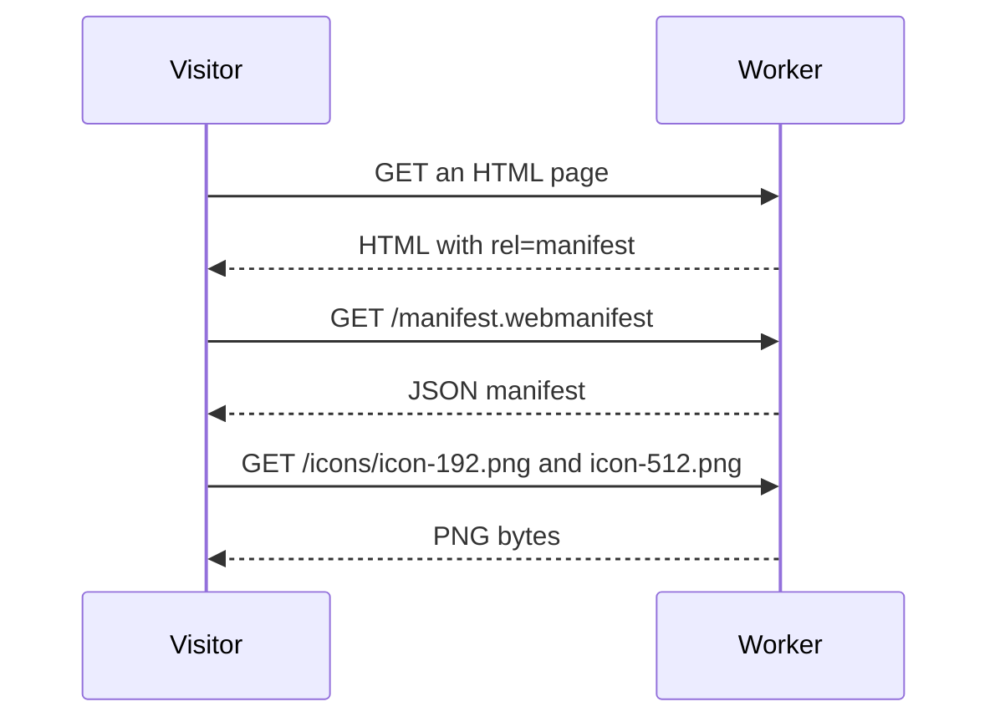

# Install design

[日本語](design.ja.md)

## About this document

This design decides how the existing Worker serves [Install](requirements.md) on [weblog.yamanoku.net](../../product.md). A visitor can install the public site. The site does not gain a service worker.

### Audience

People and agents implementing or changing the install documents.

### Prerequisites

The acceptance criteria in [Install](requirements.md).

[Web app manifest does not meet the installability requirements](https://developer.chrome.com/docs/lighthouse/pwa/installable-manifest), published 2024-04-16, lists the Lighthouse members: `short_name` or `name`, icons at 192px and 512px, `start_url`, `display` of `fullscreen`, `standalone`, or `minimal-ui`, and `prefer_related_applications` other than true.

[Revisiting Chrome's installability criteria](https://developer.chrome.com/blog/update-install-criteria), published 2023-12-05, says Chrome removed the service worker `fetch()` handler from menu installation in version 108 on mobile and 112 on desktop. The automatic prompt may still look for that handler. This feature does not add one, and it does not promise that prompt.

The [start URL member](https://www.w3.org/TR/appmanifest/#start_url-member) of the web app manifest must be inside the navigation scope. The [purpose member](https://www.w3.org/TR/appmanifest/#purpose-member) says an omitted purpose means the icon is usable in any context. A purpose of only `maskable` is not that general icon.

[Installing web applications](https://developer.chrome.com/docs/modern-web-guidance/guides/pwa/install-web-app), published 2026-11-08, says the current document links its manifest and the manifest should declare a stable `id`. An in-page install control is outside [Install](requirements.md).

### Outside this document

- Offline reading, push, and background sync
- An install button and the operating-system dialog
- A new visual system
- The browser-extension manifest
- Edit authentication

## Implementation approach

The deliverable is one manifest file and two PNG files, copied with the Worker's static files, plus a link in the shared HTML head. The Worker stays the one Void application. There is no second Worker and no service worker.

The manifest is `public/manifest.webmanifest`. The icons are `public/icons/icon-192.png` and `public/icons/icon-512.png`. Void serves `public/` from the project root as files. The extension `webmanifest` is `application/manifest+json` in the MIME map the dev server uses (`mrmime`). The PNG extension is `image/png`.

`src/pages/layout.svelte` puts `<link rel="manifest" href="/manifest.webmanifest">` in `<svelte:head>`. That layout wraps every HTML page, so the first response and a later in-host navigation both expose the link. Feeds and other non-page responses do not use the layout.

The manifest sets `id` to `/`, `name` and `short_name` to `ウェブログ`, `start_url` and `scope` to `/`, and `display` to `standalone`. It omits `prefer_related_applications`. Each icon sets `purpose` to `any` and `type` to `image/png`.

The icon picture is the path already drawn in the header of `src/pages/layout.svelte`. The fill is `#1a1a1a`, the header color `--color-neutral-solid-gray-900`. The background is white, the page background. The raster is square, 192 and 512.

The comparison key `manifest.webmanifest` is reserved with the view-path keys [Owner writing](../owner-writing/requirements.md) already refuses, so a title does not take that URL. The icon files live under `/icons/`, which is not a one-segment title path.

No script calls `navigator.serviceWorker`. No service worker file is added.

## Architecture and sequence diagrams

The visitor requests a page or a static file. The Worker returns the HTML shell, the manifest, or the PNG. No database call is added.

## Data model and ER diagrams

None. This feature adds no table and no column.

## APIs and interfaces

The host in every absolute URL is `https://weblog.yamanoku.net`. The request Host header does not change it.

| Path | Response |
| --- | --- |
| `GET /manifest.webmanifest` | The manifest JSON. No owner credential. |
| `GET /icons/icon-192.png` | A 192 by 192 PNG. No owner credential. |
| `GET /icons/icon-512.png` | A 512 by 512 PNG. No owner credential. |

`start_url` is `/`. That response stays the public home from public reading.

## External service integration

None. These files add no paid runtime.

## Data handling

The files are static. A request does not write them and does not read D1 for them.

## Authentication and authorization notes

No credential is required. An Access header on these URLs does not switch the body to an edit document. An unverified GET `/edit` stays 404 from the edit gate.

## Security considerations

The files contain the site name and the header mark. They contain no token and no entry body.

## Deployment notes

None. Publishing stays `void deploy --platform cloudflare` for the one Worker. The files travel with that Worker's static assets. This feature does not require a deploy by itself.

## Alternatives considered

### A service worker with a fetch handler

Chrome's menu install no longer requires that handler. The requirements exclude offline reading. A fetch handler would add a cache this feature does not specify. The selected design adds no service worker.

### An in-page install button

The browser already offers install UI when its own rules match. The requirements exclude a button and the operating-system dialog. The selected design only links the manifest.

### A new icon

The product excludes a new visual system. The selected design repeats the header mark at the two sizes installability asks for.

### A route handler that builds the JSON

A handler could set the content type in application code. The static file already has the `webmanifest` extension, and the MIME map sends `application/manifest+json`. The selected design keeps the document as a file the test can read without starting the Worker.

## Open questions

None. The browser's install dialog stays outside this feature, as [Install](requirements.md) states.
