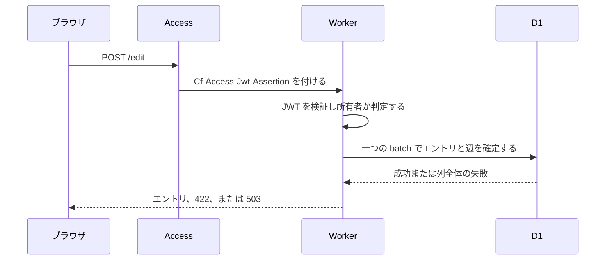
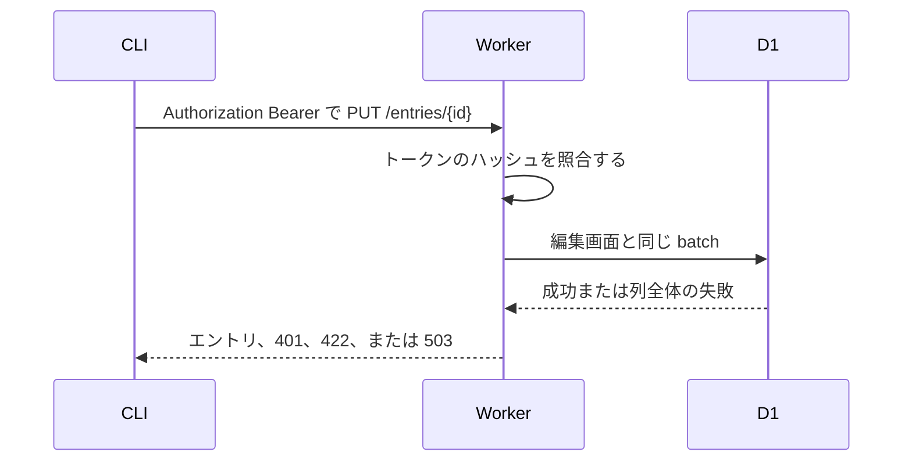
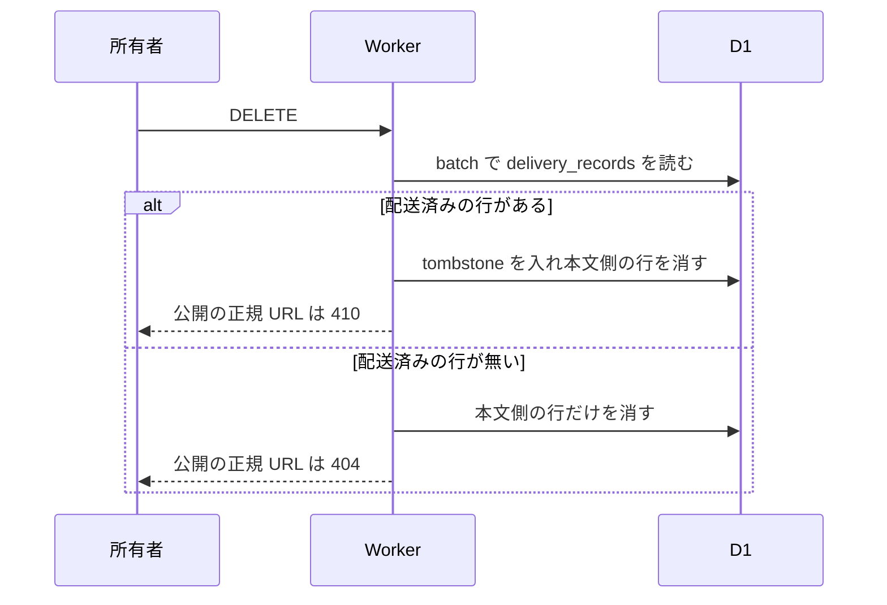
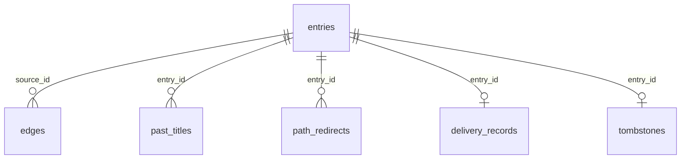

# 所有者の書き込みの設計

[English](design.md)

## このドキュメントについて

この設計は、[所有者の書き込み](requirements.ja.md) を、一つの Worker で実装する方法を決める。親プロダクトは [weblog.yamanoku.net](../../product.ja.md) である。

ブラウザの編集画面と CLI は、同じ書き込み処理を呼ぶ。資格の確認だけが入口で分かれる。エントリと辺は、D1 の一つの `batch()` で確定する。

### 対象読者

この機能を実装または変更する人と、その作業を引き受けるエージェント。

### 前提知識

[所有者の書き込み](requirements.ja.md) の受け入れ条件。D1 の `batch()` は、途中の文が失敗すると列全体を打ち切るかロールバックする、と [D1 Database](https://developers.cloudflare.com/d1/worker-api/d1-database/) に書いてある。同じページは、文が順に実行されるとも書く。この設計は、失敗した batch を「その batch の変更が残らない」として扱う。

Free プランの D1 は、Worker の 1 回の実行でクエリ 50 までである。根拠は [Limits](https://developers.cloudflare.com/d1/platform/limits/) である。バインド変数は 1 文あたり 100 まで、SQL 文は 100 KB まで、行は 2 MB までである。

Access は、保護した経路のリクエストに `Cf-Access-Jwt-Assertion` を付ける。検証は [Validate JWTs](https://developers.cloudflare.com/cloudflare-one/access-controls/applications/http-apps/authorization-cookie/validating-json/) に従う。同文書は、Cookie の `CF_Authorization` は必ず渡るとは限らない、と書く。

### このドキュメントで扱わないこと

- 人間向けフィード、タイトル一覧、空ページの HTML。未知のタイトルパスは、この機能では 404 にする。空ページへ変えるのは公開閲覧の機能である。
- ActivityPub の活動の送信と署名。`delivery_records` へ行を入れるのも、そちらの機能である。
- bookmark の URL を配送本文へ挿入すること。
- Cosense の一覧取得、再試行、ローカル編集との合流。
- ORM。

## 実装方針

成果物は一つの Worker と、その Worker を呼ぶ CLI である。編集画面は Svelte のページである。最初の応答は HTML である。そのあと、ブラウザは Svelte を動かす。項目の送信は、これまでと同じ書き込み処理を呼ぶ。ドメインは Svelte を import しない。

処理はドメインとアダプタに分ける。ドメインは、検証、タイトルの正規化、辺の抽出、publishedAt の更新、削除が 404 か 410 かを決める。ドメインは D1 の型、Access の JWT、ORM を import しない。Cloudflare SDK と Fedify の型も import しない。アダプタが D1、Access、トークンハッシュを扱う。実行場所を外すとき、アダプタだけを差し替える。分けるポートは、エントリ保存、リンク保存、ブラウザ認証である。CLI 認証とリンク抽出も分ける。エントリ保存は、エントリを確定する。リンク保存は、同じ確定の中でそのエントリの辺を置き換える。両方の保存の第一アダプタは D1 である。ブラウザ認証は Access のアダプタである。CLI 認証は、トークンのハッシュを確認する。リンク抽出は、要件の規則を適用する。

書き込みの流れは、次の順である。

1. 入口が所有者かどうかを確認する。確認できなければ 401 を返し、保存しない。
2. 種類、タイトル、本文、公開状態、外部 URL を検証する。拒否なら 422 を返し、保存しない。
3. タイトルを正規化し、本文から辺を抽出する。作成なら不変 ID を Worker 内で発行する。
4. エントリ、辺、過去タイトル、閲覧用パス、移転を、一つの `batch()` に入れる。
5. batch が成功したら、確定したエントリを返す。失敗したら 503 を返し、その batch の変更は残さない。

無料枠の超過で D1 がクエリを拒否したときも 503 にする。有料プランへは移さない。2026-09-01 以降、Free の 1 日の行数を超えるとクエリは失敗する。根拠は [D1 の変更記録](https://developers.cloudflare.com/changelog/post/2026-09-01-d1-free-tier-limit-enforcement/) である。保存済みの行は消えない。

D1 はデータベースごとに単一スレッドで、クエリを一度に一つ処理する。根拠は [Limits](https://developers.cloudflare.com/d1/platform/limits/) である。後から完了した batch の項目が残る。項目の合流はしない。衝突の判定は batch の中の SQL で行い、batch の前に読んだ結果だけでは決めない。

## アーキテクチャ・シーケンス図

入口は二つある。編集画面は Access の背後にあり、CLI の `/entries` は Access の外にある。どちらも同じドメインの処理を呼ぶ。

削除は、同じ batch の中で配送済みの記録を読む。記録があるときだけ tombstone を残し、本文の行は消す。記録自体は消さない。

## データモデル・ER 図

正規 URL の `{id}` は、作成時に `crypto.randomUUID()` で発行する小文字の UUID である。batch の次の文へ SQL の戻り値を渡せないため、ID は Worker 内で先に決める。タイトルを変えても ID は更新しない。別のエントリへ再利用しない。

時刻は UTC の ISO 8601 文字列である。`publishedAt` は、配送対象へ移ったときだけその時刻にする。すでに配送対象なら維持する。配送対象でなくしたときは NULL にする。再び配送対象にしたときは、その時刻へ更新する。

閲覧用パスの比較キーは、正規化後のタイトルの空白を `_` に変えた文字列である。百分率符号化は URL を出すときだけ行う。符号化前のキーが同じタイトルは衝突である。衝突したエントリの `view_path` は NULL にし、公開 URL は正規 URL だけにする。

次の比較キーは、API、編集画面、Gyazo 画像、人間向けフィードに使う。タイトルの比較キーがこれらと一致するときも、閲覧用パスは作らない。

- `e`
- `edit`
- `entries`
- `tokens`
- `feed`
- `feed.xml`
- `feed.json`
- `pages`
- `users`
- `gyazo`
- `.well-known`

衝突または予約で閲覧用パスをやめた旧キーは、そのエントリの正規 URL へ 301 で移す。移転先のエントリが公開で、閲覧用パスが残っていれば、そちらへ 301 で移す。

`delivery_records` と `tombstones` は、エントリ行を消したあとも残す。外部キーの削除連鎖では消さない。辺と過去タイトルは、削除の batch で明示的に消す。

表は次のとおりである。

- `entries` の列は id、kind、title、body である。visibility、bookmark_url、published_at も列である。cosense_page_id、created_at、updated_at、view_path も列である。kind は四つだけを許す。visibility は draft か public だけを許す。view_path は一意である。NULL の view_path は複数行にあってよい。cosense_page_id も一意である。NULL を許す。所有者の HTTP API は cosense_page_id を受け取らない。更新の SQL は、この列を書き換えない。
- `last_imported_body` と `source_updated_at` は `entries` の列である。NULL を許す。この機能の SQL は、この二列を書き換えない。取り込みの確定だけが書く。
- `edges` は、source_id、written_title、target_id を持つ。target_id は NULL を許す。source_id と written_title に索引を付ける。
- `past_titles` は、entry_id、title、recorded_at を持つ。主キーは entry_id と title である。title に索引を付ける。
- `path_redirects` は、path_key を主キーとし、entry_id を持つ。
- `owner_token` は、常に一行である。hash と issued_at だけを持つ。
- `delivery_records` は、entry_id を主キーとする。この機能は行を挿入しない。
- `tombstones` は、entry_id と deleted_at を持つ。本文は持たない。

解決先を一つに決められないとき、target_id は NULL である。現在タイトルの重複は、その条件である。記録時刻まで同じ過去タイトルの重複も、その条件である。過去タイトルを一つに決められるときは、recorded_at が最も新しいエントリを選ぶ。所有者向けの target_id は、draft も含めて解決した結果である。未認証の応答は、public のエントリだけへ解決し直す。draft を指す target_id は、未認証の応答へ出さない。

一つの batch が行う書き込みは、次の順である。

1. このエントリの旧 view_path が変わり、空でないとき、そのキーからこの entry_id への移転を入れる。
2. 同じ比較キーを既に持つ他のエントリがあれば、そのキーから、今持っているエントリへの移転を入れる。
3. このエントリの項目と、新しい view_path を更新する。タイトルが空の note と、予約パスは view_path を NULL にする。
4. この source_id の辺を削除する。
5. 抽出した辺を、`json_each` で一つの INSERT にする。JSON 配列は Worker がバインドする。`json_each` は [Query JSON](https://developers.cloudflare.com/d1/sql-api/query-json/) にある。
6. タイトルが変わったとき、過去タイトルを一行入れる。
7. 同じ view_path が二行以上なら、その view_path をすべて NULL にする。

辺の JSON が SQL 文の 100 KB に収まらないときは、batch を送らない。422 と `edges_too_large` を返し、既存の行は変えない。文を複数の batch に分けない。二回目が失敗すると、本文と辺が分かれるためである。

通常の書き込みは、上の数文で終わる。Free の 50 クエリに収めるため、辺を一行ずつ INSERT しない。

所有者の保存か削除では、同じ batch に活動、配送ジョブ、配送済み記録の文を足してよい。足す文は [ActivityPub](../activitypub/requirements.ja.md) が決める。この機能は決めない。取り込みの変更一覧には、その文を入れない。batch が失敗したときは、エントリの変更を残さない。足した文も残さない。

## API・インターフェース

外部の書き込み API は `/entries` である。CLI はここを呼ぶ。編集画面は Access の背後にある `/edit` へ送り、Worker が JWT を確認したあと、同じドメイン処理を呼ぶ。`/entries` を Access の背後に置かない。CLI がログイン画面へ入るためである。Cookie が `/entries` へ必ず届くことにも依存しない。

共通の処理は、createEntry、updateEntry、deleteEntry、getEntryForOwner、listEntriesForOwner、issueToken である。

### 編集画面

GET `/edit` は、記事の作成フォームと、それとは別の note 欄と、保存済み article の一覧と、それとは別の note の一覧を返す。article の一覧は draft と public を含み、note、bookmark、page を含めない。article の各項目は GET `/edit/{id}` へ進む。順序は updatedAt の新しい順で、同じ時刻なら id の降順である。GET `/edit/{id}` は、所有者ならその article のフォームを返す。編集できない ID は 404 である。POST `/edit` は article を draft で作成する。POST `/edit/{id}` は、その article の title、body、visibility を更新する。visibility は draft か public である。public で本文が空のときは保存せず、422 `empty_body` を返す。kind は article のままである。POST `/edit/tokens` はトークンを発行するか、再発行する。

note 欄は本文だけを `noteBody` として POST `/edit?note` へ送る。この投稿は、種類 note、空のタイトル、公開状態 public で保存する。`publishedAt` は確定時刻である。`view_path` は NULL のままである。空の `noteBody` は保存せず、422 `empty_body` を返す。空白だけの本文は空にしない。成功は GET `/edit?posted={id}` へ 302 で移す。その応答は、保存できたことと正規 URL `https://weblog.yamanoku.net/e/{id}` を出す。`{id}` が保存済みの公開 note であるときだけ、この URL を出す。記事一覧には note を出さない。note の一覧には出る。`note` の付かない POST `/edit` は、これまでどおり draft の article を作る。`posted` は見ない。

GET `/edit` の note 一覧は、draft と public の note を updatedAt の新しい順、同じ時刻なら id の降順で返す。各項目は本文と visibility を示し、GET `/edit/{id}` へは進まない。削除は `noteId` を POST `/edit?deleteNote` へ送る。対象が保存済みの note であるときだけ、そのエントリと、その source の辺、過去タイトル、パス移転を消す。`delivery_records` は消さない。記録があるときは `tombstones` に id と deleted_at を入れる。記録が無いときは tombstone を作らない。公開の GET `/e/{id}` は、行が無く tombstone があるとき 410 であり、削除前の本文を含まない。対象が note でない、または無いときは 404 であり、行を消さない。

共有の書き込み項目は、kind、title、body、visibility、bookmarkUrl である。記事の編集フォームが送るのは title、body、visibility である。応答の HTML には、確定した正規 URL か、拒否コードを出す。トークンを含む応答には `Cache-Control: no-store` を付ける。GET ではトークンの値を出さない。

### CLI と `/entries`

CLI は環境変数 `WEBLOG_TOKEN` を Bearer として送る。トークンをリポジトリやファイルへ書かない。基底 URL は `WEBLOG_URL` で、省略時は `https://weblog.yamanoku.net` である。CLI は本文をファイルから読み、作成と更新の body として送る。

- POST `/entries` は作成する。
- PUT `/entries/{id}` は項目を置き換える。
- DELETE `/entries/{id}` は削除する。
- GET `/entries/{id}` は所有者向けの一件取得である。
- GET `/entries` は所有者向けの一覧である。
- POST `/tokens` は、有効な Bearer があるとき再発行する。トークンが無い CLI は、ここを呼べない。最初の発行は POST `/edit/tokens` だけである。

成功した作成、更新、取得は JSON を返す。プロパティは id、canonicalUrl、viewPath、kind である。title、body、visibility、bookmarkUrl も返す。publishedAt、createdAt、updatedAt、edges も返す。edges の要素は title と targetId である。targetId は NULL を許す。cosensePageId は所有者向け JSON に含めてよい。公開 HTML には出さない。一覧は同じ項目を 50 件ずつ返す。順序は updatedAt の新しい順である。同じ時刻なら id の降順である。続きがあるときだけ `nextCursor` を付ける。カーソルは updatedAt と id である。この件数は、人間向けフィードの件数ではない。

拒否の JSON は `error` を一つ持つ。

- 401 `unauthorized`。資格が無い。draft の有無は出さない。
- 422 `missing_title`。タイトル必須の種類で、正規化後のタイトルが空である。
- 422 `missing_bookmark_url`。bookmark に外部 URL が無い。
- 422 `invalid_kind`。四つの種類でない。
- 422 `invalid_visibility`。draft と public でない。
- 422 `empty_body`。public であり、本文が空文字である。
- 422 `edges_too_large`。辺が一つの SQL 文に収まらない。
- 503 `store_unavailable`。batch が失敗したか、無料枠で D1 が拒否した。

本文キーが無いときは、空文字として扱う。public で本文が空文字のときは、422 `empty_body` を返して保存しない。draft で本文が空文字のときは、空文字を保存する。空白だけの本文は、空文字にしない。article、note、page で外部 URL が無ければ、bookmark_url は空にする。

### 公開の URL

GET `/e/{id}` は、ホスト名を `weblog.yamanoku.net` に固定した正規 URL の応答である。要求の Host ヘッダでは正規 URL を変えない。

- public のエントリは 200 の HTML である。タイトルと本文はエスケープしたテキストとして出す。リンクのアンカーは、公開閲覧の機能が付ける。Accept が Activity Streams だけを求めるとき、この機能は HTML を返さない。オブジェクトは [公開閲覧](../public-reading/requirements.ja.md) と [ActivityPub](../activitypub/requirements.ja.md) が定める。
- 公開の GET `/e/{id}` では、draft は 404 である。この経路は所有者の資格を読まない。所有者は GET `/entries/{id}` と GET `/edit/{id}` で本文を読む。
- tombstone は 410 である。Accept が `application/activity+json` または `application/ld+json` を含む。かつ `text/html` を含まない。`*/*` も含まない。このときは Activity Streams の Tombstone を返す。id は正規 URL である。type は Tombstone である。削除前の本文は入れない。それ以外の Accept は 410 の HTML である。削除前の本文は、この HTML にも入れない。
- 行が無く tombstone も無い ID は 404 である。

GET `/{比較キー}` は、固定パスのあとで判定する。

- public の view_path と一致すれば、そのエントリの HTML を返す。
- draft の view_path は、この経路では返さない。所有者は GET `/entries/{id}` と GET `/edit/{id}` で draft を読む。
- 移転先のエントリが public なら 301 を返す。現在の view_path があればそのパスへ、無ければ正規 URL へ移す。
- 移転先が draft のとき、この経路は移転せず、所有者の資格も読まない。この機能では 404 を返す。公開閲覧は、そのパスを欠落したタイトルとして扱う。
- 一致が無ければ、この機能では 404 を返す。この 404 に draft の本文は出さない。公開の入辺を持つタイトルの空ページは、公開閲覧の機能で決める。

## 外部サービスとの連携方式

ブラウザの所有者確認は、Cloudflare Access の Free プランである。契約条件は Requirements にある。この設計が追加するのは、検証の手順である。

Access アプリケーションのパスは `/edit` と `/edit/*` だけである。Worker は、その経路で `Cf-Access-Jwt-Assertion` を取る。そのヘッダが無いときだけ `CF_Authorization` Cookie を取る。署名は、JWT ヘッダの `kid` と一致するチームの証明書で検証する。`kid` が無い、または証明書集合に無い場合は所有者ではない。証明書の URL は `https://<team-name>.cloudflareaccess.com/cdn-cgi/access/certs` である。iss はチームドメイン、aud は Access アプリケーションの AUD と一致させる。検証に通った JWT の email が、設定した所有者のメールと一致するときだけ所有者とする。大小文字の違いは無視する。email が無い、署名が違う、期限切れ、aud が違う場合は所有者ではない。

証明書の取得はアダプタに閉じ、JWT の鍵集合は isolate 内にキャッシュする。ドメインはこの URL を知らない。検証ライブラリはアダプタだけが依存する。Cloudflare の Worker 例は `jose` を使っている。同じ例に合わせ、ドメインからは import しない。

設定値は `TEAM_DOMAIN`、`POLICY_AUD`、`OWNER_EMAIL` である。リポジトリへは置かない。所有者のメールアドレスそのものは、この文書で決めない。

D1 は保存のアダプタである。バインディング名は `DB` とする。ドメインは `D1Database` を知らない。無料枠を超えたエラー文は、503 `store_unavailable` に変換する。応答に、有料プランへの移行を促す文は出さない。

## データの取り扱い設計

エントリの本文とタイトルは、所有者が送ったプレーンテキストである。HTML へ変換した文字列は保存しない。作成時刻は作成の batch が確定する時刻、更新時刻はその後の batch が確定する時刻である。

過去タイトルは、正規化後のタイトルが変わった batch で追加する。消さない。Cosense のページ ID は、この機能の更新では変えない。取り込み機能が同じドメイン処理へ任意の引数として渡すときだけ設定できる。HTTP の項目には含めない。

CLI トークンは 32 バイトの乱数を base64url にした値である。保存するのは SHA256 のハッシュだけである。発行応答で値を一度返し、`owner_token` の一行を置き換える。再発行は、前のハッシュを同じ行の更新で消す。ログと公開応答へ値を出さない。

削除の batch は、edges、past_titles、その entry_id の path_redirects、entries の行を消す。delivery_records は消さない。行があるときだけ tombstones へ id と deleted_at を入れる。本文はコピーしない。未配送の削除では tombstone を作らない。

所有者向け一覧と取得は、entries に残っている行だけを返す。tombstone は編集対象に含めない。

## 認証認可に関する特記事項

書き込み、削除、トークン発行、所有者向けの取得と一覧は、要求ごとに確認する。Access の背後に画面があることだけでは認めない。

`/edit` では JWT が所有者を示す必要がある。`/entries` と `/tokens` では、Bearer のハッシュが `owner_token` と一致する必要がある。両方の資格が付いている場合は、少なくとも一方が所有者なら認める。どちらも確認できない場合は 401 である。HTTP 署名のヘッダは、この機能の資格として見ない。

無効な Bearer は 401 である。Access が所有者を確認できないブラウザ要求も 401 である。発行済みトークンの照合は、Access を呼ばない。

有効なトークンは一行だけである。再発行したあとの前のトークンは 401 になる。

## セキュリティ上の留意事項

JWT は、ヘッダがあることだけでは認めない。署名、iss、aud、期限、email を検証する。

トークンのハッシュ照合は、長さが同じバイト列をすべて比較する。最初の不一致で直ちに戻らない。

draft の公開応答は、行が無いときと同じ 404 である。エラー本文に draft という語を出さない。

トークン値、JWT、`OWNER_EMAIL`、AUD を、ログとリポジトリと公開 HTML へ出さない。

編集画面の POST は Access の背後にある。`/entries` は Cookie では認めない。Bearer だけが、Access の外からの資格である。

## デプロイに関する特記事項

初回は空の D1 に、この文書の表を作る。既存サイトからのデータ移行は無い。

Access の対象は `/edit` と `/edit/*` だけにする。ホスト全体を Access の背後に置くと、未認証の正規 URL がログイン画面の背後に入る。その配置はこの機能の公開応答に反する。

最初の CLI トークンは、所有者が `/edit` を開いてから発行する。発行前の CLI は書き込めない。

## 検討した代替手段

### 書き込み API も Access の背後に置く

CLI もログイン画面を通る。Requirements は、CLI がブラウザのログインを経由しない、と決めている。Bearer を Worker が照合する現在の分離を選んだ。

### 保護していない `/entries` へ Cookie を転送する

ブラウザがフォームを `/entries` へ直接送れる。Cloudflare は Cookie が必ず渡るとは書いておらず、ヘッダの検証を推奨している。編集画面の POST を `/edit` に残し、ヘッダが付く経路だけで JWT を見る。

### 辺を一行ずつ INSERT する

実装は単純である。リンクの多いページは、Free の 1 回 50 クエリを超える。`json_each` の一つの INSERT を選んだ。100 KB を超えるページは、batch の前に 422 で拒否する。

### note を記事一覧の項目にする

所有者は、記事と同じ一覧で note を見る。記事の項目は編集画面へ進む。note は進まない。決めた画面は、note を別の一覧にし、削除だけを付ける。

### 記事フォームに種類の選択を足す

所有者は、記事フォームで note を選ぶ。決めた画面は別の欄である。note の投稿はタイトルを送らず、下書きの article の経路を通らない。

### 投稿した note を記事一覧に出す

所有者は、`/edit` で投稿を再び見る。Requirements は、この一覧に note を出さない。成功の応答が正規 URL を持つ。

### ドメインから ORM または D1 の型を使う

クエリの記述は短くなる。プロダクトは、保存アダプタの ORM を `void/db` と決めた。ドメインから import すると、そのライブラリはドメインに入る。保存アダプタは `void/db` を import し、batch を実行する。ドメインは、batch に載せる変更の一覧だけを渡す。

## 未決事項

この設計を止める未決は無い。抽出規則の見直しは、Requirements の未決である。抽出は、ドメインの一つの関数にまとめる。規則を変えても、表は変えない。Access を外すときに書く三つの要件も、Requirements の未決である。初版のブラウザ認証は Access のままである。
