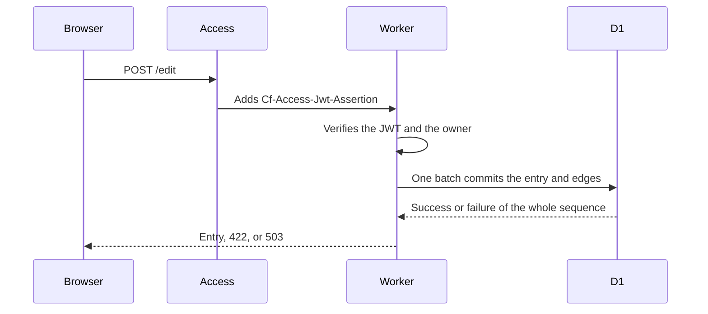
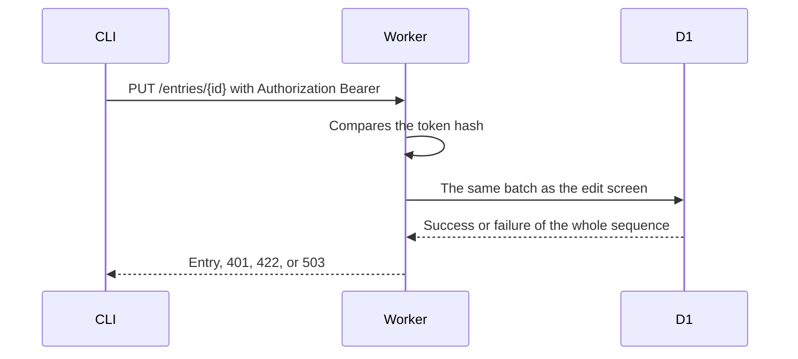
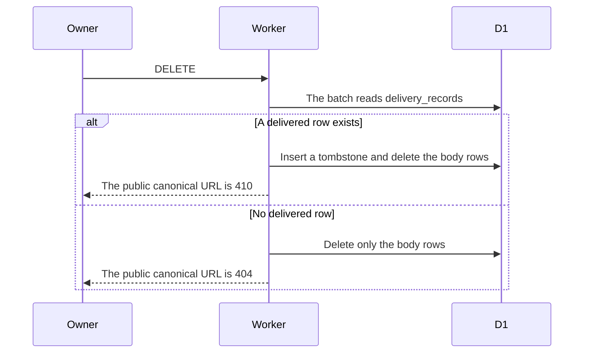
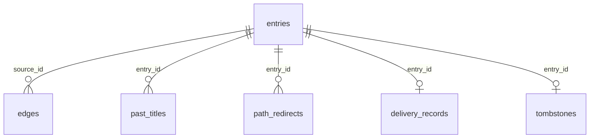

# Owner writing design

[日本語](design.ja.md)

## About this document

This design decides how to implement [owner writing](requirements.md) in one Worker. The parent product is [weblog.yamanoku.net](../../product.md).

The browser edit screen and the CLI call the same write operation. Only the credential check differs at the entrance. The entry and its edges commit in one D1 `batch()`.

### Audience

People and agents implementing or changing this feature.

### Prerequisites

The acceptance criteria in [owner writing](requirements.md). [D1 Database](https://developers.cloudflare.com/d1/worker-api/d1-database/) says that if a statement in a `batch()` fails, the sequence is aborted or rolled back. The same page also says the statements run sequentially. This design treats a failed batch as leaving none of that batch's changes.

On the Free plan, D1 allows 50 queries per Worker invocation. The source is [Limits](https://developers.cloudflare.com/d1/platform/limits/). One statement accepts at most 100 bound parameters. A SQL statement is at most 100 KB. A row is at most 2 MB.

Access adds `Cf-Access-Jwt-Assertion` on requests to a protected path. Verification follows [Validate JWTs](https://developers.cloudflare.com/cloudflare-one/access-controls/applications/http-apps/authorization-cookie/validating-json/). That document says the `CF_Authorization` cookie is not guaranteed to be passed.

### Outside this document

- Human-readable feeds, the title index, and empty-page HTML. This feature returns 404 for an unknown title path. The public-reading feature may later turn that into an empty page.
- Sending and signing ActivityPub activities. Inserting rows into `delivery_records` belongs to that feature.
- Inserting a bookmark URL into a delivered body.
- Cosense listing, retries, and merging a local edit with a newer source.
- An ORM.

## Implementation approach

The deliverables are one Worker and a CLI that calls it. The edit screen is a Svelte page. The first response is HTML. After that, the browser runs Svelte. Submitting the fields still calls the same write operation. The domain does not import Svelte.

The domain and the adapters are separate. The domain validates fields, normalizes titles, extracts edges, updates publishedAt, and chooses 404 or 410 on delete. The domain does not import D1 types, Access JWTs, the Cloudflare SDK, Fedify types, or an ORM. Adapters handle D1, Access, and the token hash. Replacing the runtime replaces the adapters. The ports this feature separates are the entry store, the link store, browser authentication, CLI authentication, and link extraction. The entry store commits the entry. The link store replaces that entry's edges in the same commit. The first adapter for both stores is D1. Browser authentication is the Access adapter. CLI authentication checks the token hash. Link extraction applies the rules in the requirements.

A write runs in this order.

1. The entrance verifies the owner. If it cannot, it returns 401 and stores nothing.
2. It validates kind, title, body, visibility, and the external URL. A refusal returns 422 and stores nothing.
3. It normalizes the title and extracts edges. On create, it issues the immutable ID inside the Worker.
4. It puts the entry, edges, past titles, view path, and redirects into one `batch()`.
5. On success it returns the committed entry. On failure it returns 503, and that batch's changes do not remain.

A D1 refusal because the free allowance is exceeded is also 503. The app does not move onto a paid plan. Since 2026-09-01, queries fail when the Free daily row allowance is exceeded. The source is the [D1 changelog](https://developers.cloudflare.com/changelog/post/2026-09-01-d1-free-tier-limit-enforcement/). Stored rows are not deleted by that failure.

Each D1 database is single-threaded and runs one query at a time. The source is [Limits](https://developers.cloudflare.com/d1/platform/limits/). The fields of the batch that finishes later remain. Fields are not merged. Collision checks run in SQL inside the batch. They do not rely only on a read made before the batch.

## Architecture and sequence diagrams

There are two entrances. The edit screen is behind Access. The CLI's `/entries` route is outside Access. Both call the same domain operation.

Delete reads the delivered record inside the same batch. Only when that row exists does it keep a tombstone and remove the body rows. It does not remove the delivered record.

## Data model and ER diagrams

The `{id}` in the canonical URL is a lowercase UUID from `crypto.randomUUID()` at create time. The ID is chosen in the Worker first, because a later statement in a batch cannot bind a value returned by an earlier statement. Title changes do not update the ID. The ID is not reused for another entry.

Timestamps are UTC ISO 8601 strings. `publishedAt` is set to the commit time only when the entry becomes deliverable. It stays when the entry is already deliverable. It becomes NULL when the entry stops being deliverable. It is set again when the entry becomes deliverable once more.

The view-path comparison key is the normalized title with each space replaced by `_`. Percent-encoding is applied only when emitting a URL. Titles whose keys match before encoding collide. A colliding entry's `view_path` is NULL, and its public URL is only the canonical URL.

These comparison keys are used by the API, the edit screen, Gyazo images, and the human-readable feeds. A title whose comparison key matches one of them gets no view path.

- `e`
- `edit`
- `entries`
- `tokens`
- `feed`
- `feed.xml`
- `feed.json`
- `pages`
- `users`
- `gyazo`
- `.well-known`

An old key dropped because of a collision or a reserved name redirects with 301 to that entry's canonical URL. If the destination entry is public and still has a view path, the redirect target is that view path.

`delivery_records` and `tombstones` remain after the entry row is gone. Foreign-key delete cascades do not remove them. Edges and past titles are deleted by explicit statements in the delete batch.

The tables are as follows.

- `entries` holds id, kind, title, body, visibility, bookmark_url, published_at, cosense_page_id, created_at, updated_at, and view_path. kind is one of the four kinds. visibility is only draft or public. view_path is unique, and many rows may have NULL. cosense_page_id is unique and may be NULL. The owner's HTTP API does not accept cosense_page_id. Update SQL does not write that column.
- `last_imported_body` and `source_updated_at` are columns of `entries`. NULL is allowed. This feature's SQL does not write them. Only an import commit writes them.
- `edges` holds source_id, written_title, and target_id. target_id may be NULL. Indexes are on source_id and written_title.
- `past_titles` holds entry_id, title, and recorded_at. The primary key is entry_id plus title. title is indexed.
- `path_redirects` has path_key as its primary key and holds entry_id.
- `owner_token` is always one row. It holds only hash and issued_at.
- `delivery_records` has entry_id as its primary key. This feature does not insert rows.
- `tombstones` holds entry_id and deleted_at. It has no body.

When more than one target matches, target_id is NULL. That happens when two or more public entries share the current title, or when only past titles match and more than one share the same recorded time. When past titles pick out one entry, the one with the latest recorded_at is chosen. The target_id stored for the owner is the result of resolution that includes drafts. An unauthenticated response resolves again using only public entries. A target_id that points at a draft is not shown in an unauthenticated response.

One write batch does the following, in order.

1. If this entry's old view_path is changing and is not empty, insert a redirect from that key to this entry_id.
2. If another row already has the same comparison key, insert a redirect from that key to the entry that holds it now.
3. Update this entry's fields and its new view_path. A note with an empty title, and a reserved path, set view_path to NULL.
4. Delete edges for this source_id.
5. Insert the extracted edges with one INSERT that uses `json_each`. The Worker binds a JSON array. `json_each` is documented in [Query JSON](https://developers.cloudflare.com/d1/sql-api/query-json/).
6. When the title changed, insert one past-title row.
7. If the same view_path now appears on more than one row, set all of those view_path values to NULL.

If the edge JSON does not fit in a 100 KB SQL statement, the Worker does not send the batch. It returns 422 `edges_too_large` and leaves existing rows unchanged. The write is not split across batches. A failed second batch would separate the body from the edges.

An ordinary write finishes in those few statements. Edges are not inserted one row at a time, so the write stays within the Free plan's 50 queries.

An owner save or delete may append activity, delivery-job, and delivered-record statements to this same batch. [ActivityPub](../activitypub/requirements.md) decides those statements. This feature does not. An import change list does not include them. A failed batch leaves both the entry change and those statements uncommitted.

## APIs and interfaces

The external write API is `/entries`. The CLI calls it. The edit screen posts to `/edit`, which is behind Access. After the Worker verifies the JWT, it calls the same domain operation. `/entries` is not behind Access, because the CLI would then hit a login screen. The design also does not depend on a cookie being delivered to `/entries`.

The shared operations are createEntry, updateEntry, deleteEntry, getEntryForOwner, listEntriesForOwner, and issueToken.

### Edit screen

GET `/edit` returns the create form and the list of stored articles. The list includes draft and public, and omits notes, bookmarks, and pages. Each item opens GET `/edit/{id}`. The order is newest `updatedAt` first, then descending id. GET `/edit/{id}` returns that article's form for the owner. An ID that cannot be edited is 404. POST `/edit` creates an article as draft. POST `/edit/{id}` updates that article's title, body, and visibility. Visibility is draft or public. A public save with an empty body does not store and returns 422 `empty_body`. The kind stays article. POST `/edit/tokens` issues a token, or reissues one.

The shared write fields are kind, title, body, visibility, and bookmarkUrl. The article edit form submits title, body, and visibility. The HTML response shows the committed canonical URL, or the refusal code. A response that contains a token uses `Cache-Control: no-store`. GET responses do not show the token value.

### CLI and `/entries`

The CLI sends the `WEBLOG_TOKEN` environment variable as a Bearer token. It does not write the token into the repository or a file. The base URL is `WEBLOG_URL`, and the default is `https://weblog.yamanoku.net`. The CLI reads the body from a file and sends that text as the body field of create and update.

- POST `/entries` creates an entry.
- PUT `/entries/{id}` replaces the fields.
- DELETE `/entries/{id}` deletes the entry.
- GET `/entries/{id}` is the owner's get-one.
- GET `/entries` is the owner's list.
- POST `/tokens` reissues a token when a valid Bearer token is present. A CLI with no token cannot call it. The first issue is only POST `/edit/tokens`.

A successful create, update, or get returns JSON with id, canonicalUrl, viewPath, kind, title, body, visibility, bookmarkUrl, publishedAt, createdAt, updatedAt, and edges. Each edge has title and targetId. targetId may be null. cosensePageId may appear in the owner's JSON. It does not appear in public HTML. The list returns the same fields, 50 at a time, ordered by updatedAt descending and then id descending. It includes `nextCursor` only when more rows exist. The cursor is updatedAt and id. This page size is not the human-readable feed page size.

Refusal JSON has one `error` field.

- 401 `unauthorized`. The caller is not the owner. The response does not reveal whether a draft exists.
- 422 `missing_title`. A title-required kind has an empty title after normalization.
- 422 `missing_bookmark_url`. A bookmark has no external URL.
- 422 `invalid_kind`. The kind is not one of the four.
- 422 `invalid_visibility`. The visibility is not draft or public.
- 422 `empty_body`. The visibility is public and the body is the empty string.
- 422 `edges_too_large`. The edges do not fit in one SQL statement.
- 503 `store_unavailable`. The batch failed, or D1 refused the query under the free allowance.

A missing body key is treated as the empty string. When the visibility is public and the body is empty, the Worker returns 422 `empty_body` and stores nothing. When the visibility is draft and the body is empty, it stores the empty string. A whitespace-only body is not empty. If an article, note, or page omits the external URL, bookmark_url is empty.

### Public URLs

GET `/e/{id}` is the response for the canonical URL, whose host is fixed as `weblog.yamanoku.net`. The request Host header does not change the canonical URL.

- A public entry is 200 HTML. The title and body are escaped text. Anchor tags for links are added by the public-reading feature. When Accept asks only for Activity Streams, this feature does not return that HTML. [Public reading](../public-reading/requirements.md) and [ActivityPub](../activitypub/requirements.md) specify the object.
- A draft is 404 on public GET `/e/{id}`. That route does not read owner credentials. The owner reads the body at GET `/entries/{id}` and GET `/edit/{id}`.
- A tombstone is 410. When Accept contains `application/activity+json` or `application/ld+json`, and it contains neither `text/html` nor `*/*`, the response is an Activity Streams Tombstone. Its id is the canonical URL and its type is Tombstone. The deleted body is absent. Any other Accept is 410 HTML and also omits the deleted body.
- An ID with neither a row nor a tombstone is 404.

GET `/{comparison key}` is decided after the fixed paths.

- If it matches a public view_path, the response is that entry's HTML.
- A draft view_path is not returned on this route. The owner reads a draft at GET `/entries/{id}` and GET `/edit/{id}`.
- If the redirect destination is public, the response is 301. The target is the current view path when one exists, and otherwise the canonical URL.
- If the destination is a draft, this route does not redirect and does not read owner credentials. In this feature the response is 404. Public reading handles that path as a missing title.
- If nothing matches, this feature returns 404. That 404 does not include a draft body. An empty page for a title with a public inbound edge is decided by public reading.

## External service integration

Browser verification of the owner uses Cloudflare Access on the Free plan. The contract is in the requirements. This design adds the verification steps.

The Access application paths are only `/edit` and `/edit/*`. The Worker reads `Cf-Access-Jwt-Assertion` on those paths, and reads the `CF_Authorization` cookie only when that header is absent. It verifies the signature with the team certificate whose `kid` equals the `kid` in the JWT header. A missing `kid`, or a `kid` that is not in the certificate set, means the caller is not the owner. The certificate URL is `https://<team-name>.cloudflareaccess.com/cdn-cgi/access/certs`. iss is the team domain. aud is the Access application's AUD. The caller is the owner only when the verified JWT email matches the configured owner email. ASCII case differs are ignored. A missing email, a bad signature, expiry, or a different aud means the caller is not the owner.

Certificate fetch stays in the adapter. The JWT key set is cached in the isolate. The domain does not know this URL. Only the adapter depends on a verification library. Cloudflare's Worker example uses `jose`. This design follows that example and does not import it from the domain.

The settings are `TEAM_DOMAIN`, `POLICY_AUD`, and `OWNER_EMAIL`. They are not stored in the repository. This document does not choose the owner's email address.

D1 is the storage adapter. The binding name is `DB`. The domain does not know `D1Database`. Errors that say the free allowance was exceeded become 503 `store_unavailable`. The response does not tell the owner to move onto a paid plan.

## Data handling

The entry body and title are the plain text the owner submitted. The stored form is not an HTML rendering. The created time is when the create batch commits. The updated time is when a later batch commits.

A past title is added in the batch that changes the normalized title. Past titles are not removed. This feature's update does not change the Cosense page ID. The import feature may set it only by passing an optional argument into the same domain operation. It is not an HTTP field.

A CLI token is 32 random bytes encoded as base64url. Only the SHA-256 hash is stored. The issuance response returns the value once and replaces the single `owner_token` row. Reissue removes the previous hash by updating that same row. The value is not written to logs or public responses.

The delete batch removes edges, past_titles, path_redirects for that entry_id, and the entries row. It does not remove delivery_records. Only when that row exists does it insert the id and deleted_at into tombstones. It does not copy the body. An undelivered delete creates no tombstone.

The owner's list and get return only rows that remain in entries. A tombstone is not an editable entry.

## Authentication and authorization notes

Every write, delete, token issuance, and owner get or list is verified per request. A screen sitting behind Access is not enough on its own.

On `/edit`, the JWT must show the owner. On `/entries` and `/tokens`, the Bearer hash must match `owner_token`. When both credentials are present, the request is allowed if at least one shows the owner. If neither verifies, the response is 401. HTTP signature headers are not a credential for this feature.

An invalid Bearer token is 401. A browser request that Access cannot verify as the owner is also 401. Checking an already issued token does not call Access.

Only one token row is valid. After reissue, the previous token receives 401.

## Security considerations

A JWT is not accepted merely because the header is present. The adapter verifies the signature, iss, aud, expiry, and email.

Token hash comparison reads every byte of the two equal-length values. It does not return at the first mismatch.

The public response for a draft is the same 404 as a missing row. The error body does not contain the word draft.

The token value, the JWT, `OWNER_EMAIL`, and the AUD do not appear in logs, the repository, or public HTML.

POST from the edit screen stays behind Access. `/entries` is not authorized by a cookie. A Bearer token is the only credential from outside Access.

## Deployment notes

The first deploy creates this document's tables in an empty D1 database. There is no migration from an existing site.

Access covers only `/edit` and `/edit/*`. Putting the whole host behind Access would place the unauthenticated canonical URL behind a login screen. That placement contradicts this feature's public responses.

The owner issues the first CLI token after opening `/edit`. Until then, the CLI cannot write.

## Alternatives considered

### Put the write API behind Access as well

The CLI would also pass through a login screen. The requirements say the CLI does not go through the browser login. The selected split is that the Worker checks the Bearer token itself.

### Forward the cookie to unprotected `/entries`

The browser could post the form directly to `/entries`. Cloudflare does not say the cookie is always passed, and it recommends verifying the header. The edit screen posts to `/edit`, and the JWT is read only on the path where Access adds the header.

### INSERT one edge row at a time

The code is simpler. A page with many links would exceed the Free plan's 50 queries per invocation. The selected write is one INSERT that uses `json_each`. A page that exceeds 100 KB is refused with 422 before the batch.

### Import an ORM or D1 types from the domain

Queries would be shorter to write. The product chooses `void/db` for the store adapter. Importing it from the domain would place that library in the domain. The adapter imports `void/db` and runs the batch. The domain passes only the list of changes that the batch must commit.

## Open questions

None that block this design. Revising the extraction rules remains open in the requirements. Extraction stays in one domain function. Changing those rules does not change the tables. The three requirements to write when Access is removed also remain open in the requirements. Version 1 browser authentication stays Access.
