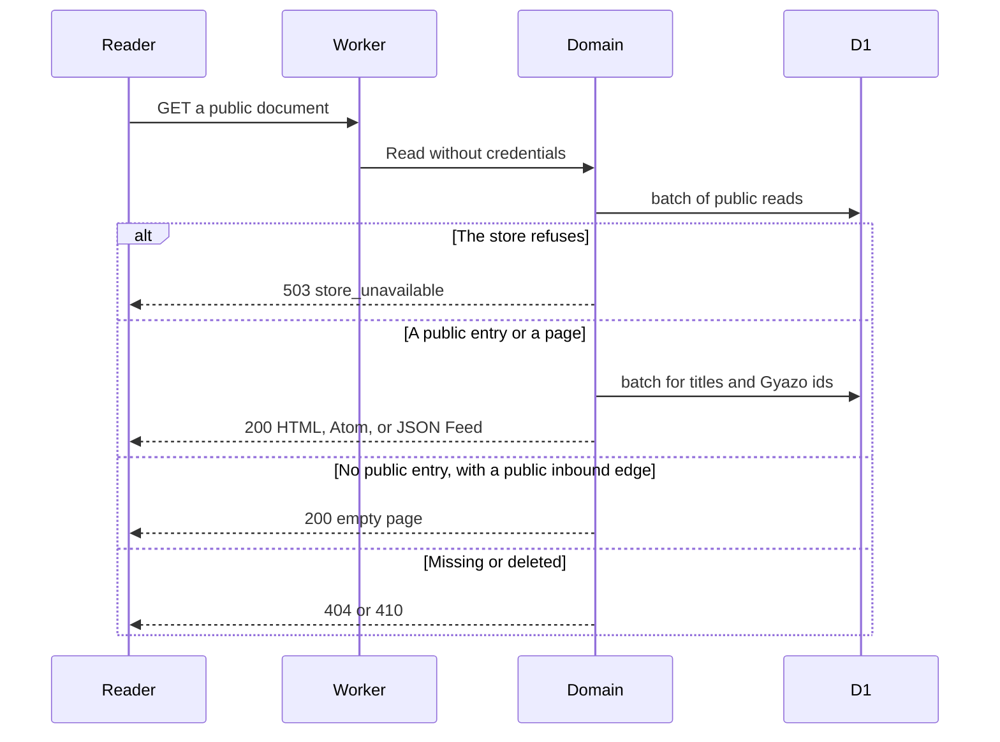
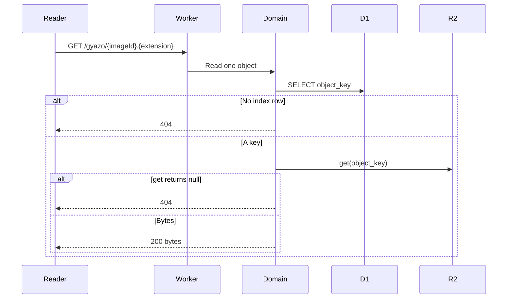
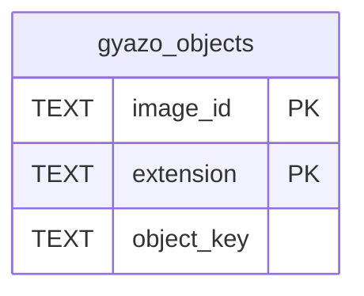

# 公開閲覧の設計

[English](design.md)

## このドキュメントについて

この設計は、[公開閲覧](requirements.ja.md) の実装方法を決める。親プロダクトは [weblog.yamanoku.net](../../product.ja.md) である。実行場所は一つの Worker である。

未認証の読者へ HTML を返す。人間向けフィード、タイトル一覧、空ページ、Gyazo のバイト列も返す。保存された本文は、プレーンテキストのままである。

書き込みの検証、閲覧用パス、draft、tombstone は [所有者の書き込み](../owner-writing/requirements.ja.md) に従う。この設計は、その規則を書き換えない。

### 対象読者

この機能を実装または変更する人と、その作業を引き受けるエージェント。

### 前提知識

[公開閲覧](requirements.ja.md) の受け入れ条件。閲覧用パス、配送対象、辺の抽出、410 の Tombstone は [所有者の書き込み](../owner-writing/requirements.ja.md) にある。

Free プランの D1 は、Worker の 1 回の実行でクエリ 50 までである。`batch()` はこの上限に対して 1 クエリとして数える。文の長さとバインド変数の上限は、batch 内の各文に残る。根拠は [Limits](https://developers.cloudflare.com/d1/platform/limits/) である。バインド変数は 1 文あたり 100 までである。クエリ結果は 50 MB までである。この結果上限は 2026-11-04 から有効になる。

[R2 の Workers API](https://developers.cloudflare.com/r2/api/workers/workers-api-reference/) は `get(key)` を定める。キーが無いときは null を返す。同じバインディングに `list()` がある。閲覧の応答中には呼ばない。

`GET /feed.json` の文書は [JSON Feed 1.1](https://www.jsonfeed.org/version/1.1/) である。公開時のメディア型は `application/feed+json` である。

### このドキュメントで扱わないこと

- 所有者の作成、更新、削除、ブラウザ認証、CLI トークン
- ActivityPub のアクター、Follow、署名、活動の送信、生存エントリの Activity Streams
- WebFinger、outbox、フォロワー、inbox
- Cosense からの一括取り込み
- リンク以外の Cosense 記法を HTML にする順序
- ORM
- 所有者の書き込み API と、50 件の所有者一覧

## 実装方針

成果物は、所有者の書き込みと同じ Worker 上の公開経路である。公開 HTML ページの最初の応答は、サーバが描画した HTML である。そのあと、このホストの別の公開 HTML ページへの移動は、ブラウザで行う。文書全体は置き換えない。画面は Svelte である。ドメインは Svelte を import しない。フィードと画像のバイト列は、文書とバイト列のままである。

ドメインは、公開行の読取、公開タイトルの解決、HTML の描画を行う。アダプタが D1 と R2 バケットを読む。ドメインは Cloudflare SDK、D1 の型、R2 の型を import しない。ORM と Fedify の型も import しない。実行場所を外すときは、アダプタだけを差し替える。描画は描画ポートである。オブジェクトポートは、画像取得ポートである。保存ポートは、この読み取りのエントリ保存である。

公開経路は所有者の資格を読まない。例外は GET `/` である。このページは、所有者の書き込みが定める note 欄を出すか省くかだけのために Access の JWT を読む。配送対象の一覧は、どの呼び出し手でも同じである。この機能の応答に draft は出ない。所有者は GET `/entries/{id}` と GET `/edit/{id}` で draft を読む。その経路は所有者の書き込みに属する。

読み取りの流れは、次の順である。

1. Worker は、タイトルパスより前に固定経路を一致させる。
2. ドメインは公開行だけを読む。保存の失敗は 503 `store_unavailable` にし、そこで応答を終える。
3. エントリとフィード項目では、所有者の書き込みと同じ差替可能な抽出関数を使う。その結果からアンカーを描く。
4. タイトルのリンク先は、公開行から解決し直す。保存済みの `target_id` は公開 href に使わない。その id は draft を指すことがある。
5. Worker は、HTML、フィード、空ページ、画像バイトのいずれか一つを返す。

タイトル解決が要るページは、`batch()` を 2 回使う。1 回目は、エントリ 1 件またはフィードの 11 行である。2 回目は、タイトルの解決先と Gyazo の id である。`IN` 句は、バインド変数 80 個ずつに分ける。[Limits](https://developers.cloudflare.com/d1/platform/limits/) では、`batch()` 1 回を 50 クエリの上限に対する 1 クエリとして数える。文の長さと、100 個のバインド変数上限は、batch の中の各文に残る。画像要求の SELECT は 1 回である。R2 の `get` も 1 回である。辺ごとにクエリは出さない。

この設計は、HTML 描画が無料枠の 1 回あたり CPU 時間に収まると主張しない。その時間は未測定である。無料枠で終わらない要求は、その要求だけ失敗する。アプリは有料プランへ移さない。

`vp dev` の公開 HTML は、ドメインのメモリ上のカタログから返す。このローダは D1 を問い合わせない。`/` はカタログの配信対象を並べる。`/pages` は公開エントリを並べる。`/{title}` は公開カタログのタイトルを解決する。`/e/{id}` はその id のカタログ項目を返す。`vp dev` のあいだ編集画面から保存した記事は、ローカルの D1 に書き、それらのページには出さない。

`vp preview` とデプロイした Worker は、同じページを保存アダプタ経由で D1 から読む。カタログの行は足さない。空の表は空の一覧のままである。draft の行は出さない。ページのファイルは `void/db` を import しない。編集画面は、どちらのモードでも D1 を読む。受入基準が説明するのは、デプロイした Worker である。カタログは二つ目の保存先ではない。

## アーキテクチャ・シーケンス図

読者は Worker だけと話す。Worker はドメインを呼ぶ。ドメインは保存ポートを呼ぶ。画像のときはオブジェクトポートも呼ぶ。保存ポートの最初のアダプタは D1 で、バインディング名は `DB` である。オブジェクトポートのアダプタは R2 で、バインディング名は `GYAZO_BUCKET`、バケット名は `gyazo-archives` である。`vp dev` の公開 HTML のローダは、カタログで止まり、D1 を呼ばない。図はデプロイ後の読み取りである。





これ以上の図は置かない。フィードとタイトル一覧は、最初の図の SELECT を変えたものだからである。実行時の構成要素は増えない。

## データモデル・ER 図

この機能は、所有者の書き込みが保存したエントリ表を読む。列は変えない。エントリは挿入しない。辺も挿入しない。公開の読取が使う列は、次のとおりである。

- `entries` は id、kind、title、body、visibility、bookmark_url、published_at、updated_at、view_path を持つ
- `edges` は source_id、written_title を持つ
- `past_titles` は entry_id、title、recorded_at を持つ
- `path_redirects` は path_key、entry_id を持つ
- `tombstones` は entry_id、deleted_at を持つ

`tombstones` は、削除済み id が配送済みだった印である。行に本文は無い。この機能は `delivery_records`、`owner_token`、`cosense_page_id` を読まない。

公開 href は、公開行を引き直して作る。`edges.target_id` は所有者の書き込み用に表へ残る。公開 HTML の SELECT には入れない。

時刻は、所有者の書き込みが保存した UTC の ISO 8601 文字列のままである。この機能は、その文字列をテキストとして比較する。次ページの URL にも、保存された文字列をそのまま入れる。書き込み側の形式は、ここでは定義し直さない。保存値が一つの固定幅 UTC 形式なら、テキスト順は時刻順と一致する。

この機能は `gyazo_objects` を追加する。公開要求では書き込まない。エントリの書き込み batch にも入れない。

- `image_id` は、Gyazo URL の先頭パスセグメントである。
- `extension` は小文字で、ドットを含まない。
- `object_key` は、書き出したディレクトリ名を含む。
- 主キーは `image_id` と `extension` である。一つの画像 id は、複数の拡張子を持てる。



`gyazo_objects` から `entries` への外部キーは無い。画像 id は本文のテキストから取り出す。エントリとの関係図は、表に無い関係を作ることになる。

頁のクエリを順序どおり読むため、読取用の索引を二つ置く。

- `entries_feed` は `(kind, published_at, id)` である。条件は `visibility = 'public'` かつ `published_at` が NULL でないことである。
- `entries_titles` は `(updated_at, id)` である。条件は `visibility = 'public'` かつ `title <> ''` である。

`view_path` は既に一意である。`edges.written_title` と `past_titles.title` は既に索引がある。この機能は、その索引を置き換えない。

## API・インターフェース

この機能が出す絶対 URL のホストは `https://weblog.yamanoku.net` である。要求の Host ヘッダでは変えない。

### 経路の順序

Worker は、タイトルより前に次のパスを一致させる。比較キー `feed.xml` と `feed.json` には閲覧用パスを作らない。所有者の書き込みが既に予約したキーも、同様に閲覧用パスを作らない。タイトルがフィードの URL を占有しないためである。

- `GET /`
- `GET /feed.xml`
- `GET /feed.json`
- `GET /feed/articles.xml`
- `GET /feed/notes.xml`
- `GET /feed/bookmarks.xml`
- `GET /pages`
- `GET /gyazo/{imageId}.{extension}`
- `GET /e/{id}`
- 所有者の接頭辞 `edit`、`entries`、`tokens`、`users`、`.well-known`

画像 id の無い `GET /gyazo` は、画像経路ではない。バケットの一覧は返さない。比較キーが `gyazo` のタイトルに閲覧用パスは無い。要求はタイトルパスとして続く。

タイトル URL は、パスセグメント一つである。セグメントを百分率復号し、比較キーにする。比較キーは所有者の書き込みが定める。正規化後のタイトルの空白を `_` に変えた文字列である。

### 次のページ

`GET /`、各フィード、`GET /pages` は、同じクエリ形を使う。最初の頁にクエリは無い。続きの頁は、同じパスへ `before` と `before_id` を付ける。

応答は 11 行を読む。返すのは先頭の 10 行である。11 行目があるとき、次の URL は絶対 URL である。`before` には 10 行目の保存されたソート値を入れる。`before_id` には、その行の id を入れる。最後の頁は、次の URL を省く。降順の条件は `sort_column < ? OR (sort_column = ? AND id < ?)` である。各頁は、この順序を分割する。カーソルの行が後から消えても、その位置から続く。

フィードの `before` は、保存された `published_at` である。`GET /pages` の `before` は、保存された `updated_at` である。値は百分率符号化する。このカーソルは、所有者一覧のカーソルとは別である。所有者一覧は 50 件のままで、draft を含む。

二つのパラメータは、揃って初めて有効である。`before_id` は小文字の UUID である。`before` は空でない文字列で、長さは 40 文字までである。空白を含まない。それ以外は 400 `invalid_cursor` である。本文は `text/plain; charset=utf-8` で、`Cache-Control` は `no-store` である。400 は空の一覧ではない。

### 共通の HTML

公開 HTML を描く関数は一つである。保存されたテキストをエスケープしてから、描画側が作ったアンカーとメディアだけを挿入する。生の本文は挿入しない。保存された本文の各行は残る。`code:` または `table:` のブロック内の行は、エスケープしたソースのままである。装飾、アイコン、数式はソースのままである。ただし、その中のリンクスパンはリンクにする。

ページ辺の範囲は、共通の抽出関数から取る。外部 URL は、code ブロックと table ブロックの外にある `http://` または `https://` の連続である。終わりは空白、`[`、`]` のいずれかである。生成する href は `http` と `https` だけである。他のスキームはエスケープしたテキストにする。

ページ辺のタイトルは、次の順で公開解決する。

- その現在タイトルを持つ公開エントリが一つなら、それがリンク先である。
- そうでなければ、その文字列の公開された過去タイトルのうち、最新の `recorded_at` を持つものが一つなら、それがリンク先である。最新の `recorded_at` はテキストとして比べる。同着なら、単一のリンク先は無い。
- それ以外は、単一のリンク先が無い。

href は、次のように決める。

- 公開のリンク先が一つで閲覧用パスがあるとき、その閲覧用パスの絶対 URL にする。
- 公開のリンク先が一つで閲覧用パスが無いとき、正規 URL にする。
- 公開のリンク先が無いとき、タイトルパスにする。空ページを開けるようにするためである。
- 単一のリンク先が無いとき、タイトルパスにする。正規 URL を一つに選ばない。

タイトルの検索は `WHERE title IN (...)` である。バインド変数は 80 個ずつに分ける。2 回目の batch に入れる。辺の数だけクエリは出さない。

`i.gyazo.com` または `gyazo.com` の URL は、アンカーを決める前に分解する。ホストの比較は大小文字を無視する。画像 id は先頭のパスセグメントである。拡張子は末尾の `.` と `[A-Za-z0-9]+` である。比較は大小文字を無視し、保存形はドット無しの小文字である。一致の判定では、クエリとフラグメントを無視する。`scrapbox.io/files` は、元の URL 文字列のままである。

書いた URL の拡張子が索引にあれば、HTML は `https://weblog.yamanoku.net/gyazo/{imageId}.{extension}` を使う。書いた URL に拡張子が無く、索引のキーが一つなら、そのキーの拡張子を使う。書いた URL に拡張子が無く、索引のキーが複数なら、元の URL を残す。索引にキーが無いときも、元の URL を残す。残した URL は外部リンクである。オブジェクトは選ばない。このホストの URL も出さない。

書き換えた URL のメディアは、次のとおりである。

- `png`、`jpg`、`jpeg`、`gif`、`webp` は `img` にする。alt は元の URL である。
- `mp4` は `controls` 付きの `video` にする。
- それ以外の拡張子は、このホストの URL へのアンカーにする。

id の読取は `WHERE image_id IN (...)` である。80 個ずつに分け、タイトル解決と同じ batch に入れる。

bookmark の外部 URL は、本文の後に描く。値が `http` または `https` なら、テキストをその URL とした外部アンカーにする。それ以外の空でない値は、エスケープしたテキストにする。所有者の書き込みは、スキームを検証しないからである。保存された本文は書き換えない。

文書の応答は `text/html; charset=utf-8` と `Cache-Control: no-cache` を使う。Content-Security-Policy の値は、次のとおりである。

```text
default-src 'none'; img-src 'self'; media-src 'self'; base-uri 'none'; form-action 'none'
```

文書の言語は `ja` である。次ページのアンカー文言は `次へ` である。これらの応答は Cookie で変えない。

エントリの HTML は、正規 URL への canonical リンクを持つ。`/feed.xml` と `/feed.json` への alternate リンクも持つ。`h1` は現在のタイトルである。タイトルが空なら `h1` を省く。文書タイトルは正規 URL にする。フィードと一覧も、同じ head のリンクを持つ。

### フィード

フィードの行は、`visibility = 'public'` かつ `published_at` が NULL でないものである。kind は `article`、`note`、`bookmark` のいずれかである。順序は `published_at` の降順、次に `id` の降順である。同着の判定は、小文字 UUID のテキスト比較である。公開の page は含めない。種類別フィードは `kind = ?` を加える。種類別の JSON Feed は作らない。

`GET /` は HTML の時系列である。各項目は、見出しのリンク、描画した本文、bookmark ならその外部 URL の行を持つ。見出しのリンクは、閲覧用パスがあればそれを使う。無ければ正規 URL を使う。

`GET /feed.xml` と三つの種類別フィードは Atom である。メディア型は `application/atom+xml; charset=utf-8` である。フィードの `id` は、クエリを除いたそのフィードの絶対 URL である。`/feed.xml` のタイトルは `weblog.yamanoku.net` である。種類別のタイトルは `記事`、`ノート`、`ブックマーク` である。`link rel="self"` は、この頁の絶対 URL である。クエリがあればそれも含む。`link rel="alternate"` は `GET /` を指す。`link rel="next"` は、次の頁があるときだけ出す。各 entry の `id` は正規 URL である。entry の `link rel="alternate"` は、閲覧用パスまたは正規 URL である。`published` は保存された `published_at` である。`updated` は保存された `updated_at` である。後からの編集を読者へ示し、フィードの順序は `published_at` のままにするためである。entry の `title` は保存されたタイトルである。タイトルが空のとき、Atom の title は正規 URL である。`content type="html"` は、エントリ頁と同じ本文断片である。bookmark の行も含む。空のフィードは 200 で、entry 要素は無い。そのフィードの `updated` は `1970-01-01T00:00:00Z` である。

`GET /feed.json` は JSON Feed 1.1 である。`version` は `https://jsonfeed.org/version/1.1` である。`title` は `weblog.yamanoku.net` である。`home_page_url` は `https://weblog.yamanoku.net/` である。`feed_url` は、この頁の絶対 URL である。`items` は必須で、空でもよい。`items[].id` は正規 URL である。`items[].url` は閲覧用パスまたは正規 URL である。`items[].content_html` は Atom の content と同じ断片である。`items[].date_published` は保存された `published_at` である。`items[].date_modified` は保存された `updated_at` である。保存されたタイトルが空なら、`items[].title` は出さない。外部 URL が `http` または `https` の bookmark は、`items[].external_url` にその URL を入れる。`next_url` は、次の頁があるときだけ出し、`feed_url` とは別の URL にする。空のフィードは 200 で、`items` は空配列である。

### タイトル一覧

`GET /pages` は、保存されたタイトルが空でない公開エントリを、四つの種類すべてから出す。順序は `updated_at` の降順、次に `id` の降順である。SELECT する列は id、title、updated_at、view_path である。本文は選ばない。各項目は、閲覧用パスへのアンカーである。閲覧用パスが無いエントリは、正規 URL へのアンカーである。文書タイトルは `ページ` である。空の一覧は 200 である。

### タイトルパス

固定経路のあと、Worker は `GET /{比較キー}` を次の順で決める。

1. 公開の `view_path` と一致すれば、そのエントリの 200 HTML を返す。
2. 移転先が public の `path_redirects` なら、301 を返す。絶対 Location は現在の閲覧用パスとする。閲覧用パスが無いときは正規 URL とする。`Cache-Control` は `no-cache` とする。draft の移転先は無視する。欠落した移転先も無視する。移転はしない。
3. 公開の `view_path` が一致せず、この比較キーを持つ公開エントリが一つ以上あるときは 404 を返す。それらのエントリは正規 URL に残る。これは衝突と予約キーの場合である。一つのエントリには選ばない。
4. このキーを持つ公開エントリが無く、比較キーが一致する `written_title` を持つ公開の辺が一つ以上あるときは 200 を返す。頁の `h1` は、復号した比較キーである。公開のリンク元は、エントリごとに一つ出す。順序は `updated_at` の降順、次に `id` の降順である。アンカーのテキストは、リンク元の現在タイトルである。href は、そのリンク元の閲覧用パスである。閲覧用パスが無ければ正規 URL である。この頁に次ページの URL は無い。クエリに `LIMIT` は無い。結果が 50 MB を超えて失敗したときは 503 を返す。
5. それ以外は 404 を返す。

同じタイトルの draft があっても、この順序は変わらない。読み取りではエントリを挿入しない。空ページのクエリは、`replace(written_title, ' ', '_')` を比較キーと照合する。保存された辺のタイトルは、既に正規化されているからである。

404 と 410 の HTML には、文 `見つかりません` または `削除しました` だけを置く。エントリの本文は置かない。draft という語は置かない。`Cache-Control` は `no-cache` である。

### 正規 URL

`GET /e/{id}` は公開行を読み、閲覧用パスと同じエントリ HTML を返す。

公開行が無く、`tombstones` にその id があるときは 410 を返す。Accept が Activity Streams だけを求めるとき、本文は Activity Streams の Tombstone である。対象の文字列は、次の二つである。

- `application/activity+json`
- `application/ld+json`

このとき Accept は `text/html` を含まない。`*/*` も含まない。`id` は正規 URL である。`type` は `Tombstone` である。`deleted` は保存された `deleted_at` である。コンテンツ型は `application/activity+json; charset=utf-8` である。削除前の本文は入れない。それ以外の Accept は 410 の HTML である。削除前の本文は、この HTML にも入れない。

公開行が無く、tombstone も無いときは 404 を返す。draft の id はこの分岐になる。

行が公開で、Accept が Activity Streams だけを求めるときは、そのエントリのオブジェクトを返す。対象の文字列は、次の二つである。

- `application/activity+json`
- `application/ld+json`

このとき Accept は `text/html` を含まない。`*/*` も含まない。コンテンツ型は `application/activity+json; charset=utf-8` である。`Cache-Control` は `no-cache` である。オブジェクトの中身は ActivityPub が定める。`text/html` を含むブラウザの Accept は HTML を受け取る。`*/*` を含む Accept も HTML を受け取る。

### 画像バイト

`GET /gyazo/{imageId}.{extension}` は、`image_id` と小文字化した拡張子が一致する `object_key` を選ぶ。アダプタは `GYAZO_BUCKET` に対して `get(object_key)` を呼ぶ。`list()` は呼ばない。

索引の行が無いとき、または `get` が null のときは 404 である。本文は空で、`Cache-Control` は `no-store` である。コンテンツ型は `text/plain; charset=utf-8` である。

オブジェクトの `httpMetadata.contentType` があれば、それを使う。無ければ拡張子で決める。`png` は `image/png`、`jpg` と `jpeg` は `image/jpeg`、`gif` は `image/gif`、`webp` は `image/webp`、`mp4` は `video/mp4` である。それ以外は `application/octet-stream` である。バイト列の内容から型は推定しない。200 の `Cache-Control` は `public, max-age=86400` である。この機能は、アーカイブのバイト列を差し替えない。1 日のキャッシュにより、再表示が Worker の 1 日の要求数へ再び数えない。画像の 404 はキャッシュしない。後からの索引読込が見えるようにするためである。

画像の応答は、それぞれ Worker の要求 1 回として数える。

### 保存の失敗

D1 のエラーは 503 `store_unavailable` にする。無料枠による拒否と、結果上限を超えた失敗も同じである。R2 の `get` が例外を投げたときも同じである。本文は `text/plain; charset=utf-8` で、`Cache-Control` は `no-store` である。応答は 404、410、301 にはしない。有料プランの購入を求める文は出さない。保存済みの行は残る。作業は 00:00 UTC まで待つか、その要求だけ失敗する。

## 外部サービスとの連携方式

D1 は保存のアダプタで、バインディング名は `DB` である。アダプタは `void/db` の `db` で問い合わせる。D1 のページは、この問い合わせがリクエストごとに D1 のセッションを使うと説明している。リクエストをまたぐと、レプリカの内容は遅れることがある。出典は [D1](https://void.cloud/guide/database/d1) である。ドメインは `D1Database` を知らない。ドメインは `void/db` を import しない。クエリ予算と 50 MB 上限の根拠は [Limits](https://developers.cloudflare.com/d1/platform/limits/) である。無料枠の 1 日の拒否と、保存済み行が残る根拠は [2026-09-01 の D1 変更記録](https://developers.cloudflare.com/changelog/post/2026-09-01-d1-free-tier-limit-enforcement/) である。

R2 はオブジェクトのアダプタで、バインディング名は `GYAZO_BUCKET`、バケット名は `gyazo-archives` である。ドメインは、ポートからバイト列とコンテンツ型を受け取る。`R2Bucket` は知らない。`get` の定義は [Workers API の参照](https://developers.cloudflare.com/r2/api/workers/workers-api-reference/) にある。この機能はアップロードしない。バケットの一覧も取らない。既存アーカイブの月間 10 GB を超える保管は、ゼロ円の対象外のままである。

公開経路は Cloudflare Access の背後に置かない。Access は `/edit` と `/edit/*` だけに残す。

## データの取り扱い設計

公開応答は、保存されたプレーンテキスト、公開の辺、過去タイトル、移転、tombstone、`gyazo_objects` から作る。描画結果はエントリへ書き戻さない。読み取りは、エントリを作らない。辺も作らない。

Gyazo の索引は、所有者のコマンドが読み込む。読者の要求では読み込まない。コマンドは、ローカルの一覧 `{directory}/{imageId}.{extension}` を読み、`gyazo_objects` の行を挿入または置換する。R2 の `list` と R2 の `put` は呼ばない。id が無い HTML は元の URL を残すので、途中までの読込を再実行して続けられる。一覧に無い索引行は、このコマンドでは消さない。公開画像の URL をやめるには、その索引行を消す。この機能は、アーカイブのバイト列を消さない。

2026-11-01 に数えた一覧は、画像ファイル 15686 件だった。この行数は、1 日の無料の書き込み行数に収まる。コマンドは、完了できる大きさの `batch()` に分け、再実行できる。

公開の本文、タイトル、bookmark URL は、人の名前を含むことがある。所有者が visibility を public にしたので、誰でも読める。ここでは draft を読まない。この機能はアカウント情報を集めない。公開画像 URL のバイト列は、誰でも読める。同意の手続きは増やさない。

## 認証・認可に関する注記

これらの経路は、draft や別のエントリ一覧を選ぶために資格を確認しない。GET `/` は `Cf-Access-Jwt-Assertion` を読み、そのヘッダが無いときだけ `CF_Authorization` Cookie を読む。読む目的は、note 欄を出すか省くかだけである。JWT が無い、または無効なときは 200 のまま欄を出さない。所有者の応答は `Cache-Control: private, no-store` を付ける。他の経路は `Cf-Access-Jwt-Assertion` と `Authorization` を読まない。draft は、所有者の書き込みが定める所有者経路に残す。

## セキュリティ上の考慮事項

公開 HTML は、保存されたテキストをエスケープしてから、生成した `http` と `https` のアンカーを挿入する。コンテンツセキュリティポリシーは、スクリプトを拒否する。他ホストの画像も拒否する。書き換えた画像は、このホストから読む。この機能が残した元の Gyazo URL はアンカーなので、ポリシーはそれを画像としては取得しない。

これらの経路の応答は、draft の本文を含めない。所有者として確認できた GET `/` は、あわせて `Cache-Control: private, no-store` と `Vary: Cookie` を送る。共有キャッシュが note 欄を保存しないようにするためである。他の応答は Cookie によって変えない。削除前の本文は SELECT しない。画像経路は、一つのオブジェクトのバイト列を返す。画像経路でないパスは、アーカイブのバイト列を返さない。バケットの一覧も返さない。

## デプロイに関する注記

この機能のマイグレーションは、`gyazo_objects` と二つの読取索引を作る。空の索引でも有効である。行が無いあいだ、エントリの HTML は元の Gyazo URL を残す。画像の GET は 404 を返す。

索引の読込は、ローカルの書き出し一覧から所有者が実行するコマンドである。公開経路ではない。エントリの書き込みにも含めない。最初のデータベースは、空の `gyazo_objects` から始めてよい。

## 検討した代替案

### オフセットのページ番号

ページ番号は入力しやすい。要求のあいだに挿入や削除があると、項目が重複するか欠ける。`before` と `before_id` のキーセットは、要件が求める分割を保つ。

### 不透明なカーソル

不透明なトークンは、ソートキーを隠せる。別の符号化が要り、結局は `published_at` または `updated_at` と id を運ぶ。明示したクエリは、保存された文字列をそのまま使う。

### 描画中に R2 バケットを一覧する

一覧すれば、索引が無くてもキーを探せる。公開要求はバケットを頁送りする。キーが複数なら、一つを選ぶことになる。D1 の索引は、一つの SELECT で id に答える。公開要求は、一つのキーに対して `get` を呼ぶ。

### Gyazo の索引をエントリの書き込み batch に入れる

索引が、関係の無いエントリと一緒に確定する。読者の要求は、どのエントリ HTML よりも前に行を必要とする。読込は、所有者の別コマンドのままにする。

### Activity Streams だけを求める要求へ HTML を返す

エントリ HTML を返すと、Activity Streams のオブジェクトにならない。Activity Streams だけを求める Accept には、そのオブジェクトを返す。`text/html` も受け付ける要求は、これまでどおり HTML を受け取る。削除済み ID も、Activity Streams だけを求める Accept には Tombstone を返す。`text/html` か `*/*` を含む Accept は、410 の HTML である。

### Cookie があるとき、公開パスで draft を返す

所有者は、閲覧用パスで draft を開ける。Cookie で応答が変わるキャッシュは、その応答を公開 URL の下へ保存できる。公開経路は資格を無視する。所有者は `/entries/{id}` と `/edit/{id}` で draft を読む。

## 未解決の質問

実装を止める未決は無い。

article の Markdown は、要件の本文 HTML のとおり一つの関数が描く。アイコン、表、数式、Cosense の装飾は、その描画の Requirements に残す。その Requirements が出来るまでは、この機能はソースのテキストを示す。この HTML 描画の CPU 時間は未測定である。その測定では、上の経路は変わらない。
