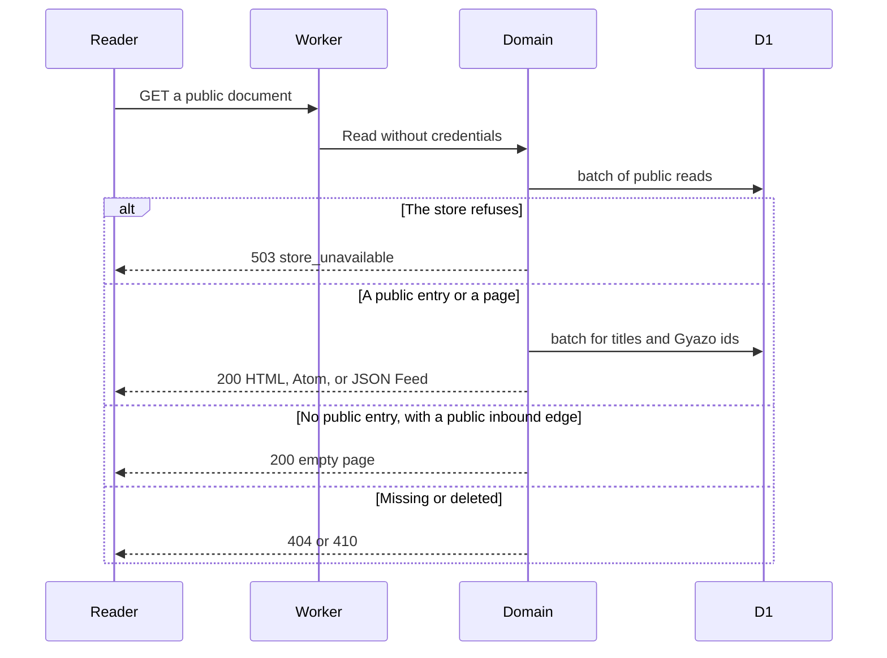
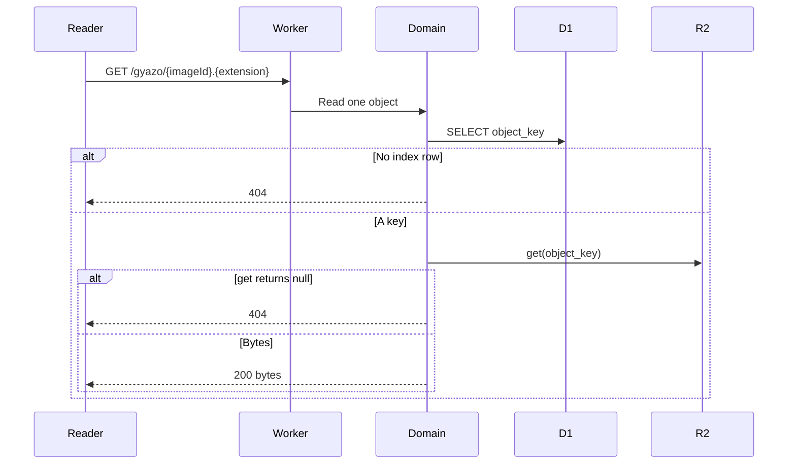
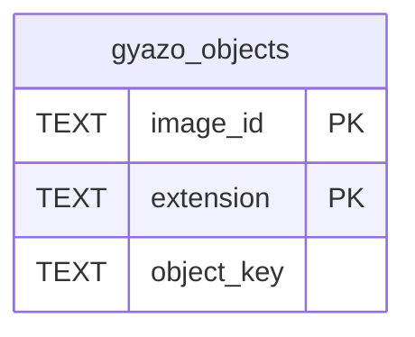

# Public reading design

[日本語](design.ja.md)

## About this document

This design decides how one Worker serves [Public reading](requirements.md) on [weblog.yamanoku.net](../../product.md). An unauthenticated reader receives HTML, the human-readable feeds, the title index, empty pages, and Gyazo bytes. The stored body stays plain text.

Write validation, the view path, drafts, and tombstones stay in [Owner writing](../owner-writing/requirements.md). This document does not restate those rules.

### Audience

People and agents implementing or changing this feature.

### Prerequisites

The acceptance criteria in [Public reading](requirements.md). The view path, deliverable entries, edge extraction, and the 410 Tombstone in [Owner writing](../owner-writing/requirements.md).

On the Free plan, D1 allows 50 queries per Worker invocation. A `batch()` call counts as one query against that limit. Statement length and bound parameters still apply to each statement inside the batch. The source is [Limits](https://developers.cloudflare.com/d1/platform/limits/). One statement accepts at most 100 bound parameters. A query result is at most 50 MB. That result cap takes effect on 2026-11-04.

[R2 Workers API](https://developers.cloudflare.com/r2/api/workers/workers-api-reference/) defines `get(key)`. It returns the object body, or null when the key is absent. `list()` exists on the same binding. This feature does not call it while serving a reader.

[JSON Feed 1.1](https://www.jsonfeed.org/version/1.1/) is the feed document for `GET /feed.json`. Publishers serve it as `application/feed+json`.

### Outside this document

- Owner create, update, delete, browser authentication, and the CLI token
- The ActivityPub actor, Follow, signatures, sending activities, and Activity Streams for a live entry
- WebFinger, the outbox, followers, and the inbox
- Bulk import from Cosense
- The order of rendering Cosense notation other than links
- The UI framework and the ORM
- The owner's write API and the owner's list of 50 entries

## Implementation approach

The deliverable is the public routes on the same Worker that handles owner writes. Pages are server-rendered HTML. There is no client-side application.

The domain reads public rows, resolves public titles, and renders HTML. Adapters read D1 and the R2 bucket. The domain does not import the Cloudflare SDK, D1 types, R2 types, or an ORM. Replacing the host means replacing those adapters.

Public routes do not read owner credentials. A draft is absent from every response this feature returns. The owner reads a draft at GET `/entries/{id}` and GET `/edit/{id}`, which belong to owner writing.

The read flow is as follows.

1. The Worker matches a fixed route before a title path.
2. The domain reads only public rows. A store error becomes 503 `store_unavailable` and stops the response.
3. For an entry or a feed item, the domain runs the same replaceable extract function owner writing uses, then renders anchors from that result.
4. Title targets are resolved again from public rows. The stored `target_id` is not the public href, because that id can point at a draft.
5. The Worker returns one HTML document, one feed document, one empty page, or the image bytes.

A page that needs title resolution uses two `batch()` calls. The first reads the entry or the 11-row page. The second resolves titles and Gyazo ids, with `IN` lists chunked at 80 bound parameters. [Limits](https://developers.cloudflare.com/d1/platform/limits/) counts one `batch()` as one query toward the 50-query invocation limit. Statement length and the 100-parameter limit still apply inside the batch. An image request uses one SELECT and one R2 `get`. This feature does not issue one query per edge. This design does not claim that HTML rendering fits the free tier's CPU time per invocation. That time is unmeasured. A request that cannot finish inside the free tier fails for that request. The app does not move onto a paid plan.

## Architecture and sequence diagrams

The reader talks only to the Worker. The Worker calls the domain. The domain calls a store port and, for an image, an object port. The store port's first adapter is D1, binding `DB`. The object port's adapter is R2, binding `GYAZO_BUCKET`, bucket `gyazo-archives`.





A further diagram is omitted. Feed pages and the title index use the first sequence with a different SELECT. They do not add another runtime component.

## Data model and ER diagrams

This feature reads the entry tables owner writing already stores. It does not change their columns, and it does not insert entries or edges. The columns a public read uses are:

- `entries`: id, kind, title, body, visibility, bookmark_url, published_at, updated_at, view_path
- `edges`: source_id, written_title
- `past_titles`: entry_id, title, recorded_at
- `path_redirects`: path_key, entry_id
- `tombstones`: entry_id, deleted_at

`tombstones` is the signal that a deleted id was delivered. The row has no body. This feature does not read `delivery_records`, `owner_token`, or `cosense_page_id`.

Public hrefs are built from a fresh public lookup. `edges.target_id` stays in the table for the owner's write. It is not selected for public HTML.

Timestamps stay the UTC ISO 8601 strings owner writing stores. This feature compares those strings as text and copies the stored string into the next-page URL. It does not redefine the write format. Text order matches time order when every stored value uses one fixed-width UTC form.

This feature adds `gyazo_objects`. A public request does not write it. The entry write batch does not include it.

- `image_id` is the first path segment of a Gyazo URL.
- `extension` is lowercase and has no dot.
- `object_key` includes the export directory name.
- The primary key is `image_id` plus `extension`. One image id can have several extensions.



There is no foreign key from `gyazo_objects` to `entries`. The image id is parsed from body text. An entry diagram would invent a relationship the tables do not have.

Two read indexes keep the page queries ordered:

- `entries_feed` on `(kind, published_at, id)` where `visibility = 'public'` and `published_at` is not null
- `entries_titles` on `(updated_at, id)` where `visibility = 'public'` and `title <> ''`

`view_path` is already unique. `edges.written_title` and `past_titles.title` are already indexed. This feature does not replace those indexes.

## APIs and interfaces

The host in every absolute URL this feature emits is `https://weblog.yamanoku.net`. The request Host header does not change it.

### Route order

The Worker matches these paths before a title. The comparison keys `feed.xml` and `feed.json` take no view path, together with the keys owner writing already reserves, so a title does not occupy a feed URL.

- `GET /`
- `GET /feed.xml`
- `GET /feed.json`
- `GET /feed/articles.xml`
- `GET /feed/notes.xml`
- `GET /feed/bookmarks.xml`
- `GET /pages`
- `GET /gyazo/{imageId}.{extension}`
- `GET /e/{id}`
- The owner prefixes `edit`, `entries`, `tokens`, `users`, and `.well-known`

`GET /gyazo` with no image id is not the image route. It does not list the bucket. A title whose key is `gyazo` has no view path, so the request continues as a title path.

A title URL is one path segment. The segment is percent-decoded to the comparison key. The comparison key is the one owner writing defines: the normalized title with each space replaced by `_`.

### Next page

`GET /`, every feed, and `GET /pages` use the same query shape. The first page has no query. A later page sets `before` and `before_id` on that same path.

The response reads 11 rows. It returns the first 10. When an 11th row exists, the next URL is absolute and uses the 10th row's stored sort value as `before` and that row's id as `before_id`. The last page omits the next URL. The predicate for a descending sort is `sort_column < ? OR (sort_column = ? AND id < ?)`. The pages partition that order. A cursor whose row was later deleted still continues from that position.

For a feed, `before` is the stored `published_at`. For `GET /pages`, `before` is the stored `updated_at`. Values are percent-encoded. This cursor is not the owner's list cursor. The owner list remains 50 rows and includes drafts.

Both parameters are required together. `before_id` is a lowercase UUID. `before` is a non-empty string of at most 40 characters and contains no whitespace. Any other combination is 400 `invalid_cursor`. The body is `text/plain; charset=utf-8` and `Cache-Control: no-store`. A 400 is not an empty list.

### Shared HTML

One function renders public HTML. It escapes the stored text, then inserts only anchors and media the renderer created. The raw body is never inserted. Every line of the stored body remains. Lines inside a `code:` or `table:` block stay escaped source text. Decoration, icons, and formulas stay source text except where a link span sits inside them.

Page-edge spans come from the shared extract function. An external URL is an `http://` or `https://` run outside a code or table block, ending at whitespace, `[`, or `]`. Generated hrefs are only `http` or `https`. Any other scheme is escaped text.

Public resolution of a page-edge title:

- Exactly one public entry has that current title. That entry is the target.
- Otherwise, exactly one public past title has the latest `recorded_at` for that string. That entry is the target. The latest `recorded_at` is compared as text. A tie means there is no single target.
- Otherwise there is no single target.

The href is then:

- One public target with a view path: that absolute view path.
- One public target with no view path: the canonical URL.
- No public target: the title path, so an empty page can open.
- No single target: the title path. The renderer does not choose one canonical URL.

The title lookups are `WHERE title IN (...)`, in chunks of 80 bound parameters, inside the second batch. The Worker does not query once per edge.

A `i.gyazo.com` or `gyazo.com` URL is parsed before the anchor is chosen. The host is compared case-insensitively. The image id is the first path segment. An extension is a trailing `.` plus `[A-Za-z0-9]+`, compared case-insensitively and stored lowercase without the dot. Query and fragment are ignored for the match. `scrapbox.io/files` stays the original URL string.

When the written URL's extension is in the index, the HTML uses `https://weblog.yamanoku.net/gyazo/{imageId}.{extension}`. When the written URL has no extension and the index has one key, the HTML uses that key's extension. When the written URL has no extension and the index has more than one key, the HTML keeps the original URL. When the index has no key, the HTML keeps the original URL. A kept URL is an external link. The renderer does not pick an object and does not emit the host URL.

Media for a rewritten URL:

- `png`, `jpg`, `jpeg`, `gif`, `webp`: an `img`. The alt text is the original URL.
- `mp4`: a `video` with `controls`.
- Any other extension: an anchor to the host URL.

The ids are loaded with `WHERE image_id IN (...)`, chunked at 80, in the same batch as title resolution.

A bookmark's external URL is rendered after the body. An `http` or `https` value is an external anchor whose text is the URL. Any other non-empty value is escaped text, because owner writing does not validate the scheme. The stored body is not rewritten.

Document responses use `text/html; charset=utf-8` and `Cache-Control: no-cache`. The Content-Security-Policy value is:

```text
default-src 'none'; img-src 'self'; media-src 'self'; base-uri 'none'; form-action 'none'
```

The document language is `ja`. The visible next-page anchor text is `次へ`. These responses do not vary on a cookie.

Entry HTML has a canonical link, plus alternate links to `/feed.xml` and `/feed.json`. The `h1` is the current title. An empty title omits the `h1`, and the document title is the canonical URL. Feed and index pages use the same head links.

### Feeds

A feed row is `visibility = 'public'`, `published_at` is not null, and `kind` is `article`, `note`, or `bookmark`. Order is `published_at` descending, then `id` descending. Text comparison of the lowercase UUID is the tie-break. A public page is excluded. A kind feed adds `kind = ?`. There is no per-kind JSON Feed.

`GET /` is the HTML timeline. Each item has a heading link, the rendered body, and the bookmark line when the kind is bookmark. The heading link uses the view path when one exists, and otherwise the canonical URL.

`GET /feed.xml` and the three kind feeds are Atom. The media type is `application/atom+xml; charset=utf-8`. The feed `id` is the absolute URL of that feed without a query. The feed title is `weblog.yamanoku.net` for `/feed.xml`, and `記事`, `ノート`, or `ブックマーク` for the kind feeds. `link rel="self"` is the absolute URL of this page, including the query when one is present. `link rel="alternate"` points at `GET /`. `link rel="next"` is present only when a next page exists. Each entry `id` is the canonical URL. The entry `link rel="alternate"` is the view path or the canonical URL. `published` is the stored `published_at`. `updated` is the stored `updated_at`, so a later edit is visible to a reader while the feed order stays on `published_at`. The entry `title` is the stored title. When the title is empty, the Atom title is the canonical URL. `content type="html"` is the same body fragment as the entry page, including the bookmark line. An empty feed is 200 and has no entry elements. Its feed `updated` is `1970-01-01T00:00:00Z`.

`GET /feed.json` is JSON Feed 1.1. `version` is `https://jsonfeed.org/version/1.1`. `title` is `weblog.yamanoku.net`. `home_page_url` is `https://weblog.yamanoku.net/`. `feed_url` is the absolute URL of this page. `items` is required and may be empty. `items[].id` is the canonical URL. `items[].url` is the view path or the canonical URL. `items[].content_html` is the same fragment as Atom content. `items[].date_published` is the stored `published_at`. `items[].date_modified` is the stored `updated_at`. `items[].title` is omitted when the stored title is empty. A bookmark whose external URL is `http` or `https` sets `items[].external_url` to that URL. `next_url` is present only when a next page exists, and it differs from `feed_url`. An empty feed is 200 with `"items": []`.

### Title index

`GET /pages` lists public entries of every kind whose stored title is not empty. Order is `updated_at` descending, then `id` descending. The response selects id, title, updated_at, and view_path. It does not select the body. Each item is an anchor to the view path, or to the canonical URL when the entry has no view path. The document title is `ページ`. An empty index is 200.

### Title path

After the fixed routes, the Worker decides `GET /{comparison key}` in this order.

1. A public `view_path` match is 200 HTML for that entry.
2. A `path_redirects` row whose entry is public is 301. The absolute `Location` is the current view path when one exists, and otherwise the canonical URL. `Cache-Control` is `no-cache`. A destination that is draft or missing is ignored. The response does not redirect.
3. When no public `view_path` matched, and at least one public entry has this comparison key, the response is 404. Those entries remain at their canonical URLs. This is the collision and reserved-key case. The response does not choose one entry.
4. When no public entry has the key, and at least one public edge has a `written_title` whose comparison key equals it, the response is 200. The page shows the decoded comparison key as the `h1`. It lists each public source once, ordered by `updated_at` descending and then `id` descending. The anchor text is the source's current title. The href is that source's view path, or its canonical URL when it has no view path. The page has no next-page URL. The query has no `LIMIT`. A result over the 50 MB cap fails, and the response is 503.
5. Otherwise the response is 404.

A draft with the same title does not change this order. Reading does not insert an entry. The empty-page query matches `replace(written_title, ' ', '_')` to the comparison key, which is valid because stored edge titles are already normalized.

The 404 and 410 HTML documents contain the sentence `見つかりません` or `削除しました` and no entry body. They do not contain the word draft. `Cache-Control` is `no-cache`.

### Canonical URL

`GET /e/{id}` reads the public row and returns the same entry HTML as the view path.

When no public row exists and `tombstones` has the id, the response is 410. When `Accept` contains `application/activity+json` or `application/ld+json`, the body is an Activity Streams Tombstone. Its `id` is the canonical URL, its `type` is `Tombstone`, and `deleted` is the stored `deleted_at`. The content type is `application/activity+json; charset=utf-8`. The deleted body is absent. Any other Accept is 410 HTML and also omits the deleted body.

When no public row exists and no tombstone exists, the response is 404. A draft id takes this branch.

When the row is public and `Accept` contains `application/activity+json` or `application/ld+json`, and it contains neither `text/html` nor `*/*`, the response is the Activity Streams object for that entry. The content type is `application/activity+json; charset=utf-8`. `Cache-Control` is `no-cache`. The object rules belong to ActivityPub. A browser Accept that includes `text/html` receives HTML. An Accept that includes `*/*` also receives HTML.

### Image bytes

`GET /gyazo/{imageId}.{extension}` selects `object_key` where `image_id` and the lowercased extension match. The adapter then calls `get(object_key)` on `GYAZO_BUCKET`. It does not call `list()`.

No index row, or a null `get`, is 404 with an empty body and `Cache-Control: no-store`. The content type is `text/plain; charset=utf-8`.

A body uses the object's `httpMetadata.contentType` when that value is present. Otherwise the extension map is `png` to `image/png`, `jpg` and `jpeg` to `image/jpeg`, `gif` to `image/gif`, `webp` to `image/webp`, `mp4` to `video/mp4`, and every other extension to `application/octet-stream`. The Worker does not sniff the bytes. A 200 uses `Cache-Control: public, max-age=86400`. This feature does not replace archive bytes. The one-day cache keeps a repeat view from counting again toward the daily Worker request allowance. An image 404 is not cached, so a later index load becomes visible.

Each image response counts as one Worker request.

### Store failure

D1 errors, including a free-allowance refusal and a result that exceeds the cap, become 503 `store_unavailable`. An R2 `get` that throws does too. The body is `text/plain; charset=utf-8` and `Cache-Control: no-store`. The response is not 404, 410, or 301. It does not ask the reader to buy a plan. Stored rows remain. Work waits until 00:00 UTC or fails for that request.

## External service integration

D1 is the store adapter, binding `DB`. The domain does not know `D1Database`. Sessions and read replicas are not used. The database is the primary, which is single-threaded. The source for the query budget and the 50 MB cap is [Limits](https://developers.cloudflare.com/d1/platform/limits/). The source for daily free-tier refusal, leaving stored rows in place, is the [D1 changelog of 2026-09-01](https://developers.cloudflare.com/changelog/post/2026-09-01-d1-free-tier-limit-enforcement/).

R2 is the object adapter, binding `GYAZO_BUCKET`, bucket `gyazo-archives`. The domain receives bytes and a content type from the port. It does not know `R2Bucket`. `get` is defined in the [Workers API reference](https://developers.cloudflare.com/r2/api/workers/workers-api-reference/). This feature does not upload and does not list the bucket. Storage beyond 10 GB a month for the existing archive stays outside the zero-yen target.

The public routes are not behind Cloudflare Access. Access remains on `/edit` and `/edit/*` only.

## Data handling

The public response is derived from stored plain text, public edges, past titles, redirects, tombstones, and `gyazo_objects`. Rendering is not written back to the entry. A read does not create an entry or an edge.

The Gyazo index is loaded by an owner command, not by a reader. The command reads a local listing of `{directory}/{imageId}.{extension}` and inserts or replaces `gyazo_objects` rows. It does not call R2 `list` or R2 `put`. A second run can continue a partial load because a missing id keeps the original URL in HTML. The command does not delete index rows that are absent from the listing. Removing a public image URL requires deleting that index row. This feature does not delete archive bytes.

The listing counted on 2026-11-01 had 15686 image files. That row count fits the product's free daily write allowance. The command uses `batch()` calls small enough to finish, and it can be run again.

Public bodies, titles, and bookmark URLs may name a person. They are world-readable because the owner set visibility to public. Drafts are not read here. This feature collects no account data. Image bytes at the public image URL are world-readable. There is no extra consent step.

## Authentication and authorization notes

None of these routes check a credential. The Worker does not read `Cf-Access-Jwt-Assertion` or `Authorization` for them. The same document is returned to every caller. Drafts stay on the owner routes from owner writing.

## Security considerations

Public HTML escapes stored text before it inserts generated `http` and `https` anchors. The content security policy refuses scripts and refuses images from other hosts. A rewritten image is loaded from this host. An original Gyazo URL that this feature keeps is an anchor, so the policy does not fetch it as an image.

Responses on these routes do not include a draft body and do not vary on a cookie, so a shared cache cannot attach a draft to a public URL. A deleted body is not selected. The image route returns one object's bytes. A path that is not the image route does not return archive bytes and does not list the bucket.

## Deployment notes

The migration for this feature creates `gyazo_objects` and the two read indexes. An empty index is valid. Until rows exist, entry HTML keeps original Gyazo URLs, and image GET returns 404.

The index load is an owner command run from the local export listing. It is not a public route and it is not part of an entry write. The first database can start with an empty `gyazo_objects` table.

## Alternatives considered

### Offset page numbers

Page numbers are easier to type. An insert or a delete between requests repeats or skips an item. The keyset on `before` and `before_id` keeps the partition the requirements ask for.

### An opaque cursor

An opaque token can hide the sort keys. It needs a second encoding and still has to carry `published_at` or `updated_at` plus the id. The explicit query uses the stored strings directly.

### Listing the R2 bucket while rendering

A list would find keys without an index. The public request would page through the bucket, and more than one key would still have to be chosen. The D1 index answers the id in one SELECT, and the public request calls `get` for one key.

### Putting the Gyazo index in the entry write batch

The index would then commit with an unrelated entry. A reader request would still need the rows before any entry HTML can rewrite URLs. The load stays a separate owner command.

### HTML for an Activity Streams-only request

Returning the entry HTML would present a document that is not the Activity Streams object. The activity-only Accept receives that object. A request that also accepts `text/html` still receives HTML.

### Returning a draft on the public path when a cookie is present

The owner could open a draft at its view path. A cache that varies on the cookie can also store that response under the public URL. Public routes ignore credentials, and the owner reads drafts at `/entries/{id}` and `/edit/{id}`.

## Open questions

None that block implementation.

The order for rendering Cosense notation other than links stays with the requirements of that rendering. Until those requirements exist, this feature shows the source text. The CPU time of this HTML render is unmeasured. That measurement does not change the routes above.
